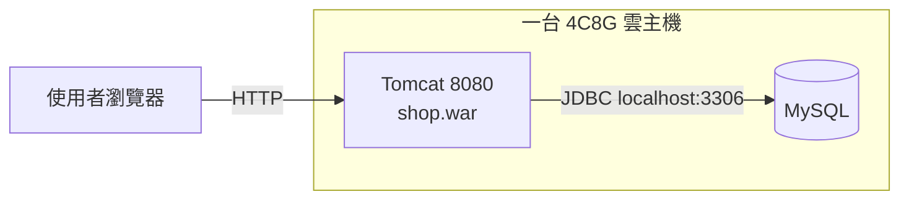
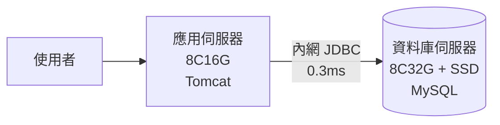
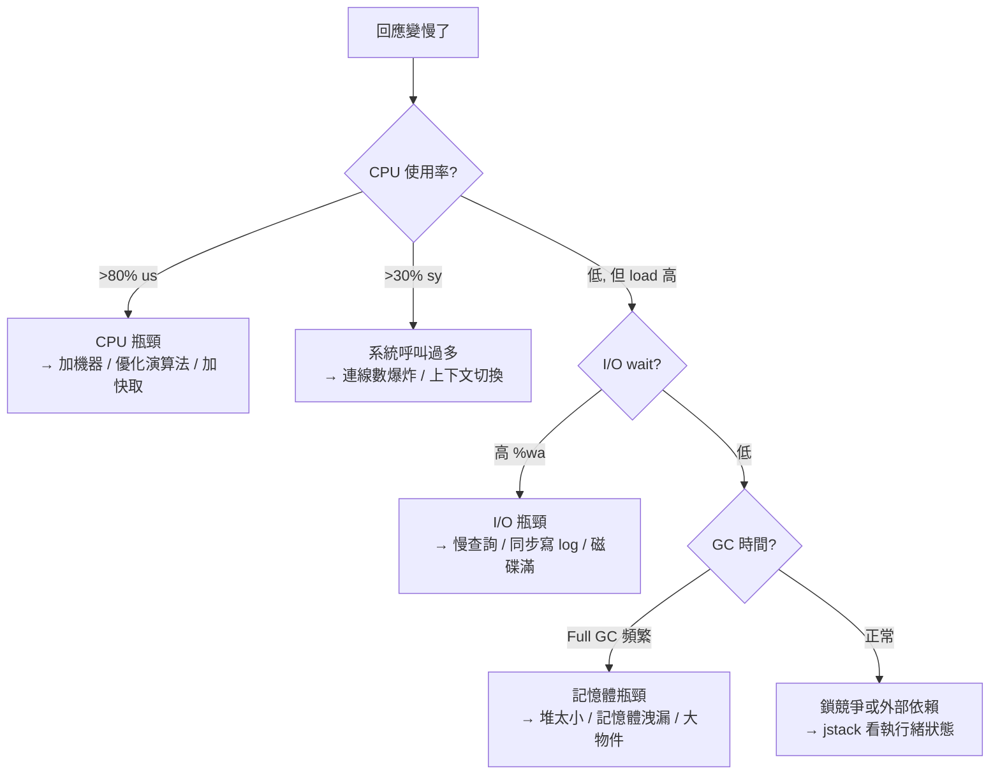

# 第一章　單體架構的起點與極限

> **本章場景**：一個購物網站剛上線，日活 500 人，尖峰併發不到 100。
> 一台機器、一個 war 包、一個 MySQL，跑得好好的。
> 本章要回答：這樣的架構到底能撐到哪裡？第一道裂縫會出現在哪？

---

## 1.1 淘寶初期的 Web 架構：單機 Tomcat + 資料庫

### 起點長什麼樣

任何大型網站的第一版，都長得跟你期末專題一模一樣：



- **一個部署單元**：`shop.war`，裡面塞著會員、商品、訂單、購物車、後台、金流回呼。
- **一個資料庫**：`shop` schema，30 張表，全部 InnoDB。
- **一次發版**：`scp shop.war` → `./shutdown.sh` → `./startup.sh`，停機 40 秒，沒人在意。

這叫 **單體架構（Monolithic Architecture）**。請先記住一件事：

> **單體不是原罪，單體是最划算的起點。**
> 在流量不確定的階段，把系統拆成 20 個服務，只會讓你用 20 倍的維運成本，去服務同樣的 500 個人。

### 單體的真實優勢（別急著嫌棄它）

| 面向 | 單體的表現 |
|---|---|
| 開發 | IDE 裡一個專案，`Ctrl+B` 直接跳到實作，不用猜是誰提供的 API |
| 除錯 | 一條 stack trace 從 Controller 貫穿到 DAO，不用串 trace id |
| 交易 | `@Transactional` 一標，ACID 由資料庫保證，沒有分散式交易 |
| 部署 | 一個檔案、一台機器 |
| 效能 | 模組間是 **方法呼叫**（奈秒級），不是網路呼叫（毫秒級） |

最後一列非常關鍵，後面幾章會反覆打臉：**你每拆出一個服務，就把一次奈秒級的方法呼叫，換成一次毫秒級的網路呼叫，而且這次呼叫會失敗。**

### 這台機器上實際發生的事

假設這台 4 核 8G 的機器上：

```
Tomcat  堆內存 4G，執行緒池 maxThreads=200
MySQL   innodb_buffer_pool_size = 2G
OS      剩下約 1.5G 給 page cache 與其他
```

一個「查看商品詳情」的請求，資源長這樣：

| 步驟 | 耗時 | 吃什麼資源 |
|---|---|---|
| Nginx/Tomcat 收請求、解析 | 0.3 ms | CPU |
| 查商品主表（走主鍵索引） | 2 ms | MySQL CPU + 磁碟/buffer pool |
| 查庫存、查賣家、查評價數 | 6 ms | 同上 ×3 |
| 組 VO、Jackson 序列化 | 1 ms | CPU + 堆記憶體 |
| 回傳 | 0.2 ms | 網路 |
| **合計** | **≈ 10 ms** | |

單機的理論吞吐：`200 執行緒 ÷ 10 ms = 20,000 QPS`？
**不可能。** 因為那 200 個執行緒會同時去搶 4 顆 CPU 和同一顆磁碟。真實的單機極限通常落在幾百到兩三千 QPS，取決於哪個資源先見底。

---

## 1.2 第一次演進：Web 伺服器與資料庫分離部署

### 痛點浮現

日活長到 5,000，尖峰併發 300。監控開始出現這樣的畫面：

```
$ top
%Cpu(s): 91.2 us,  6.1 sy,  0.0 ni,  0.4 id, ...
  PID USER   %CPU %MEM  COMMAND
 2145 mysql  188   32   mysqld
 1873 tomcat 162   48   java
```

**症狀**：回應時間從 50 ms 飄到 800 ms，偶爾 502。CPU 100%，但兩個進程誰也沒吃到自己需要的量。

**診斷**：Tomcat 和 MySQL 是兩種性格完全相反的鄰居。

| | Tomcat（應用） | MySQL（資料庫） |
|---|---|---|
| 主要吃 | CPU、堆記憶體 | 記憶體（buffer pool）、磁碟 IOPS |
| 對延遲敏感的點 | GC 停頓 | 磁碟隨機讀寫 |
| 擴容方式 | 加副本（水平） | 加記憶體/SSD（垂直）為主 |

它們住在一起會出現三種互毆：

1. **CPU 互搶**：Tomcat 一次 Full GC 佔滿核心，MySQL 的查詢執行緒被排隊，慢查詢暴增。
2. **記憶體互搶**：JVM 堆調大，OS page cache 就縮小，MySQL 讀資料從記憶體命中變成磁碟 I/O，慢 100 倍。嚴重時 OOM Killer 直接殺掉 `mysqld`——通常它是記憶體用最多的那個。
3. **I/O 互搶**：應用寫 log、MySQL 刷 redo log，兩者搶同一顆磁碟的 fsync。

### 解法：分機部署



一行設定的事：

```properties
# application.properties
# 從 jdbc:mysql://localhost:3306/shop
spring.datasource.url=jdbc:mysql://10.0.1.20:3306/shop?useSSL=false&rewriteBatchedStatements=true
```

但你買到的東西比一行設定多得多：

| 收穫 | 說明 |
|---|---|
| 資源隔離 | 應用 GC 不再拖垮 DB 查詢 |
| 獨立選型 | 應用機挑高頻 CPU；DB 機挑大記憶體 + NVMe |
| 獨立擴容 | 應用可以加到 10 台，DB 不動 |
| 為第 4 步鋪路 | 應用機一旦不再持有資料，就具備「複製成多台」的可能 |

### 你同時付出的代價（誠實時間）

| 代價 | 說明 |
|---|---|
| 多了一跳網路 | 每次 SQL 多 0.2–0.5 ms。單一請求打 20 次 DB，就多 10 ms |
| 連線池變得關鍵 | 跨機 TCP 建連成本高，`HikariCP` 的 `maximumPoolSize` 開始需要算 |
| 新的故障模式 | 網路抖動 = DB「假死」；必須設 `connectTimeout` / `socketTimeout`，否則執行緒全卡死 |
| 運維面變大 | 兩台機器要監控、要備份、要打補丁 |

> **架構師的第一課**：每一次演進都是 **拿一組問題換另一組問題**。
> 好的架構師不是「消滅問題」，而是「換到一組自己扛得住的問題」。

實務上要記得補的兩行設定：

```properties
spring.datasource.hikari.maximum-pool-size=20
spring.datasource.hikari.connection-timeout=3000    # 拿不到連線 3 秒就放棄，別讓執行緒堆積
spring.datasource.hikari.validation-timeout=1000
# JDBC URL 上務必加：
# connectTimeout=3000&socketTimeout=10000
```

沒有 `socketTimeout` 的系統，會在資料庫網路故障時，把 200 個 Tomcat 執行緒全部卡在 read 上，
然後整站 100% 不可用——即使資料庫只是「有點慢」而已。這叫 **執行緒池耗盡（thread pool exhaustion）**，
是本書後面「熔斷、限流、降級」那一節的伏筆。

---

## 1.3 應用伺服器的效能瓶頸：CPU、記憶體與 I/O 競爭

分家之後，日活長到 5 萬。應用機再度告急。這節教你**怎麼判斷是哪個資源見底**——
這是架構師最基本的手藝，比會背 K8s 物件重要得多。

### 四種瓶頸的識別指紋



### 對應的觀測指令

```bash
# 1) 整體：誰吃 CPU、有沒有 iowait
top -H -p $(pgrep -f tomcat)     # -H 看到執行緒級別
vmstat 1 5                        # r(執行佇列) b(阻塞) wa(iowait) cs(上下文切換)

# 2) GC：真正的 Java 應用殺手
jstat -gcutil <pid> 1000 10
#  O 欄(老年代) 一直接近 100、FGC 次數持續上升 → 記憶體瓶頸或洩漏

# 3) 執行緒都卡在哪
jstack <pid> > /tmp/t.txt
grep -c "java.lang.Thread.State: BLOCKED"       /tmp/t.txt   # 鎖競爭
grep -c "java.lang.Thread.State: WAITING"       /tmp/t.txt   # 等連線池/等外部
grep -c "socketRead0"                            /tmp/t.txt   # 全卡在等 DB/HTTP 回應

# 4) 磁碟
iostat -x 1 3     # %util 接近 100、await 飆高 → 磁碟到頂
```

### 一個真實的誤判故事（教學版）

某次大促前壓測，QPS 上不去，CPU 只有 40%。團隊第一反應是「加機器」。
加到 6 台，QPS 完全沒動。`jstack` 一抓，發現 190/200 個執行緒都是：

```
"http-nio-8080-exec-88" #142 ... WAITING
    at sun.misc.Unsafe.park(Native Method)
    at com.zaxxer.hikari.pool.HikariPool.getConnection(HikariPool.java:...)
```

**真相**：`maximumPoolSize=10`，而資料庫端一個查詢要 300 ms。
整個系統的吞吐上限是 `10 ÷ 0.3s = 33 QPS`，跟有幾台應用機**完全無關**。

> **法則**：系統吞吐由**最窄的那個資源**決定（Little's Law / 木桶效應）。
> 加機器只對「CPU 是瓶頸」有效。看到 CPU 沒滿卻上不去，先找那個共用的窄門：
> 連線池、執行緒池、下游服務、鎖、單一磁碟。

這也解釋了為什麼本書第 4 步（應用多副本）要排在第 3 步（快取）**後面**：
如果瓶頸在資料庫，加再多應用機只是讓資料庫死得更快。

### 擴容的兩條路

| | 垂直擴展 Scale-up | 水平擴展 Scale-out |
|---|---|---|
| 做法 | 4C8G → 32C128G | 1 台 → 10 台 |
| 上限 | 硬體規格上限，價格超線性成長 | 理論上無限 |
| 難度 | 極低（重開機就好） | 需要無狀態化、負載均衡、資料一致性 |
| 適用 | 資料庫、快取、早期應用 | 應用層、無狀態服務 |

雲端時代的預設答案是水平擴展，但請記住：
**垂直擴展是被低估的解法。** 在你有 500 QPS 的時候，把機器升級一級只要 5 分鐘，
而導入一整套水平擴展體系要 5 週。過早做水平擴展，是新手架構師最常見的浪費。

---

## 1.4 單體什麼時候不夠用：擴展性 vs 效能

### 兩個常被混為一談的詞

| 名詞 | 定義 | 白話 |
|---|---|---|
| **效能（Performance）** | 單個請求多快 | 一個人去餐廳，多久上菜 |
| **擴展性（Scalability）** | 加資源能換到多少吞吐 | 客人變 10 倍，加 10 個廚師能不能撐住 |

**兩者經常互相矛盾。** 微服務化會讓單請求變慢（多了網路跳數），但讓系統可以擴展。
單體效能好，但擴展受限於「必須整包一起擴」。

### 單體的真正死因，不是效能

單體撐不住的原因，幾乎從來不是「跑太慢」。前面幾節的瓶頸都能用加快取、加機器、
升級硬體解決。單體的真正死因是**組織性的**：

| 死因 | 現象 | 出現在第幾章 |
|---|---|---|
| **發版耦合** | 改一行文案要重啟整站；40 人共用一條發版通道，一週只能上線一次 | 5.1 |
| **故障擴散** | 後台的報表 SQL 跑掛 JVM，把前台交易也帶走 | 5.1 |
| **擴容粒度太粗** | 大促只有「下單」需要 10 倍資源，卻要把含後台的整包複製 10 份 | 5.1 |
| **技術棧鎖死** | 搜尋想用 Go、推薦想用 Python，但全部卡在同一個 war 裡 | 6.1 |
| **程式碼腐化** | `OrderService` 五千行，沒人敢動，改一個欄位炸三個模組 | 5.1 |

> 換句話說：**單體的極限是「人」的極限，不是「機器」的極限。**
> 5 個人維護的單體可以跑到很大的流量；50 個人維護的單體，在流量還很小的時候就已經寸步難行。

### 判斷表：你該不該離開單體？

當下列項目你勾超過 3 個，才開始考慮第三篇的服務化：

- [ ] 團隊超過 2 個 pizza team（約 15 人以上），且合併衝突每週都在吵
- [ ] 發版頻率被卡住：想一天上線 3 次，但實際兩週一次
- [ ] 不同模組的資源需求差距超過 5 倍（例如：搜尋要 32G，後台要 1G）
- [ ] 有明確的業務邊界正在成形（商品/交易/會員/物流各自有專屬 PM）
- [ ] 非核心模組故障已經害核心鏈路掛過至少一次
- [ ] 不同模組有不同的合規/資安等級（金流 vs 評論）

**沒勾滿？回去把單體寫好。** 具體做法見第十二章的「模組化單體」——
那是這本書繞了一大圈之後，會再回來的地方。

---

## 本章代價與下一章的痛

**我們做了什麼**：把應用與資料庫分機部署，學會判斷瓶頸在哪個資源。

**我們買進的新問題**：
- 多了一跳網路與一組 timeout 設定要維護。
- 資料庫成為單點：它掛了，整站掛。

**新的痛點**：日活 20 萬，尖峰 QPS 3,000。應用機可以一路加，但監控顯示——

```
MySQL:  Threads_running 180   （正常應 < 20）
        Slow queries    4,200/min
        %util           99.7
```

其中 **95% 是讀請求**，而且高度重複：同一個爆款商品的詳情頁，一分鐘被查了 12 萬次，
每次都老老實實去磁碟撈同一筆資料。

**這太蠢了。** 下一章：[第二章　引入快取與快取一致性](02-引入快取與快取一致性.md)。

---

## 名詞速查

| 名詞 | 一句話 |
|---|---|
| 單體架構 Monolith | 所有功能打包成單一部署單元 |
| Scale-up / Scale-out | 把機器變強 / 把機器變多 |
| 執行緒池耗盡 | 所有工作執行緒卡在等待下游，整站不可用 |
| Little's Law | 併發數 = 吞吐量 × 回應時間；三者知二得一 |
| buffer pool | MySQL InnoDB 的記憶體快取區，命中率決定 DB 效能 |
