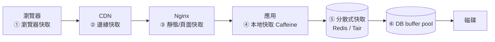
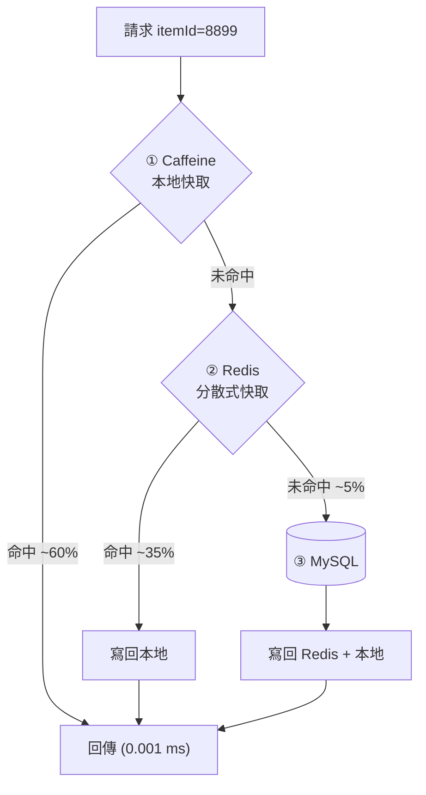
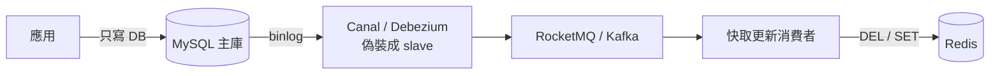

# 第二章　引入快取與快取一致性

> **本章場景**：日活 20 萬，尖峰 QPS 3,000，其中 95% 是讀。
> 資料庫 `%util` 99.7%，慢查詢每分鐘 4,200 條。應用機還很閒。
> 本章要回答：怎麼讓這些重複的讀不要碰到資料庫，以及——**這件事為什麼比想像中難十倍**。

---

## 2.1 資料庫讀寫瓶頸與快取救星

### 先看清楚資料的形狀

把一天的請求撈出來做直方圖，幾乎所有 C 端系統都長一樣：

```
商品被存取的次數（log scale）
│█
│█
│██
│███
│█████
│█████████
│████████████████████████████████████████
└──────────────────────────────────────────→ 商品（依熱度排序）
  ↑ 前 0.1% 的商品        ↑ 剩下 99.9% 的商品
    吃掉 50%+ 的流量        加起來吃掉另一半
```

這叫 **冪次分布 / 長尾（power law）**。它給了我們一個巨大的機會：

> **只要把最熱的那 1% 資料放進記憶體，就能擋掉 80–95% 的資料庫讀請求。**

### 快取為什麼快：延遲數量級表

架構師腦中必須刻著這張表（數量級比精確值重要）：

| 操作 | 量級 | 相對感受（放大 10 億倍） |
|---|---|---|
| CPU L1 快取 | 1 ns | 1 秒 |
| 主記憶體讀取 | 100 ns | 1.7 分鐘 |
| 同機房網路來回 | 0.5 ms | 6 天 |
| Redis 查詢（含網路） | 0.5–1 ms | 6–12 天 |
| SSD 隨機讀 | 0.1 ms | 1.2 天 |
| MySQL 走索引查詢（命中 buffer pool） | 1–3 ms | 12–35 天 |
| MySQL 查詢（回表 + 磁碟） | 10–100 ms | 1–3 年 |
| 跨地域網路來回（台北↔法蘭克福） | 250 ms | 8 年 |

重點不是「Redis 比 MySQL 快」——命中 buffer pool 的 MySQL 也在記憶體裡。
重點是：

1. **MySQL 每個連線成本高**（解析 SQL、優化器、MVCC、鎖、事務），Redis 幾乎是純記憶體讀 + 單一指令。
2. **Redis 可以輕鬆水平擴展**，MySQL 主庫不行。
3. **快取可以存「算好的結果」**，一次快取命中能省掉 8 次 SQL + 一堆組裝運算。

第 3 點常被忽略，卻是威力最大的：快取真正的價值不是「存資料」，是 **存運算結果**。

### 三種快取的位置



**離使用者越近的快取越便宜、越快，但越難失效。**
這是快取設計的根本張力，本章 2.4 節會反覆遇到。

---

## 2.2 本地快取與分散式快取：Memcached / Redis / Tair

### 本地快取（Local Cache）

資料直接放在應用進程的堆記憶體裡，存取是**奈秒級**，連網路都不用。

```java
// Caffeine：目前 JVM 生態的事實標準
Cache<Long, ItemVO> local = Caffeine.newBuilder()
    .maximumSize(10_000)                          // 只放最熱的一萬件商品
    .expireAfterWrite(Duration.ofSeconds(30))     // 容忍 30 秒的資料不一致
    .recordStats()                                // 一定要開，否則你不知道命中率
    .build();

ItemVO item = local.get(itemId, id -> redisOrDb(id));
```

| 優點 | 缺點 |
|---|---|
| 最快（無網路） | 每台機器一份，**浪費記憶體** |
| 沒有序列化成本 | **一致性最差**：10 台機器可能有 10 個版本 |
| 沒有外部依賴，Redis 掛了還能活 | 重啟即失效（冷啟動雪崩風險） |
| 天然扛熱點 | 容量受 JVM 堆限制，放太多會 GC 爆炸 |

**用在哪裡**：極熱極小且可容忍短暫不一致的資料——設定開關、類目樹、匯率、
以及「擋熱點 key」（見 2.3）。

### 分散式快取（Distributed Cache）

資料放在獨立的快取集群，所有應用機看到同一份。

| | Memcached | Redis | Tair（阿里系代表） |
|---|---|---|---|
| 資料結構 | 只有 K-V 字串 | String/Hash/List/Set/ZSet/Stream/Bitmap… | Redis 相容 + 持久記憶體、多結構 |
| 持久化 | 無 | RDB / AOF | 支援，可做持久記憶體型 |
| 集群 | 客戶端一致性雜湊 | Redis Cluster（16384 slot） | 雲託管，代理層分片 |
| 執行緒模型 | 多執行緒 | 單執行緒處理指令（6.0 後 I/O 多執行緒） | 多執行緒 |
| 適合 | 純快取、極簡 | 快取 + 輕量資料結構 + 分散式鎖 | 大規模、需 SLA 與持久化 |

> Memcached 在 2010 年代前期是主流，現在新專案幾乎一律選 Redis——
> 不是因為 Redis 更快（純 GET/SET Memcached 不輸），而是因為 **Redis 的資料結構讓你少寫很多程式**：
> 排行榜用 ZSet、去重用 Bitmap/HyperLogLog、限流用 INCR + EXPIRE、分散式鎖用 SET NX PX。

### 經典組合：兩級快取



**效果試算**：QPS 3,000 的讀流量，經過兩級快取後打到 MySQL 的只剩約 150 QPS。
資料庫從 99.7% util 降到 5%。這就是第 3 次演進的全部價值。

實作時的關鍵細節：**本地快取的 TTL 要短（10–60 秒），Redis 的 TTL 可以長（分鐘～小時）**。
因為本地快取沒有辦法可靠地被主動失效（你得廣播給 N 台機器），只能靠「短命」來收斂不一致。

```java
public ItemVO getItem(long id) {
    return local.get(id, k -> {
        String json = redis.get("item:" + k);
        if (json != null) return JSON.parse(json, ItemVO.class);
        ItemVO vo = itemMapper.selectById(k);            // 回源
        if (vo == null) {
            redis.setex("item:" + k, 60, "");            // 空值也快取，見 2.3 穿透
            return null;
        }
        redis.setex("item:" + k, 1800 + rnd(300), JSON.toJSONString(vo)); // 隨機 TTL，見 2.3 雪崩
        return vo;
    });
}
```

這短短 12 行，已經內建了本章後面要講的三個坑的解法。

---

## 2.3 快取實戰痛點：穿透、擊穿、雪崩與熱點失效

加了快取之後，你會獲得一種全新的故障類型：**平常好好的，一出事就是全站級的**。
以下四個名詞非常容易搞混，用一張表釘死：

| 名詞 | 一句話 | 觸發條件 | 典型場景 |
|---|---|---|---|
| **穿透** Penetration | 查**根本不存在**的資料，快取永遠不命中 | 惡意或 bug | 攻擊者狂查 `itemId=-1` |
| **擊穿** Breakdown | **單一熱 key** 過期的瞬間，大量請求同時回源 | 熱 key TTL 到期 | 爆款商品快取剛好過期 |
| **雪崩** Avalanche | **大量 key 同時**過期，或快取集群整個掛掉 | 統一 TTL / Redis 宕機 | 預熱時一次寫入 100 萬 key，TTL 都是 30 分鐘 |
| **熱點失效/傾斜** Hotspot | 單一 key 的 QPS 打爆**單一 Redis 節點** | 極端熱點 | 秒殺商品，10 萬 QPS 全打同一個 slot |

### 穿透：不存在的資料

```
攻擊者 → GET item:-1 → Redis miss → MySQL 查無 → 不寫快取 → 下一個請求重來
        （每秒 5 萬次，MySQL 直接躺平）
```

**解法**：

1. **快取空值**：查無也寫入 `""`，TTL 設短（60 秒）。簡單有效，缺點是佔記憶體。
2. **布隆過濾器（Bloom Filter）**：把所有存在的 ID 預先建成一個 bitmap，
   查詢前先問布隆：「這個 ID 可能存在嗎？」
   - 說「不存在」→ **一定不存在**，直接回 404，連 Redis 都不用查。
   - 說「可能存在」→ 才往下走（有誤判率，約 1%）。

```java
// Redisson 的布隆過濾器
RBloomFilter<Long> bf = redisson.getBloomFilter("item:exists");
bf.tryInit(100_000_000L, 0.01);   // 1 億元素、1% 誤判 → 約 114 MB
if (!bf.contains(itemId)) return null;   // 擋掉 99% 的惡意查詢
```

3. **參數校驗 + 限流**：最便宜的一道防線，別跳過。

### 擊穿：熱 key 過期的那一毫秒

```
     TTL 到期
        ↓
  ┌─────┴──────────────────────┐
  │ 這 20 ms 內湧入 6,000 個請求 │  全部 miss，全部去打 MySQL
  └────────────────────────────┘
```

**解法**：

| 方案 | 做法 | 適用 |
|---|---|---|
| **互斥鎖** | 只放一個請求回源，其餘等待或回舊值 | 通用，最常用 |
| **邏輯過期** | 永不物理過期，value 內帶 `expireAt`；過期時由背景執行緒非同步重建，前台先回舊值 | 極熱 key，要求絕不回源 |
| **主動預熱** | 大促前把熱資料寫滿，TTL 拉長並續期 | 可預期的熱點（雙十一） |

```java
// 互斥鎖版本（單機用 JVM 鎖 + 分散式用 Redis 鎖）
String v = redis.get(key);
if (v != null) return parse(v);

String lockKey = "lock:" + key;
if (redis.set(lockKey, "1", "NX", "PX", 3000)) {     // 搶到鎖
    try {
        v = loadFromDb();                             // 只有這一個請求回源
        redis.setex(key, ttl(), v);
    } finally { redis.del(lockKey); }
    return parse(v);
} else {
    Thread.sleep(50);                                 // 其餘的等一下重試
    return getItem(key);                              // 注意：要有重試上限，否則遞迴爆炸
}
```

> ⚠️ 上面這段是教學版。生產環境用 Redisson 的 `RLock`，它處理了看門狗續期、
> 可重入、鎖誤刪（用 UUID 校驗）等問題。**自己手寫分散式鎖是 bug 的溫床。**

### 雪崩：大面積同時失效

兩種成因，解法完全不同：

**(a) TTL 撞在一起**——預熱時 100 萬個 key 同一秒寫入、同樣 TTL 1800 秒。
解法一行字：**TTL 加隨機擾動**。

```java
redis.setex(key, 1800 + ThreadLocalRandom.current().nextInt(600), value);
//                    ↑ 把失效時間打散在 10 分鐘的窗口裡
```

**(b) Redis 集群掛了**——這時所有流量瞬間打向 MySQL，而 MySQL 的承載力只有 Redis 的 1/50。
結果是：**Redis 故障 → MySQL 被打死 → 整站不可用，且重啟後立刻再被打死（無法自愈）**。

解法是**設計時就假設快取會掉**：

| 防線 | 做法 |
|---|---|
| 快取高可用 | Redis Sentinel / Cluster，多副本跨可用區 |
| 本地快取兜底 | Redis 掛了，Caffeine 還能擋一部分 |
| **回源限流** | 回源到 DB 的併發設上限（如 50），超過的直接回降級內容 |
| **熔斷降級** | DB 也扛不住時，回傳「靜態兜底頁」而不是錯誤頁（第 5.4 節） |
| 服務分級 | 保交易，棄評價/推薦 |

> **記住這句話**：*快取不是可用性的提升，快取是可用性的負債。*
> 加了快取之後，你的系統多了一個「掛掉就會連鎖擊垮下游」的元件。
> 所有引入快取的系統，都必須同時設計「快取全掛時怎麼辦」。

### 熱點 key：分片也救不了的傾斜

Redis Cluster 用 CRC16 把 key 分到 16384 個 slot。但一個 key 只會落在一個 slot、
一個節點上。秒殺商品 10 萬 QPS 全打 `item:8899`，那個節點的網卡就先爆了。

**解法**：

1. **本地快取擋在前面**（最有效）：熱點 key 天然會被本地快取吸收，因為它每台機器都被狂查。
2. **key 打散**：`item:8899` 複製成 `item:8899#0` ~ `item:8899#9`，讀取時隨機挑一個，
   分散到 10 個節點。代價是寫入要更新 10 份。
3. **熱點自動探測**：由 SDK/Proxy 統計 key 的 QPS，超過閾值自動提升到本地快取
   （Tair、JD hotkey、京東/阿里都有類似機制）。

---

## 2.4 快取與資料庫的一致性難題

這是整章最難、也是面試最愛問的地方。先講結論：

> **在「快取 + 資料庫」的雙寫架構下，強一致性是不可能的。**
> 你能做到的只有 **最終一致性**，而工程的重點是「讓不一致的窗口足夠短、足夠罕見，且業務能容忍」。

### 四種寫入策略

| 策略 | 順序 | 問題 |
|---|---|---|
| ① 先更新快取，再更新 DB | 快取 → DB | DB 寫失敗就全錯；兩個併發寫會亂序 |
| ② 先更新 DB，再更新快取 | DB → 快取 | 併發寫亂序（見下）；且若快取值需複雜計算則浪費 |
| ③ 先刪快取，再更新 DB | 刪 → DB | **有經典不一致**（見下） |
| ④ **先更新 DB，再刪快取** | DB → 刪 | **業界主流**（Cache-Aside），仍有極小機率不一致 |

### 為什麼「更新快取」不如「刪除快取」

```
時間 →
執行緒 A:  更新 DB 為 100 ──────────→ 更新快取為 100
執行緒 B:      更新 DB 為 200 → 更新快取為 200
                                      ↑ A 的慢寫入後到，快取被覆蓋成 100
最終：DB = 200，快取 = 100   ❌ 永久不一致（直到 TTL 到期）
```

**刪除**沒有這個問題，因為刪除是冪等的、沒有「值」的競爭。
而且刪除是懶惰的：如果這筆資料之後沒人讀，你就省下了重建快取的成本。

### 為什麼「先刪快取，再更新 DB」有洞

```
時間 →
A(寫):  刪快取 ──────────────────→ 更新 DB 為 200
B(讀):        查快取 miss → 查 DB 得 100 → 寫回快取 100
最終：DB = 200，快取 = 100   ❌ 不一致
```

這個窗口很大（DB 寫入耗時 = 幾毫秒 ~ 幾十毫秒），**很容易發生**。

### 主流解法：Cache-Aside（先更新 DB，再刪快取）

```java
@Transactional
public void updateItem(Item item) {
    itemMapper.update(item);       // 1. 先寫資料庫（事務內）
}
// 2. 事務提交後才刪快取
@TransactionalEventListener(phase = AFTER_COMMIT)
public void onUpdated(ItemUpdatedEvent e) {
    redis.del("item:" + e.getId());
}
```

它仍有一個**理論上的洞**：

```
時間 →
B(讀):  查快取 miss → 查 DB 得 100 ─────────────────→ 寫回快取 100
A(寫):              更新 DB 200 → 刪快取
最終：快取 = 100   ❌
```

但這需要「B 的讀 DB 比 A 的寫 DB + 刪快取還慢」，機率極低（讀通常比寫快一個量級），
而且 TTL 到期後會自動修復。**業界普遍接受這個風險。**

### 想再保險一點：延遲雙刪與訂閱 binlog

**延遲雙刪**：寫完 DB 刪一次，過 500 ms 再刪一次，蓋掉上面那個殘留。

```java
redis.del(key);
scheduler.schedule(() -> redis.del(key), 500, MILLISECONDS);   // 補刀
```
缺點：延遲時間難調（要大於一次讀 DB + 寫快取的耗時），且多一次無效刪除。

**訂閱 binlog（最乾淨的架構解）**：



好處：
- **應用程式碼完全不管快取失效**，職責單一，不會有人忘記刪。
- binlog 是 DB 的**唯一真相來源**，順序天然正確。
- 任何管道改的資料（其他系統、DBA 手動改）都會被捕獲。

代價：多一套中間件、多一份延遲（通常 10–100 ms）、消費者要做冪等與重試。
**這是大型電商的標準做法**，也是第六章訊息佇列的伏筆。

### 業務視角：一致性要求分級

不要對所有資料用同一套策略。實務上這樣分：

| 資料類型 | 一致性要求 | 策略 |
|---|---|---|
| 商品標題、圖片、詳情 | 秒級最終一致即可 | 本地快取 30s + Redis 30min + Cache-Aside |
| 商品價格 | 分鐘級，但錯了要賠錢 | Cache-Aside + binlog 訂閱，下單時**以 DB 為準二次校驗** |
| **庫存** | **強一致，不可超賣** | **不用快取做扣減**；用 DB 行鎖或 Redis + Lua 原子扣減 + 最終對帳 |
| 使用者餘額 | 強一致 | 絕不快取寫路徑 |
| 評價數、瀏覽數 | 極弱 | Redis INCR，定期回寫 DB，允許丟失 |

> **架構師的判斷力在這張表裡**：不是「要不要快取」，而是「這個欄位錯 3 秒，會怎樣？」
> 商品標題錯 3 秒：沒人在意。庫存錯 3 秒：超賣 500 台 iPhone，公司賠錢上新聞。
>
> **凡是「下單/扣款/扣庫存」的最後一步，都必須回到資料庫做真正的校驗。**
> 快取只負責「擋掉 99% 明顯不可能成功的請求」，不負責「決定交易成立」。

---

## 本章代價與下一章的痛

**我們做了什麼**：兩級快取擋掉 95% 的讀請求，資料庫 util 從 99.7% 降到 5%。

**我們買進的新問題**：

| 新問題 | 說明 |
|---|---|
| 一致性變成永久課題 | 每加一處快取，就多一個「什麼時候失效」的設計題 |
| 多了一個高危單點 | Redis 掛 = MySQL 被打死 = 全站掛，必須設計回源限流與降級 |
| 除錯難度上升 | 「我改了資料為什麼沒生效」會變成日常對話 |
| 冷啟動風險 | 快取集群重啟後空的，必須有預熱腳本 |

**新的痛點**：資料庫舒服了，換應用機叫。

```
$ top   # 應用伺服器
%Cpu(s): 96.8 us
# Tomcat 執行緒 200/200 滿載，佇列堆積，回應時間 P99 = 4.2s
```

單台應用機已經到頂。垂直擴展（換 32C）能再撐一陣，但：
- 價格是線性的 4 倍，效能不會是 4 倍。
- **它還是一台機器——它重啟時，全站停擺。**

我們需要的是**很多台應用機**。但這立刻帶出三個問題：
流量怎麼分配？使用者登入狀態存在哪？其中一台掛了怎麼辦？

下一章：[第三章　無狀態應用與負載均衡](03-無狀態應用與負載均衡.md)。

---

## 名詞速查

| 名詞 | 一句話 |
|---|---|
| Cache-Aside | 讀時回填、寫時先更新 DB 再刪快取的主流模式 |
| 穿透 / 擊穿 / 雪崩 | 查不存在 / 單熱 key 過期 / 大量 key 同時失效 |
| 布隆過濾器 | 空間極省的「一定不存在 / 可能存在」判斷器 |
| 邏輯過期 | value 內帶過期時間，永不物理失效，背景非同步重建 |
| Canal / Debezium | 偽裝成 MySQL slave 訂閱 binlog 的資料變更捕獲（CDC）工具 |
| 最終一致性 | 允許短暫不一致，但保證最後會一致 |
