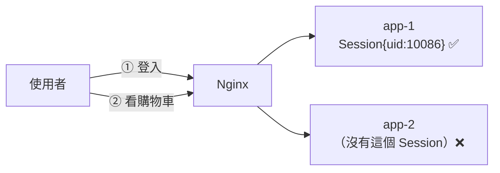
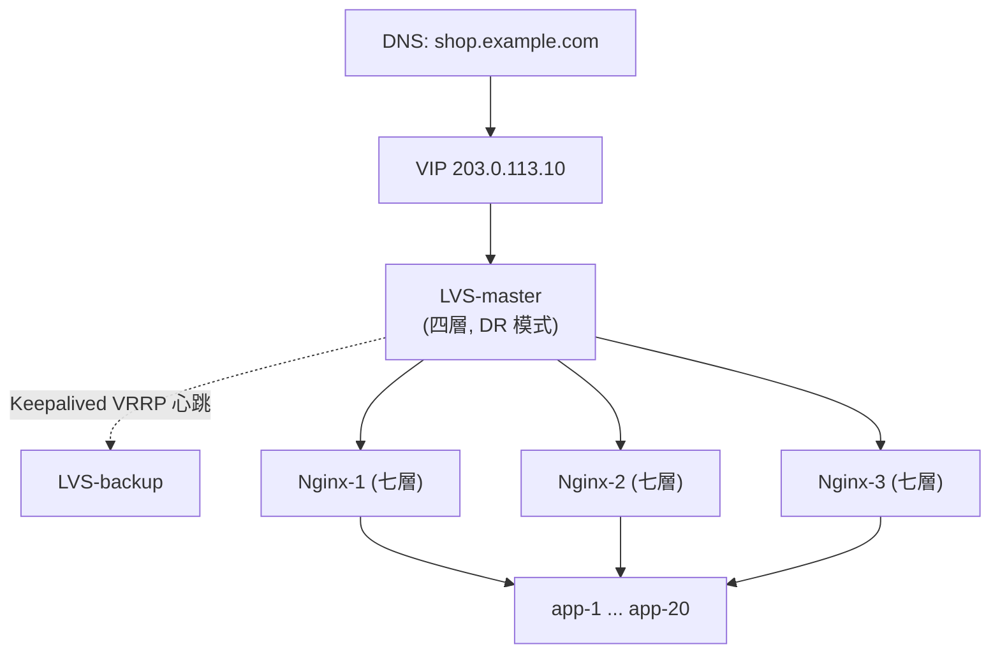
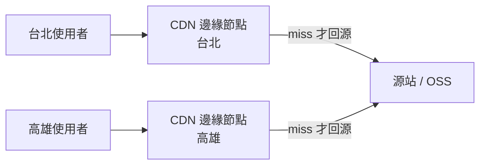
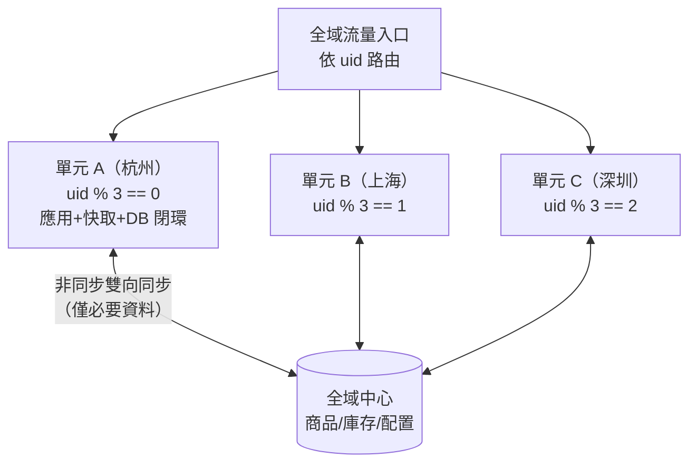

# 第三章　無狀態應用與負載均衡

> **本章場景**：快取已經擋掉 95% 的讀，但應用機 CPU 96%，執行緒池 200/200 滿載，P99 = 4.2 秒。
> 本章要回答：怎麼把一台應用變成一群應用？以及那個所有人都會踩的坑——**使用者登入狀態放哪裡**。

---

## 3.1 反向代理與 Web 集群：Nginx / HAProxy

### 正向代理 vs 反向代理

這兩個詞長得像，立場完全相反：

```
正向代理（Forward Proxy）— 代理「客戶端」，伺服器不知道你是誰
   你 → [VPN/公司代理] → 目標網站

反向代理（Reverse Proxy）— 代理「伺服器」，客戶端不知道後面有幾台
   使用者 → [Nginx] → ┬→ app-1
                      ├→ app-2
                      └→ app-3
```

反向代理是水平擴展的**入口與前提**。使用者永遠只看到一個網址、一個 IP，
後面是 3 台還是 300 台，是它的事。

### 一份能用的 Nginx 設定

```nginx
upstream shop_app {
    least_conn;                       # 選當前連線數最少的，比 round-robin 適合長短請求混雜

    server 10.0.1.11:8080 max_fails=3 fail_timeout=10s weight=1;
    server 10.0.1.12:8080 max_fails=3 fail_timeout=10s weight=1;
    server 10.0.1.13:8080 max_fails=3 fail_timeout=10s weight=2;   # 這台規格較好
    server 10.0.1.14:8080 backup;     # 平常不用，其他全掛才頂上

    keepalive 64;                     # 對後端保持長連線，省下 TCP 三次握手
}

server {
    listen 80;
    server_name shop.example.com;

    location / {
        proxy_pass http://shop_app;
        proxy_http_version 1.1;
        proxy_set_header Connection "";              # 配合 upstream keepalive，必須清空
        proxy_set_header Host              $host;
        proxy_set_header X-Real-IP         $remote_addr;
        proxy_set_header X-Forwarded-For   $proxy_add_x_forwarded_for;
        proxy_set_header X-Forwarded-Proto $scheme;

        proxy_connect_timeout 2s;      # 連不上後端 2 秒就換一台
        proxy_read_timeout   10s;      # 後端 10 秒不回，放棄
        proxy_next_upstream error timeout http_502 http_503;   # 失敗自動換下一台
    }

    location /static/ {
        root /data/www;                # 靜態資源不要進 Tomcat
        expires 7d;
        add_header Cache-Control "public, immutable";
    }
}
```

幾個新手最常漏的細節：

| 設定 | 不寫會怎樣 |
|---|---|
| `keepalive` + `Connection ""` | 每個請求都重新 TCP 握手，QPS 上千時 TIME_WAIT 爆炸 |
| `X-Forwarded-For` | 應用拿到的 IP 全是 Nginx 的，風控、限流、日誌全部失效 |
| `proxy_read_timeout` | 後端慢查詢會把 Nginx 的 worker 連線耗盡 |
| `max_fails` / `fail_timeout` | 掛掉的後端仍持續收到流量，使用者一直看到 502 |

### 負載均衡演算法

| 演算法 | Nginx 指令 | 適用 | 陷阱 |
|---|---|---|---|
| 輪詢 Round Robin | （預設） | 後端同規格、請求耗時相近 | 慢請求會堆在同一台 |
| 加權輪詢 | `weight=N` | 後端規格不一 | 權重要隨擴容維護 |
| 最少連線 | `least_conn` | 請求耗時差異大 | 需要維護連線狀態 |
| IP 雜湊 | `ip_hash` | 需要黏性會話 | **擴縮容會重新分配 → 大量掉登入**；且 NAT 後的使用者會擠同一台 |
| 一致性雜湊 | `hash $arg_uid consistent` | 快取親和性 | 需要 key 設計 |

> `ip_hash` 是「不想改程式就能解決 Session 問題」的誘惑，但它把應用重新變成有狀態的。
> **請不要用它來解 Session 問題**，正確做法在 3.2。

### Nginx vs HAProxy vs 其他

| | Nginx | HAProxy | Traefik / Envoy |
|---|---|---|---|
| 強項 | 靜態資源、HTTP 反向代理、生態龐大 | 純負載均衡、健康檢查細膩、TCP 層強 | 動態設定、服務發現、雲原生 |
| 設定變更 | reload（平滑但需要檔案） | reload / runtime API | **API 動態下發，不用 reload** |
| 定位 | 全能型 | 專業型 | 雲原生型（第十章主角） |

記住最後一欄：**當後端會自動擴縮容時，「改設定檔 + reload」這個模式就崩潰了**。
這正是第十章 Ingress 與服務網格要解決的事。

---

## 3.2 無狀態設計與 Session 共享

### 問題長什麼樣

單機時代，登入狀態存在 Tomcat 的記憶體裡：

```java
request.getSession().setAttribute("userId", 10086);
```

現在有 4 台機器，使用者第一個請求落在 app-1（Session 建在 app-1 的記憶體），
第二個請求被輪詢到 app-2——**app-2 完全不認識他，直接踢回登入頁**。

使用者體驗：登入後每點兩下就被登出一次。



### 有狀態 vs 無狀態

> **無狀態（Stateless）的定義**：伺服器不在本機保存任何「跨請求的使用者資料」。
> 任何一台機器都能處理任何一個請求，因為處理所需的一切，
> 要嘛在請求裡（token），要嘛在共享儲存裡（Redis / DB）。

**無狀態是水平擴展的入場券。** 一旦應用無狀態：
- 可以隨意加機器（新機器立刻能幹活）
- 可以隨意殺機器（沒有資料會丟）
- 可以滾動更新、可以自動擴縮容
- **可以裝進容器**（第七章）

**這一節是整本書通往 Docker/K8s 最關鍵的一步。** K8s 的 Pod 隨時會被殺掉重建，
如果你的應用是有狀態的，K8s 只會讓你死得更快。

### 四種解法

#### 方案一：Session 黏性（Sticky Session）— 不推薦

靠 `ip_hash` 或 cookie 把同一使用者固定到同一台。
**缺點致命**：那台機器一重啟/擴容，該批使用者全部掉登入；且流量無法均勻分配。
只適合過渡期的緊急處置。

#### 方案二：Session 複製 — 不推薦

Tomcat 集群互相廣播 Session。N 台機器就有 N² 條複製鏈路，
超過 5 台就會被網路流量拖死。這是 2000 年代的方案，現在只存在於歷史課。

#### 方案三：集中式 Session（Redis）— 推薦，改動最小

```xml
<dependency>
  <groupId>org.springframework.session</groupId>
  <artifactId>spring-session-data-redis</artifactId>
</dependency>
```

```properties
spring.session.store-type=redis
spring.session.timeout=30m
spring.session.redis.namespace=shop:session
```

加完這幾行，`request.getSession()` 的語意不變，但資料寫進 Redis。
所有機器共享同一份，應用瞬間無狀態。

| 優點 | 缺點 |
|---|---|
| 程式碼幾乎不用改 | 每個請求多一次 Redis 來回（0.5 ms） |
| 可以主動踢人下線（刪 key） | Redis 成為關鍵路徑上的單點 |
| Session 內容可以很大 | 跨語言/跨系統共享麻煩（序列化格式綁 Java） |

#### 方案四：Token（JWT）— 推薦，最徹底

把狀態直接交給客戶端保管：

```
Header.Payload.Signature
{"alg":"HS256"} . {"uid":10086,"exp":1767225600,"role":"buyer"} . <HMAC 簽章>
```

伺服器只要驗簽章，**完全不需要任何儲存**。

```java
String token = Jwts.builder()
    .claim("uid", 10086)
    .setExpiration(Date.from(Instant.now().plus(15, MINUTES)))   // 短效
    .signWith(key, SignatureAlgorithm.HS256)
    .compact();
```

| 優點 | 缺點 |
|---|---|
| 真正零儲存，無限水平擴展 | **無法主動撤銷**（簽發後在到期前一直有效） |
| 跨服務、跨語言通用 | Payload 放在 header 裡，每個請求都變大 |
| 適合 API / 手機 App / 微服務 | 內容只是 base64，**不加密，不能放敏感資料** |

**JWT 最大的坑是「無法登出」。** 使用者按了登出、管理員封鎖了帳號，
但那張 token 還能用到過期。實務上的標準解法是雙 token：

```
Access Token  （JWT，15 分鐘，無狀態，不查庫）
Refresh Token （隨機串，7 天，存在 Redis，可撤銷）
```

短效 access token 把「撤銷延遲」壓到 15 分鐘以內；要立即封鎖時，
再搭配一個小小的黑名單（只存「被提前撤銷的 jti」，量極小）。

### 無狀態化的檢查清單

Session 只是最明顯的狀態。要把應用真正無狀態化，還得清掉這些：

- [ ] **本機檔案**：使用者上傳的圖片存在 `/data/upload/`？→ 改存物件儲存（OSS/S3）
- [ ] **本機快取**：可以留，但必須容忍不一致，且不能是唯一來源
- [ ] **本機定時任務**：`@Scheduled` 在 10 台機器上會跑 10 次 → 改用分散式排程（XXL-Job / ElasticJob）或分散式鎖
- [ ] **記憶體計數器**：`AtomicLong` 的限流計數 → 改 Redis
- [ ] **本機 log**：不能只寫本機檔案，機器一沒就查不到 → 收集到 ELK（第 13.2 節）
- [ ] **WebSocket 長連線**：天生有狀態 → 獨立成連線層，用 MQ 廣播推送

> 這份清單就是「一個應用能不能上 K8s」的體檢表。
> **第七章之前，請先把這六項清乾淨。** 容器化不會幫你解決狀態問題，只會放大它。

---

## 3.3 四層與七層負載的搭配：LVS / F5 + Keepalived

### 新的痛：Nginx 自己成了瓶頸與單點

應用機加到 20 台之後，問題換位置了：

- **單點**：那唯一一台 Nginx 掛了，20 台健康的應用機一個請求也收不到。
- **瓶頸**：單台 Nginx 大約能扛數萬 QPS 的七層處理與 SSL 卸載，再往上網卡與 CPU 都到頂。

那就多開幾台 Nginx？但**使用者怎麼知道要連哪一台**？
我們需要在 Nginx 之前，再放一層更快、更薄的東西。

### OSI 分層：四層與七層的差別

| | 四層（L4，傳輸層） | 七層（L7，應用層） |
|---|---|---|
| 看得到 | IP + Port | URL、Header、Cookie、Method |
| 能做 | 轉發 TCP/UDP | 依路徑路由、改寫 header、SSL 卸載、壓縮、快取 |
| 效能 | 極高（可達百萬級 pps，核心態轉發） | 較低（要解析 HTTP） |
| 代表 | LVS、F5、雲端 NLB | Nginx、HAProxy(L7)、ALB、Envoy |



**為什麼要兩層？** 因為分工：
- **L4 只做「分流」**，不解析內容，所以極快，一台就能扛住整個機房的入口流量。
- **L7 做「智慧路由」**，解析 URL、卸載 SSL、做灰度發布，功能豐富但較慢，用多台橫向堆。

### LVS 的三種模式（重點是 DR）

| 模式 | 回程路徑 | 效能 | 限制 |
|---|---|---|---|
| NAT | 回程也經過 LVS | 低（LVS 成雙向瓶頸） | 簡單，跨網段可用 |
| **DR（Direct Routing）** | **後端直接回使用者** | **最高** | LVS 與後端必須同一個二層網路 |
| TUN（IP Tunneling） | 後端直接回 | 高 | 需要隧道支援，可跨機房 |

DR 模式的精髓：**請求進來走 LVS，回應直接出去**。
由於 HTTP 回應通常比請求大 10–100 倍（想想圖片與 JSON），
只處理進向流量的 LVS 就能扛非常巨大的規模。

### Keepalived：消滅單點

LVS 本身也是一台機器，也會掛。Keepalived 用 **VRRP 協議** 讓兩台 LVS 共享一個虛擬 IP（VIP）：

```
正常時：VIP 綁在 master，backup 靜靜聽心跳
master 掛：backup 在 1~3 秒內接管 VIP，使用者幾乎無感
```

```conf
# /etc/keepalived/keepalived.conf（master）
vrrp_instance VI_1 {
    state MASTER
    interface eth0
    virtual_router_id 51
    priority 100              # backup 設 90
    advert_int 1              # 每秒一次心跳
    authentication { auth_type PASS; auth_pass 1111 }
    virtual_ipaddress { 203.0.113.10/24 }
}
```

> **高可用的通用套路，看到這裡請記起來**：
> 任何一個「唯一的東西」都是單點。消滅單點的標準動作是
> **「多副本 + 心跳偵測 + 自動故障轉移 + 對外提供一個不變的虛擬位址」**。
> 這個 pattern 你會在本書看到至少五次：Keepalived 的 VIP、MySQL 的 MHA、
> Redis Sentinel、K8s 的 Service、以及 K8s 自己的 etcd raft。

### 雲端時代：這一層通常不用自己做

自建 LVS + Keepalived 現在主要出現在自建機房。公有雲上直接買：

| 自建 | 雲端對應 |
|---|---|
| LVS + Keepalived | NLB / CLB（四層負載均衡） |
| Nginx 集群 | ALB / ELB（七層），或自建 Nginx/Ingress |
| F5 硬體 | 雲端 LB 的高規格實例 |

但**原理必須懂**：因為 K8s 的 `Service type=LoadBalancer` 底層就是在跟雲端的 L4 LB 對接，
`kube-proxy` 的 IPVS 模式底層就是 LVS。第十章會回頭印證這件事。

---

## 3.4 機房入口：DNS 輪詢、CDN 與異地多活基礎

### 再往上一層：單一機房的天花板

現在單機房內部已經很健康了，但還有三個問題：

1. **頻寬上限**：機房出口頻寬買到 100 Gbps 就很貴了，雙十一的圖片流量遠超過。
2. **地理延遲**：新疆的使用者連杭州機房，光速來回就要 60 ms 以上。
3. **機房級故障**：挖土機挖斷光纖、機房斷電、整個可用區故障——這在業界每年都會發生。

### DNS 輪詢：最原始的全域負載均衡

一個域名解析到多個 IP，DNS 伺服器輪流回不同的答案：

```bash
$ dig shop.example.com +short
203.0.113.10     # 杭州機房 VIP
198.51.100.20    # 上海機房 VIP
192.0.2.30       # 深圳機房 VIP
```

| 優點 | 缺點 |
|---|---|
| 零成本，天然分散 | **TTL 快取**：機房掛了，DNS 改了，但使用者本機/ISP 仍快取舊 IP 數分鐘到數小時 |
| 可做地理就近（GeoDNS） | 無法感知後端健康（需搭配健康檢查型 DNS） |
| | 權重調整不精準 |

**所以 DNS 不能當作故障轉移的主要手段**，它太慢了。
現代做法是 **DNS 指向「任播（Anycast）IP」或雲端全域負載均衡**，
由網路層在秒級內把流量導離故障區域。

### CDN：把 90% 的流量攔在門外

電商的流量組成大概是這樣：

| 類型 | 佔頻寬比例 | 能不能被 CDN 快取 |
|---|---|---|
| 圖片、影片 | 85–92% | ✅ 完全可以 |
| JS / CSS | 3–5% | ✅ 可以（帶 hash 檔名，可 immutable） |
| HTML 頁面 | 1–2% | ⚠️ 部分（活動頁可以，個人化頁不行） |
| API JSON | 3–8% | ⚠️ 少數（商品詳情可短快取） |

> **一個殘酷但重要的事實**：對電商而言，第一個真正有效的「架構優化」不是快取、不是分庫，
> 而是 **把圖片丟到 CDN**。它一次砍掉 90% 的源站頻寬，成本與效果都無可比擬。

CDN 的運作：



關鍵設定：

```nginx
# 帶 hash 的靜態資源：永久快取
location ~* \.(js|css)$ {
    expires max;
    add_header Cache-Control "public, immutable";
}
# 商品圖片：長快取 + 版本化 URL（改圖就換 URL，不要指望刷新 CDN）
# 錯誤示範：/img/item/8899.jpg  → 改圖後要全球刷新，慢且不可靠
# 正確示範：/img/item/8899_v3.jpg 或 /img/item/8899.jpg?v=a1b2c3
```

**CDN 刷新是不可靠的**（全球數千節點，總有漏網），
所以規則是：**內容改變就改 URL，永遠不要原地覆蓋。**
這個「不可變（immutable）」的思想，在第七章會以「容器鏡像用 tag 而非 latest」的形式再度出現。

### 異地多活的三個階段

| 階段 | 名稱 | 說明 | RTO/RPO |
|---|---|---|---|
| 1 | **冷備** | 異地機房只存備份資料，平時不開機 | RTO 數小時，RPO 數小時 |
| 2 | **同城雙活** | 兩個同城機房都跑流量，共用或主從資料庫（延遲 1–2 ms） | RTO 分鐘級，RPO ≈ 0 |
| 3 | **異地多活** | 多地機房都承接寫入，資料雙向同步 | RTO 秒級，RPO 近 0 |

> **RTO（Recovery Time Objective）**：能容忍多久不可用。
> **RPO（Recovery Point Objective）**：能容忍丟多少資料。

異地多活真正的難點不是機房，是 **資料**。跨地域網路來回 30–60 ms，
不可能做同步強一致複製（那樣每筆寫入都要 60 ms）。實務上的主流策略是 **單元化（Unitization）**：

```
把使用者按 uid 雜湊分成 N 個「單元」，
每個單元的「讀 + 寫」都在自己所屬機房閉環完成，
跨單元的資料（如商品庫存）用單獨的「全域中心」處理。
```



單元化是本書最高階的架構模式之一，也是雙十一能扛住的根本原因。
本章只需要記住它的**核心思想**：

> **把使用者的請求鏈路「閉環」在一個機房內，避免跨機房調用。**
> 一次跨機房調用 = 30 ms；一個請求打 20 次服務，若有 5 次跨機房 = 150 ms，體驗直接崩潰。

這個「調用要閉環、要有親和性」的思想，會在第十一章的 `Affinity`、
第十章的 `Istio Locality Load Balancing` 再次出現。

---

## 本章代價與下一章的痛

**我們做了什麼**：應用無狀態化 → Nginx 集群 → LVS/Keepalived → DNS/CDN/多機房。
應用層現在可以**近乎無限地水平擴展**。

**我們買進的新問題**：

| 新問題 | 說明 |
|---|---|
| 入口層級變多 | CDN → DNS → LVS → Nginx → App，一次 502 要查五層 |
| 設定管理爆炸 | 20 台應用機擴縮容，要改 Nginx upstream 並 reload（**這是第七、十章的伏筆**） |
| 灰度發布變複雜 | 要讓 5% 流量進新版，得在 Nginx 手動調權重 |
| 部署變成人肉工程 | 上線一次要輪流操作 20 台機器 |

**新的痛點**：應用層無限擴展之後，所有壓力沉到底層。

```
MySQL 主庫:
  QPS         12,000  （其中寫 3,000）
  Threads_running 90
  主從延遲     8 秒     ← 使用者下單後看不到自己的訂單
  單表 order    4.2 億筆
  一次 ALTER TABLE 預估 6 小時，且會鎖表
```

快取只能擋「重複的讀」，擋不住**寫**，也擋不住**每次都不同的查詢**（如「我的訂單列表」）。
而且單表破億之後，連索引都開始失效——B+ 樹層數變深，每次查詢的磁碟 I/O 次數增加。

**資料庫，是這條路上最硬的一塊骨頭。** 下一章：
[第四章　資料庫的高可用與分庫分表](04-資料庫的高可用與分庫分表.md)。

---

## 名詞速查

| 名詞 | 一句話 |
|---|---|
| 反向代理 | 代理伺服器端，對外隱藏後端拓撲 |
| 無狀態 Stateless | 伺服器不保存跨請求的使用者資料，任一台都能處理任一請求 |
| Sticky Session | 把同一使用者固定到同一台後端；水平擴展的反模式 |
| JWT | 自帶簽章的 token，伺服器免儲存，但難以主動撤銷 |
| LVS / DR 模式 | 四層負載均衡；請求經過它、回應直接返回使用者 |
| VRRP / VIP | 多台設備共享一個虛擬 IP，故障時秒級接管 |
| RTO / RPO | 容忍多久不可用 / 容忍丟多少資料 |
| 單元化 | 把使用者分片，每片的請求鏈路在單一機房內閉環 |
