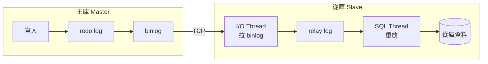
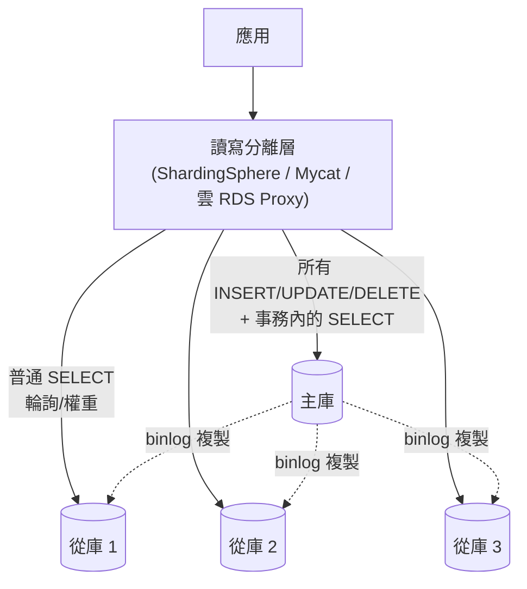
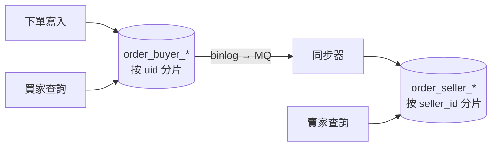
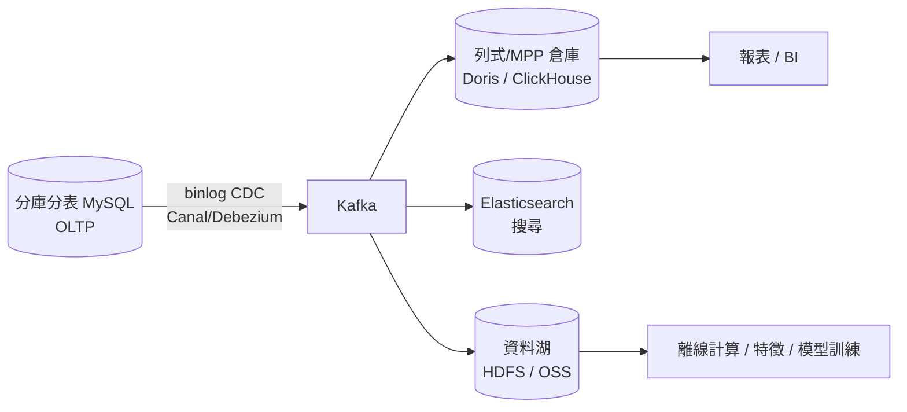

# 第四章　資料庫的高可用與分庫分表

> **本章場景**：主庫 QPS 12,000（寫 3,000）、主從延遲 8 秒、`order` 單表 4.2 億筆、
> 一次 DDL 要 6 小時且鎖表。
> 本章要回答：資料庫這塊最硬的骨頭要怎麼拆，以及拆完之後你會失去什麼。

---

## 4.1 讀寫分離與主從同步：Mycat 與資料一致性

### 為什麼快取擋不住這些讀

第二章的快取對付「同一筆熱資料被反覆讀」極為有效，但下面這些讀它完全無能為力：

| 查詢 | 為什麼快取無效 |
|---|---|
| 「我的訂單列表」 | 每個使用者都不同，命中率極低，且資料常變 |
| 「搜尋含『無線耳機』的商品」 | 查詢條件組合無限多 |
| 「賣家後台：本月銷售報表」 | 聚合查詢，每次結果都不同 |
| 剛下單後立刻查訂單 | 必須看到最新資料，不能讀快取 |

這些讀的共同點：**低重複、個人化、要求較新**。它們只能打到資料庫。

### 主從複製的原理

MySQL 的主從複製本質上是**把主庫的 binlog 搬到從庫重放**：



三種複製模式，決定了你的資料安全等級：

| 模式 | 主庫何時回覆客戶端「成功」 | 資料安全 | 效能 |
|---|---|---|---|
| **非同步 async** | 寫完本地就回 | ❌ 主庫掛可能丟資料 | 最快 |
| **半同步 semi-sync** | 至少一個從庫**收到** binlog 才回 | ✅ 幾乎不丟 | 多一次 RTT |
| **全同步 / 組複製** | 多數節點**確認** | ✅✅ | 最慢 |

> **金融級系統一律用半同步以上。** 非同步複製 + 主庫磁碟損毀 = 已回覆使用者「下單成功」
> 的訂單憑空消失，這是真實發生過的事故類型。

### 讀寫分離的架構



兩種實作路線：

| | 客戶端（SDK 內嵌） | 代理（Proxy） |
|---|---|---|
| 代表 | ShardingSphere-JDBC、MyBatis 多資料源 | Mycat、ShardingSphere-Proxy、ProxySQL、RDS Proxy |
| 效能 | 好（無多一跳） | 多一跳網路 |
| 語言 | 綁定 Java | **任何語言都能用** |
| 運維 | 升級要改所有應用 | 集中管理 |
| 連線數 | 每個應用都連所有 DB，**連線數爆炸** | Proxy 收斂連線 |

> **連線數是被嚴重低估的問題**：50 台應用機 × 每台連線池 20 × 4 個資料庫 = 4,000 條連線。
> MySQL 每條連線約佔數百 KB ~ 數 MB 記憶體，光連線就吃掉數 GB，
> 且 `Threads_running` 一高，context switch 讓效能斷崖。**這是選 Proxy 的主要理由。**

### 主從延遲：讀寫分離最大的陷阱

```
使用者點「下單」 → 寫入主庫（成功）
使用者被導到「我的訂單」→ 讀從庫 → 從庫還沒同步到 → 「查無訂單」
使用者：？？？ 我的錢呢？
```

延遲來源：

| 原因 | 說明 |
|---|---|
| SQL Thread 單執行緒 | 主庫多執行緒併發寫，從庫早期單執行緒重放，天生追不上（MySQL 5.7+ 有並行複製可緩解） |
| 大事務 | 一個 `UPDATE` 改 100 萬列，從庫要整包重放 |
| 從庫扛了大查詢 | 報表 SQL 佔滿從庫 CPU，重放被拖慢 |
| 網路頻寬 | 跨機房複製尤其明顯 |

**解法（依可靠度排序）**：

1. **強制走主庫（Hint）**——最可靠，寫完之後這條鏈路的讀都指定主庫。

```java
// ShardingSphere
HintManager.getInstance().setWriteRouteOnly();
orderMapper.selectById(orderId);
```

2. **寫後短期主庫**：寫入後把 `uid` 記進 Redis（TTL 3 秒），這段期間該使用者的讀全走主庫。
   兼顧一致性與從庫分流，是實務上最常見的折衷。

3. **前端規避**：下單成功頁直接用「剛才提交的資料」渲染，不重新查庫。
   **最便宜的架構優化，經常是把問題還給產品設計。**

4. **監控與熔斷**：`Seconds_Behind_Master > 5` 時，Proxy 自動把該從庫摘除。

### 高可用：主庫掛了怎麼辦

讀寫分離解決的是「讀的擴展」，不解決「主庫單點」。主庫仍然是**寫的唯一入口**，它一掛就全站不能下單。

| 方案 | 原理 | 切換時間 |
|---|---|---|
| MHA | 監控 + 自動提升從庫為主 | 10–30 秒 |
| MySQL Group Replication / InnoDB Cluster | Paxos 多數派 | 秒級 |
| 雲端 RDS 高可用版 | 主備同步 + 自動切換 VIP | 30 秒內 |
| Orchestrator | 拓撲管理 + 故障轉移 | 秒~十數秒 |

**架構師要問的問題不是「會不會掛」，而是「掛了以後多久恢復、會丟多少資料」**（RTO/RPO，第三章）。

---

## 4.2 按業務垂直分庫：降低資源競爭

### 痛點：一個爛查詢毀掉所有業務

所有表都在同一個 `shop` 庫、同一個 MySQL 實例裡。於是：

- 營運跑了一句沒走索引的報表 SQL，掃了 3 億列，buffer pool 被無關資料洗掉，
  **商品查詢與下單同時變慢**。
- `商品` 表因為促銷批次更新，鎖住了大量行，**交易表的寫入排隊**。
- 資料庫實例升到 64C512G 已經是規格上限，沒得再升。

**根因**：不同業務的資料擠在同一個資源池裡，互相污染。
（這跟第 1.2 節「Tomcat 與 MySQL 搶資源」是同一個道理，只是換了一層。）

### 垂直分庫：按業務切

```
拆之前：            拆之後：
shop 庫             user 庫      ┐
 ├ user            item 庫      │ 各自獨立實例
 ├ user_address    trade 庫     │ 各自獨立擴容
 ├ item            pay 庫       │ 各自獨立備份策略
 ├ item_sku        logistics 庫 ┘
 ├ order
 ├ order_item
 ├ payment
 └ shipment
```

| 收穫 | 說明 |
|---|---|
| 資源隔離 | 報表打掛 item 庫，交易庫毫髮無傷 |
| 獨立擴容 | 交易庫上 NVMe + 大記憶體，日誌庫用便宜磁碟 |
| 獨立備份/合規 | 支付庫可單獨加密、單獨審計 |
| **為服務化鋪路** | 庫的邊界，往往就是服務的邊界（第五章） |

### 代價：跨庫的東西全部失效

```sql
-- 拆分前，一句話搞定
SELECT o.*, u.nick, i.title
FROM `order` o
JOIN `user` u ON o.uid = u.id
JOIN `item` i ON o.item_id = i.id
WHERE o.id = 12345;

-- 拆分後，這句話跑不起來了。必須變成：
```

```java
Order o = orderMapper.selectById(12345);          // 打 trade 庫
User  u = userService.getById(o.getUid());        // 打 user 庫（或呼叫 user 服務）
Item  i = itemService.getById(o.getItemId());     // 打 item 庫
// 應用層自己組裝
```

三個新麻煩：

1. **N+1 查詢**：查 20 筆訂單就要呼叫 20 次 user。
   → 必須改成**批次查詢**（`getByIds(List)`），這是拆庫後最重要的效能紀律。
2. **跨庫事務消失**：「扣庫存 + 建訂單」不再是一個 `@Transactional`。→ 見 4.4。
3. **資料冗餘的取捨**：為了避免每次都 join，訂單表常會**冗餘**一份 `buyer_nick`、`item_title`
   ——這叫**快照語意**，而且在業務上是**正確的**：
   > 訂單要記錄的是「下單當下的商品標題與價格」，不是「現在的」。
   > 賣家事後改標題改價格，不該影響已成立的訂單。

   **很多冗餘不是妥協，是業務語意本來就該冗餘。** 這是資料建模的重要洞見。

---

## 4.3 大表拆小表：Hash / 時間分片與水平擴展

### 痛點：單表 4.2 億

垂直分庫之後，`trade` 庫裡的 `order` 表還是 4.2 億筆、資料 800 GB。症狀：

| 症狀 | 原因 |
|---|---|
| 查詢變慢 | B+ 樹從 3 層變 5 層，每次查詢多 2 次磁碟 I/O；二級索引回表更痛 |
| DDL 要 6 小時 | 加一個欄位要重建整張表 |
| 備份要 4 小時 | 且還原時間更長，RTO 無法接受 |
| 寫入變慢 | 索引維護成本隨資料量上升，page split 頻繁 |
| 單機容量到頂 | 磁碟、記憶體、IOPS 都無法再垂直擴展 |

### 水平分片：把一張表切成 N 張

```
order  →  order_0, order_1, ... order_15   （分 16 張表）
           分佈在 ds_0 ~ ds_3 （4 個庫）
```

**分片鍵（Sharding Key）的選擇，是整個系統最難撤回的決定之一。**

| 分片策略 | 做法 | 優點 | 缺點 |
|---|---|---|---|
| **Hash 取模** | `uid % 16` | 資料均勻、無熱點 | **擴容要遷移資料**；範圍查詢要掃全部分片 |
| **一致性雜湊** | hash ring | 擴容只遷移部分資料 | 實作較複雜 |
| **範圍 / 時間** | `order_202609` | 擴容簡單（開新表）、冷熱分離、刪舊資料只要 drop table | **熱點集中在最新分片** |
| **基因法（範圍+雜湊）** | 先按時間再按 uid | 兼顧兩者 | 最複雜 |
| **查找表（Lookup）** | 存一張「key → 分片」對照表 | 最靈活，可任意搬遷 | 多一次查詢，對照表本身要高可用 |

### 電商訂單的經典難題：按誰分片？

訂單有兩個高頻查詢方，需求互相衝突：

| 查詢方 | 查詢條件 | 想要的分片鍵 |
|---|---|---|
| 買家「我的訂單」 | `WHERE uid = ?` | `uid` |
| 賣家「我的店訂單」 | `WHERE seller_id = ?` | `seller_id` |

按 `uid` 分片，賣家查詢就要**掃描全部 16 個分片再合併**（scatter-gather），慢且吃資源。

**業界標準解法：雙寫兩份（異構索引 / 冗餘表）**



同一份訂單存兩份，各自用不同分片鍵。**用空間與最終一致性，換取兩邊都是單分片查詢。**

> 這是一個極其重要的架構思想：
> **在分散式系統裡，「為每種查詢模式維護一份專用的資料副本」是常態，不是設計失誤。**
> NoSQL 的「面向查詢建模」、CQRS 的讀寫分離模型、Elasticsearch 做為搜尋副本（6.1 節），
> 全部是同一個思想的不同外衣。

### 全域唯一 ID：分庫分表的第一個必需品

分表之後不能再用 `AUTO_INCREMENT`（各分片會撞號）。方案：

| 方案 | 原理 | 優缺點 |
|---|---|---|
| UUID | 隨機 128 bit | 無序 → **InnoDB 主鍵頁分裂嚴重，效能差**，且佔空間 |
| **雪花演算法 Snowflake** | `時間戳(41) + 機器ID(10) + 序列(12)` | **趨勢遞增、本機生成、無網路開銷**；缺點是依賴時鐘（時鐘回撥要處理） |
| 號段模式（Leaf-segment） | 從 DB 批次取一段 ID 到記憶體慢慢發 | 高效、可容忍 DB 短暫故障；ID 不連續 |
| Redis INCR | 原子遞增 | 簡單；Redis 成為關鍵依賴 |

```
Snowflake 64 bit 佈局：
 0 | 41 bits 毫秒時間戳 | 10 bits 機器ID | 12 bits 序列號
 ↑ 符號位            (約 69 年)      (1024 台)  (每毫秒 4096 個)
→ 單機每秒 409 萬個 ID，趨勢遞增，對 B+ 樹友善
```

**實務技巧**：把分片資訊「編進 ID」裡。例如訂單 ID 的末幾位放 `uid` 的後兩位（**基因分片**），
這樣只拿到訂單 ID 也能直接算出在哪個分片，不用查對照表。

### 用 ShardingSphere 落地

```yaml
# ShardingSphere-JDBC 設定（節錄）
rules:
- !SHARDING
  tables:
    t_order:
      actualDataNodes: ds_${0..3}.t_order_${0..3}
      databaseStrategy:
        standard:
          shardingColumn: user_id
          shardingAlgorithmName: db_hash
      tableStrategy:
        standard:
          shardingColumn: user_id
          shardingAlgorithmName: tbl_hash
      keyGenerateStrategy:
        column: order_id
        keyGeneratorName: snowflake
  bindingTables:
    - t_order, t_order_item        # 綁定表：同 user_id 必落同分片，join 不跨庫
  broadcastTables:
    - t_config                     # 廣播表：小字典表每個庫存一份
  shardingAlgorithms:
    db_hash:
      type: INLINE
      props: { algorithm-expression: "ds_${user_id % 4}" }
    tbl_hash:
      type: INLINE
      props: { algorithm-expression: "t_order_${user_id.hashCode().abs() % 4}" }
```

注意 `bindingTables` 與 `broadcastTables` 這兩個概念，它們讓大部分 join 得以存活：
- **綁定表**：訂單與訂單明細用同一個分片鍵，永遠落在同一個庫 → join 可以在單庫內完成。
- **廣播表**：小的字典表（地區、類目）在每個庫都存一份 → 隨便 join 都不跨庫。

---

## 4.4 拆分後的代價：分散式事務、跨庫 Join 與 MPP 資料庫

### 代價一：分散式事務

```java
// 拆分前：資料庫保證 ACID
@Transactional
public void createOrder(...) {
    itemMapper.decreaseStock(itemId, qty);   // 同一個庫
    orderMapper.insert(order);               // 同一個庫
}   // 任一失敗全部回滾 ✅

// 拆分後：兩個庫、兩個服務，@Transactional 管不到了
```

分散式事務的方案光譜：

| 方案 | 一致性 | 效能 | 複雜度 | 適用 |
|---|---|---|---|---|
| **2PC / XA** | 強一致 | 差（全程持鎖） | 中 | 傳統金融、跨庫少量場景 |
| **TCC** (Try-Confirm-Cancel) | 最終一致 | 好 | **高**（每個服務寫 3 個方法） | 高併發核心交易 |
| **Saga** | 最終一致 | 好 | 中（要寫補償） | 長流程業務（訂單→出貨→結算） |
| **本地訊息表 / 事務訊息** | 最終一致 | 好 | 低 | **最常用**，通用非同步場景 |
| **最大努力通知** | 弱 | 最好 | 最低 | 對賬可修復的場景（發通知、加積分） |

**最常用的「本地訊息表 / 事務訊息」長這樣：**

```java
@Transactional   // 本地事務：業務資料 + 訊息記錄，同庫同事務，ACID 保證
public void createOrder(Order o) {
    orderMapper.insert(o);
    msgMapper.insert(new LocalMsg("DEDUCT_STOCK", o.getItemId(), o.getQty(), "PENDING"));
}
// 另一個執行緒/定時任務掃描 PENDING 訊息 → 投遞到 MQ → 庫存服務消費 → 回寫 SENT
```

核心思想：**把「跨庫的原子性」降級為「本地的原子性 + 可靠的非同步重試」**。
只要訊息一定會被投遞、消費方冪等、失敗會重試，最終就會一致。

RocketMQ 的**事務訊息**把這套機制內建了（半訊息 + 回查），第 6.2 節細講。

> **最重要的一句話**：
> **絕大多數業務不需要分散式事務，它們需要的是「冪等 + 重試 + 對賬」。**
> 在動手引入 Seata 或 TCC 之前，先問：這個流程能不能接受 3 秒後才一致？
> 如果能（通常都能），用訊息就好，複雜度差十倍。

### 代價二：跨庫 Join 與聚合

| 需求 | 解法 |
|---|---|
| 兩張大表 join | 綁定表（同分片鍵）、或應用層兩次查詢 + 記憶體組裝 |
| 小表 join 大表 | 廣播表 |
| 全域排序分頁 `ORDER BY time LIMIT 100,10` | **分散式分頁難題**：每個分片都要取 `LIMIT 0,110` 再全域合併排序。深分頁時成本爆炸 |
| 全域 `COUNT` / 報表 | 不要在線上庫做，見下 |

**分散式深分頁的實務解法**：禁止跳頁，改用 **游標分頁（Cursor / Seek 分頁）**：

```sql
-- ❌ 傳統分頁：offset 越大越慢，分片後更慘
SELECT * FROM t_order WHERE uid=? ORDER BY id DESC LIMIT 100000, 20;

-- ✅ 游標分頁：每頁都一樣快
SELECT * FROM t_order WHERE uid=? AND id < :lastId ORDER BY id DESC LIMIT 20;
```
「上一頁/下一頁」的互動幾乎覆蓋所有 App 場景；能跳到第 5000 頁的需求，多半是想像出來的。

### 代價三：OLTP 與 OLAP 必須分家

| | OLTP（線上交易） | OLAP（分析） |
|---|---|---|
| 典型查詢 | 「查這一筆訂單」 | 「統計上季各省銷售額」 |
| 資料量/查詢 | 極少（1~100 列） | 極大（全表掃描、聚合） |
| 要求 | 低延遲、高併發 | 高吞吐、可等待 |
| 儲存 | 行式（Row） | **列式（Columnar）** |
| 代表 | MySQL / PostgreSQL | ClickHouse / Doris / StarRocks / Greenplum / BigQuery |

**規則：永遠不要讓報表查詢跑在線上交易庫上。**

典型的資料流（這也是第 6.1 節與第十三章的預告）：



**MPP（Massively Parallel Processing）** 的意思是：把一個查詢切成 N 份，
丟到 N 個節點同時算，再合併結果。它讓「掃 100 億列做聚合」從幾小時變成幾秒。

---

## 本章代價與下一章的痛

**我們做了什麼**：讀寫分離 → 垂直分庫 → 水平分表 → 異構索引 → OLTP/OLAP 分離。
資料層終於也能水平擴展了。

**我們買進的新問題**：

| 新問題 | 嚴重度 |
|---|---|
| 跨庫事務消失，要靠訊息 + 冪等 + 對賬 | ⭐⭐⭐⭐⭐ |
| 跨庫 join、全域排序、深分頁全部要重寫 | ⭐⭐⭐⭐ |
| 分片鍵一旦選錯，遷移成本極高 | ⭐⭐⭐⭐⭐ |
| 擴容要做資料遷移（雙寫 + 校驗 + 切流） | ⭐⭐⭐⭐ |
| 運維物件從 1 個實例變成 8 主 16 從 | ⭐⭐⭐ |

**新的痛點**：現在底層很強壯了，但上層那個 `shop.war` 還是**一整包**。
團隊也從 8 人長到 80 人：

```
現況：
  程式碼行數    120 萬行，單一 repo
  war 包大小    780 MB，啟動要 4 分鐘
  發版頻率      兩週一次，每次 3 小時窗口，20 人待命
  合併衝突      每天 5~10 次
  昨天的事故    營運後台一個報表功能 OOM，把同一個 JVM 裡的
                「下單」一起帶走，全站無法交易 22 分鐘
```

最後那一行是壓垮駱駝的稻草：**一個沒人在乎的報表功能，害公司少賺了 22 分鐘的錢。**
資料庫已經分開了，但**程式還綁在一起**——爆炸半徑（blast radius）沒有縮小。

下一章：[第五章　拆分單體：垂直應用與微服務抽離](05-拆分單體.md)。

---

## 名詞速查

| 名詞 | 一句話 |
|---|---|
| 讀寫分離 | 寫主庫、讀從庫，用複製延遲換讀的擴展性 |
| 半同步複製 | 至少一個從庫收到 binlog 才回覆成功，避免丟資料 |
| 垂直分庫 / 水平分表 | 按業務切庫 / 把一張大表切成多張 |
| 分片鍵 Sharding Key | 決定資料落在哪個分片的欄位；最難撤回的決定 |
| 綁定表 / 廣播表 | 同分片鍵的關聯表 / 每庫一份的小字典表 |
| Snowflake | 時間戳+機器ID+序列的 64 bit 趨勢遞增 ID |
| 異構索引 | 同一份資料按不同分片鍵存多份，服務不同查詢 |
| TCC / Saga / 事務訊息 | 三種最終一致的分散式事務模式 |
| 游標分頁 | 用 `id < lastId` 取代 `OFFSET`，避免深分頁 |
| MPP | 把查詢切片並行到多節點計算的分析型架構 |
