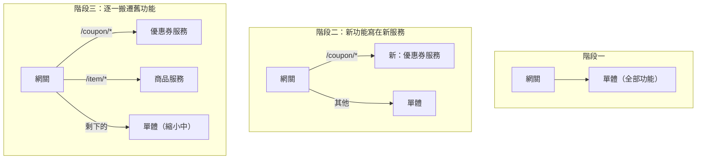
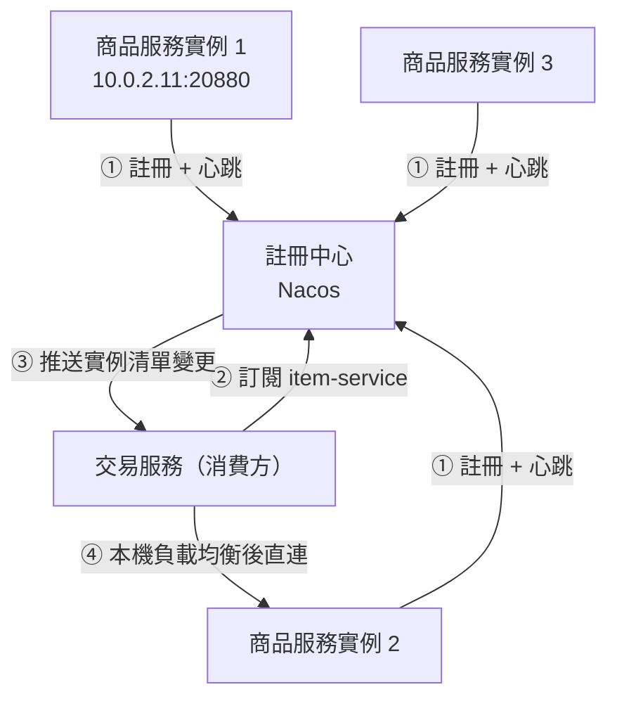
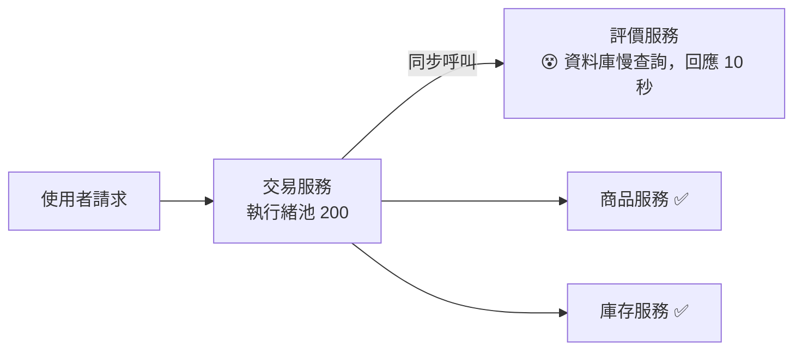
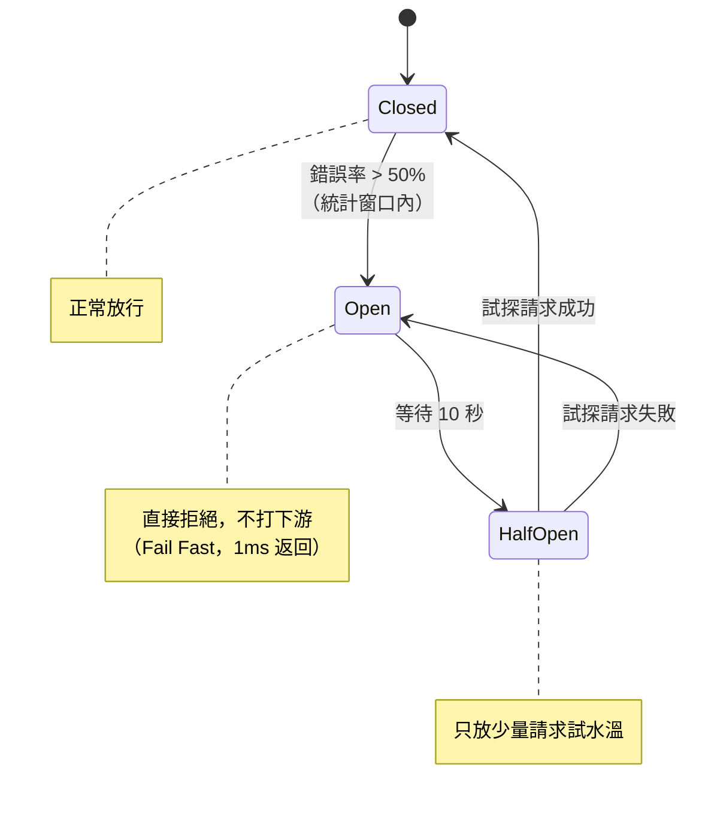

# 第五章　拆分單體：垂直應用與微服務抽離

> **本章場景**：120 萬行單一 repo、780 MB war、啟動 4 分鐘、兩週才能上線一次、80 人共用一條發版通道。
> 昨天一個報表功能 OOM，把同 JVM 的下單一起帶走，全站停擺 22 分鐘。
> 本章要回答：怎麼把這一大坨拆開，以及**拆開之後你要付出多少代價**（這部分業界講得太少）。

---

## 5.1 大應用拆小應用：業務邊界與 DDD 簡介

### 先確認你拆的動機

拆分的正當理由只有這幾個，其他都是藉口：

| 正當理由 | 對應要解決的痛 |
|---|---|
| **獨立發版** | 改一行文案不用等兩週、不用重啟全站 |
| **故障隔離** | 報表掛掉不能影響下單（縮小爆炸半徑） |
| **獨立擴容** | 大促時只把「下單」擴 10 倍，不用把後台也擴 10 倍 |
| **團隊自治** | 80 人分成 8 個小隊，各自對自己的服務負責 |
| **技術異構** | 搜尋用 Go、推薦用 Python、交易留 Java |

**不是正當理由**：「微服務比較潮」、「面試要寫」、「別人都在做」。
每拆一個服務，你就多了一份 CI/CD、一份監控、一份告警、一份容量規劃、一個 on-call 責任人。

### 第一刀：垂直拆分（按業務線切成幾個大應用）

**不要一步到位切成 50 個微服務。** 第一刀應該切得很粗：

```
shop.war (780 MB)
   ↓ 第一刀：垂直拆分成 4 個獨立部署的應用
shop-web.war      買家前台（商品瀏覽、購物車、下單）
shop-seller.war   賣家中心
shop-admin.war    營運後台   ← 昨天那個 OOM 的兇手，現在獨立了
shop-openapi.war  對外 API
```

成本極低（程式碼搬家 + 4 條發版流水線），收益立刻兌現：
**營運後台再 OOM，也只會影響營運自己。** 昨天那場 22 分鐘事故，永遠不會重演。

> **教學重點**：架構演進的效益極不均勻。
> 第一刀的「垂直拆分」是投入產出比最高的一步（幾天工作，消滅整類事故）；
> 而後面的「微服務化」投入產出比低得多。**先吃掉便宜的那一半。**

### 第二刀：識別真正的服務邊界

垂直拆分之後，你會發現 4 個應用裡有大量重複：
商品查詢邏輯在前台、賣家中心、後台各寫了一份，且**三份不一樣**。

這時才需要抽出真正的「服務」。怎麼切？這就是 **DDD（領域驅動設計）** 的價值。

#### DDD 的三個關鍵詞（架構師版，非完整版）

**① 限界上下文（Bounded Context）**：同一個詞在不同上下文有不同意義，這就是天然的邊界線。

> 「商品」這個詞：
> - 在**商品上下文**：是 SPU/SKU、標題、圖片、類目、屬性。
> - 在**交易上下文**：只需要 id、下單當下的標題與價格（**快照**）。
> - 在**庫存上下文**：只是一個 `sku_id` 與一個可用數量。
> - 在**搜尋上下文**：是一堆分詞後的 term 與權重。
>
> **它們不該共用同一個 `Item` 類別。** 硬要共用，就會產生一個有 80 個欄位、
> 每個上下文都只用其中 10 個的「上帝物件」——這正是單體腐化的主因。

**② 聚合根（Aggregate Root）**：一組必須一起變更、一起保證一致性的物件，
外界只能透過聚合根來操作。

> `Order`（聚合根）持有 `OrderItem`、`OrderAddress`。
> 你不能直接改 `OrderItem` 的數量——必須透過 `order.changeQuantity()`，
> 因為改數量要同時重算總價。**聚合根的邊界，就是本地事務的邊界。**
> 這一點極其重要：**一個事務只改一個聚合根**，這樣分庫時就不會產生跨庫事務。

**③ 通用語言（Ubiquitous Language）**：PM 說的、程式碼裡寫的、資料表叫的，用同一套詞。
PM 說「妥投」，程式碼裡卻叫 `status = 7`，這種翻譯損耗是 bug 的溫床。

#### 實務上的切分方法：事件風暴（Event Storming）

把 PM、開發、測試關進一間有大白牆的房間，貼便利貼：

```
① 先貼「領域事件」（橘色，過去式）
   訂單已建立 → 庫存已扣減 → 支付已完成 → 商品已出庫 → 包裹已簽收

② 再貼「命令」（藍色）與「執行者」
   [買家] 提交訂單 → 訂單已建立

③ 把相關的事件圈起來 → 圈出來的就是限界上下文
   ┌─交易─────┐ ┌─庫存─┐ ┌─支付───┐ ┌─物流───────┐
   │訂單已建立 │ │已扣減│ │已完成  │ │已出庫/已簽收│
   └──────────┘ └──────┘ └────────┘ └────────────┘
```

這個方法的價值在於：**邊界是被業務流程「自然折出來」的，不是架構師拍腦袋畫的。**

### 拆分順序：從邊緣開始，不要從核心開始

**絞殺榕模式（Strangler Fig Pattern）** 是安全改造單體的標準做法：



規則：
1. **新功能一律寫在新服務**，單體不再長大。
2. 搬遷順序：**先搬依賴最少的葉子節點**（優惠券、訊息通知），
   最後才動核心（交易、支付）。
3. 每搬一個，就**用網關切流量**（1% → 10% → 100%），隨時可以切回去。
4. **絕不做「大爆炸重寫」**。業界失敗案例的共通點都是：
   「我們花 18 個月重寫，上線那天全面切換」——然後公司差點沒了。

---

## 5.2 公共模組服務化：Dubbo / Spring Cloud RPC

### 從方法呼叫到遠端呼叫

拆開之後，原本的一行程式：

```java
Item item = itemService.getById(8899);   // 方法呼叫，0.0001 ms，永遠成功
```

變成：

```java
Item item = itemService.getById(8899);   // 長得一樣，但現在是網路呼叫
// 實際上：序列化 → TCP → 網路 → 反序列化 → 對方執行 → 再序列化回來 → 1~50 ms
// 而且它會：逾時、失敗、對方掛了、網路分區、回傳半個結果
```

**這是整本書最危險的一次「介面沒變，語意全變」。**
分散式運算的八大謬誤（Fallacies of Distributed Computing）就是在講這件事：

| 謬誤 | 真相 |
|---|---|
| 網路是可靠的 | 會斷、會丟包 |
| 延遲是零 | 同機房 0.5 ms，跨地域 60 ms |
| 頻寬無限 | 傳大物件會塞爆 |
| 網路是安全的 | 需要 mTLS、鑑權 |
| 拓撲不會變 | 服務隨時擴縮容、IP 隨時變 |
| 只有一個管理員 | 多團隊各自升級 |
| 傳輸成本為零 | 序列化吃 CPU |
| 網路是同質的 | 協議、版本、機房規格都不同 |

> **每一次 RPC 呼叫，都必須假設它會失敗。**
> 沒有 timeout 的 RPC 呼叫是定時炸彈；沒有重試策略的 RPC 是脆弱的；
> 有重試但沒有冪等的 RPC，會造成重複扣款。

### RPC vs REST

| | RPC（Dubbo / gRPC） | REST / HTTP+JSON |
|---|---|---|
| 協議 | 二進位（Dubbo、Protobuf） | 文字（JSON） |
| 效能 | 高（體積小、解析快） | 較低 |
| 可讀性 | 差（要工具） | 好（curl 就能測） |
| 跨語言 | gRPC 好、Dubbo 以 Java 為主 | 最好 |
| 契約 | IDL（.proto）強型別 | OpenAPI（較鬆） |
| 適用 | **內部服務之間**、高頻呼叫 | **對外開放 API**、前後端 |

**實務結論**：內部東西向流量用 RPC/gRPC，對外南北向流量用 REST/HTTP。
這也是為什麼會有 API Gateway（6.3 節）——它就是做這個協議轉換的。

### 兩大生態對照

| | Dubbo（Apache） | Spring Cloud |
|---|---|---|
| 通訊 | Dubbo 協議 / Triple(gRPC 相容) | HTTP（OpenFeign）/ gRPC |
| 註冊中心 | Zookeeper / **Nacos** | Eureka / Consul / **Nacos** |
| 配置 | Nacos / Apollo | Spring Cloud Config / Nacos |
| 熔斷限流 | **Sentinel** | Hystrix（已停更）/ Resilience4j |
| 網關 | 搭配 Higress / APISIX | Spring Cloud Gateway |
| 特色 | 效能好、治理細（分組/版本/路由規則） | 生態整合順、上手快 |

```java
// Dubbo：提供方
@DubboService(version = "1.0.0", timeout = 500, retries = 0)
public class ItemServiceImpl implements ItemService {
    public Item getById(long id) { ... }
}

// Dubbo：消費方
@DubboReference(version = "1.0.0", timeout = 500, retries = 0, check = false)
private ItemService itemService;
```

⚠️ **注意上面那兩個 `retries = 0`。** Dubbo 預設 `retries = 2`（總共呼叫 3 次），
對**查詢**是好事，對**寫入**是災難——網路逾時但對方其實成功了，重試就變成重複下單。

> **鐵律：所有寫操作，要嘛 `retries = 0`，要嘛保證冪等。**
> 冪等的標準做法是「業務唯一鍵 + 去重表」：
> ```java
> // 用 requestId 做唯一索引，重複請求直接被資料庫擋下
> INSERT INTO dedup(request_id, biz_type) VALUES (?, ?)   -- 撞唯一鍵 = 已處理過
> ```

### 介面設計的三條紀律

拆成服務之後，介面就是**公開契約**，改它的成本是改內部方法的 100 倍：

1. **只增不改不刪**：新增欄位可以（舊客戶端會忽略），改欄位意義與刪欄位不行。
   要淘汰就開 `v2`，並讓 `v1` 與 `v2` 並存到所有呼叫方遷移完。
2. **批次優先**：提供 `getByIds(List<Long>)` 而不只是 `getById(Long)`。
   不然呼叫方一定會寫出 for 迴圈打 100 次 RPC（N+1 問題的分散式版本，殺傷力更大）。
3. **粗粒度**：不要提供 `getItemTitle()`、`getItemPrice()` 這種細碎介面。
   一次回傳呼叫方需要的完整 DTO。**RPC 的成本在「呼叫次數」，不在「傳輸大小」。**

---

## 5.3 分散式協調：Zookeeper / Nacos 配置中心與服務發現

### 問題：服務的 IP 現在是會動的

拆之前，設定檔寫死 IP 就好。拆之後：
- 商品服務有 30 個實例，擴縮容時 IP 一直變。
- 某個實例掛了，呼叫方要在 **秒級** 內知道，不能繼續打過去。
- 20 個服務 × 4 套環境 × 200 個設定項，改一個要重啟多少機器？

### 服務發現



四個步驟是所有服務發現的通用模型，請記起來——
**第十章的 K8s Service、Istio，做的是同一件事，只是換了實作位置。**

注意第 ④ 步：**呼叫是直連的，註冊中心不在資料路徑上**。
這表示註冊中心掛掉時，已經拿到清單的服務**仍然能互相呼叫**（靠本機快取），
只是無法感知新的變化。這叫 **故障時的優雅降級**，是註冊中心設計的核心要求。

### CP 還是 AP：Zookeeper vs Nacos/Eureka

CAP 定理：在網路分區（P）發生時，只能在一致性（C）與可用性（A）之間選一個。

| | Zookeeper（CP） | Nacos AP 模式 / Eureka（AP） |
|---|---|---|
| 網路分區時 | **停止服務**，寧可不可用也不給錯資料 | **繼續服務**，可能回傳過期的實例清單 |
| 適合 | 分散式鎖、選主、元資料（必須正確） | **服務發現**（過期一下沒關係） |

> **服務發現應該選 AP。**
> 理由：拿到一個已下線的 IP，最壞結果是「一次呼叫失敗然後重試別台」——可以接受。
> 但註冊中心因為機房間網路抖動就整個拒絕服務，會導致**所有新啟動的服務都無法工作**，
> 這是災難級的。歷史上有名的大型故障，不少都是註冊中心選了 CP 造成的。
>
> Nacos 支援兩種模式：臨時實例走 AP（服務發現），持久化實例走 CP（元資料）。

### 配置中心

```java
@RefreshScope   // Spring Cloud：設定變更時自動刷新這個 Bean
@Component
public class PromotionConfig {
    @Value("${promotion.seckill.enabled:false}")
    private boolean seckillEnabled;

    @Value("${promotion.max-qps:1000}")
    private int maxQps;
}
```

配置中心的價值遠超過「不用重啟」：

| 能力 | 實戰價值 |
|---|---|
| 動態生效 | 半夜出事，改個開關 3 秒生效，不用發版 |
| **功能開關（Feature Flag）** | 新功能先上線但關閉，確認沒問題再逐步開給 1%/10%/100% 使用者 |
| **降級開關** | 大促時一鍵關閉「猜你喜歡」，把資源全留給下單（第 5.4 節） |
| 灰度發布 | 按環境/機器/使用者分組下發不同設定 |
| 版本與回滾 | 改錯了一鍵回上一版 |
| 審計 | 誰在什麼時候改了什麼（事故覆盤必備） |

> **功能開關（Feature Flag）是被低估的架構能力。**
> 它把「發布（deploy）」與「啟用（release）」分開：
> 程式碼可以天天上線，但功能什麼時候對使用者開放，是一個設定的事。
> 這讓回滾從「重新部署 20 分鐘」變成「改一個布林值 3 秒」。
> 這個思想在第十三章的 GitOps 與第十二章的漸進式交付會再出現。

### 分散式鎖與選主

Zookeeper 的另一個經典用途。它的 **臨時順序節點（ephemeral sequential node）** 天生適合：

```
/locks/order_123/
    ├── lock-0000000001   ← 我是最小的，我拿到鎖
    ├── lock-0000000002   ← 監聽前一個節點，它消失了就輪到我
    └── lock-0000000003
```
Session 斷線時臨時節點自動刪除 → **鎖自動釋放，不會死鎖**。這比 Redis 鎖安全，但較慢。

| 需求 | 建議 |
|---|---|
| 高頻、可容忍極小機率失效 | Redis（Redisson RLock） |
| 低頻、絕不可失效（選主、排程唯一執行） | **Zookeeper / etcd** |

> **K8s 自己就用 etcd 做選主**（`kube-controller-manager` 的 leader election）。
> 你在第九章看到的 K8s Control Plane 高可用，用的就是這一節的原理。

---

## 5.4 微服務三板斧：限流、熔斷與降級

### 為什麼非做不可：雪崩效應



評價服務只是「顯示商品有幾則評價」，一個無關緊要的功能。但是：

```
評價服務回應時間 10s
  → 交易服務每個請求卡 10 秒
  → 交易服務 200 個執行緒在 20 秒內全部被佔滿
  → 交易服務無法處理任何新請求（包括不需要評價的下單！）
  → 上游網關的執行緒也被交易服務拖住
  → 整站掛掉
```

**一個最不重要的服務，害死了整個系統。** 這就是**雪崩效應（Cascading Failure）**，
是微服務架構最經典、也最致命的故障模式。

單體架構沒有這個問題（方法呼叫不會卡 10 秒）。**這是你為「拆分」付出的代價之一。**

### 板斧一：限流（Rate Limiting）—— 保護自己不被打死

| 演算法 | 原理 | 特點 |
|---|---|---|
| 固定窗口計數 | 每秒計數，超過就拒 | 簡單；**臨界問題**（第 0.9 秒與 1.1 秒各放行 N 個 = 瞬間 2N） |
| 滑動窗口 | 細分小格子滑動統計 | 平滑，記憶體稍多 |
| **漏桶 Leaky Bucket** | 固定速率流出 | **強制勻速**，削峰但不允許突發 |
| **令牌桶 Token Bucket** | 固定速率放令牌，取到才放行 | **允許一定突發**，最常用 |

```java
// Sentinel：宣告式限流 + 降級
@SentinelResource(value = "getItemDetail",
                  blockHandler = "onBlock",     // 被限流時走這裡
                  fallback = "onFallback")      // 拋異常時走這裡
public ItemVO getItemDetail(long id) { ... }

public ItemVO onBlock(long id, BlockException ex) {
    return ItemVO.simplified(id);      // 回精簡版，不是回錯誤
}
public ItemVO onFallback(long id, Throwable t) {
    return localCache.getIfPresent(id);   // 回舊資料
}
```

**限流要限在哪一層？** 答案是**每一層都要**，而且越靠近入口越好：

```
CDN/WAF（擋惡意流量） → 網關（按 API/使用者限流）
    → 服務入口（按來源服務限流） → 資源（DB 連線池、執行緒池隔離）
```

### 板斧二：熔斷（Circuit Breaker）—— 保護下游，也保護自己

概念直接借用電路的保險絲：**下游持續失敗時，直接不打了，快速失敗。**



熔斷帶來兩個好處：
1. **自己活下來**：不再有執行緒卡在等待，10 秒的等待變成 1 毫秒的失敗。
2. **讓下游有機會恢復**：下游正在垂死掙扎時，最後一件需要的就是你繼續打它。
   停止流量是給它喘息的空間——**這是熔斷最常被忽略的價值**。

### 板斧三：降級（Degradation）—— 決定「壞掉的時候顯示什麼」

熔斷之後回什麼？這是**業務決策，不是技術決策**：

| 服務 | 正常 | 降級後 |
|---|---|---|
| 評價數 | 「3,421 則評價」 | 直接不顯示這一塊 |
| 猜你喜歡 | 個人化推薦 | 靜態熱銷榜 |
| 商品詳情 | 即時資料 | 快取的舊資料（標「資料可能延遲」） |
| 庫存 | 精確剩餘 | 「有貨/無貨」 |
| **下單** | 正常 | **不可降級** —— 這是核心，寧可限流也不降級 |

**服務分級是降級的前提**，大促前必做：

| 等級 | 定義 | 範例 | 大促策略 |
|---|---|---|---|
| **P0 核心** | 掛了就沒生意 | 下單、支付、庫存、登入 | 資源優先，絕不降級，獨立資源池 |
| **P1 重要** | 影響體驗 | 商品詳情、搜尋、購物車 | 可降級到快取版 |
| **P2 一般** | 錦上添花 | 評價、推薦、瀏覽記錄 | **大促前直接關掉** |
| **P3 後台** | 內部使用 | 報表、營運後台 | 大促期間停用 |

> **大促的本質不是「讓系統能扛所有流量」，而是「決定放棄什麼」。**
> 有限的 CPU 與資料庫連線，只能拿去做最賺錢的事。
> 雙十一零點那一刻，淘寶的很多次要功能是被主動關閉的——這是設計，不是故障。

### 三板斧的關係

| | 限流 | 熔斷 | 降級 |
|---|---|---|---|
| 針對 | **上游流量太大** | **下游故障** | 任何異常 |
| 動作 | 拒絕超額請求 | 停止呼叫下游 | 回傳兜底內容 |
| 比喻 | 餐廳滿了就不收客 | 供應商出事就不進貨 | 沒有牛肉就上雞肉 |

**降級是「結果」，限流與熔斷是「觸發原因」。** 三者要一起設計。

### 隔離：第四板斧（常被漏掉）

即使有熔斷，熔斷觸發前的那幾秒仍可能打滿執行緒。徹底的解法是**艙壁隔離（Bulkhead）**：

```java
// 不同下游用不同的執行緒池，一個滿了不影響其他
ExecutorService reviewPool = Executors.newFixedThreadPool(20);   // 評價：最多佔 20
ExecutorService itemPool   = Executors.newFixedThreadPool(50);   // 商品：50
// 評價服務再慢，最多也只卡住 20 個執行緒，剩下 180 個照常服務
```

名字來自船的隔艙：**一個艙進水，不會沉船。**

---

## 本章代價與下一章的痛

**我們做了什麼**：垂直拆分 → DDD 找邊界 → 絞殺榕漸進遷移 → RPC + 註冊中心 + 配置中心 → 三板斧。

**我們買進的新問題**（這是全書最貴的一次交易）：

| 新問題 | 說明 |
|---|---|
| 呼叫鏈變長 | 一個首頁請求扇出到 30+ 個服務，P99 是所有依賴中最慢的那個 |
| 雪崩風險 | 必須為每個 RPC 設 timeout / 熔斷 / 降級，一個漏掉就是全站事故 |
| 除錯困難 | 使用者說「慢」，你要查 30 個服務的 log（第 13.2 節的伏筆） |
| 分散式事務 | 第 4.4 節的問題全面爆發 |
| 介面版本管理 | 20 個服務互相依賴，升級要編排順序 |
| **運維物件從 4 個變 40 個** | **這就是下一章的重點** |

**新的痛點**：現在有 40 個服務、每個 3–20 個實例，共約 300 個進程。而且：

- 搜尋團隊想用 Go 重寫，運維說「我們的機器只裝了 JDK8」
- 推薦團隊要 Python 3.11 + PyTorch，跟同機器的服務套件版本衝突
- 新同事 build 失敗，查了兩天發現是本機 JDK 小版本不同
- 擴容一台要：申請機器 → 裝 JDK → 裝 agent → 改 Nginx upstream → reload
- **上線一次 40 個服務要 6 小時，還經常「測試環境好好的，生產就掛」**

下一章先把資料與訊息這兩塊補完，然後在 6.4 節，我們會把這個地獄完整攤開——
那就是 Docker 誕生的理由。

下一章：[第六章　多樣化數據與服務治理](06-多樣化數據與服務治理.md)。

---

## 名詞速查

| 名詞 | 一句話 |
|---|---|
| 限界上下文 | 同一個詞意義不同的地方，就是服務的邊界 |
| 聚合根 | 必須一起變更的一組物件的入口；本地事務的邊界 |
| 絞殺榕模式 | 新功能寫新服務、舊功能逐一搬遷，避免大爆炸重寫 |
| 分散式運算八大謬誤 | 網路可靠、延遲為零…全部是錯的 |
| CAP / AP vs CP | 分區時選可用性還是一致性；服務發現該選 AP |
| 功能開關 Feature Flag | 把「部署」與「啟用」分離的設定開關 |
| 雪崩效應 | 一個小服務故障沿呼叫鏈拖垮整站 |
| 熔斷三態 | Closed → Open → Half-Open |
| 艙壁隔離 Bulkhead | 每個下游用獨立執行緒池，故障不擴散 |
| 冪等 | 同一請求執行多次，結果與一次相同 |
