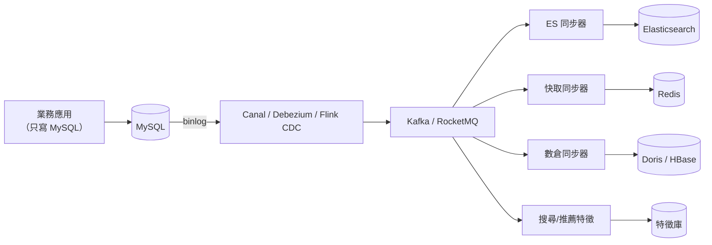
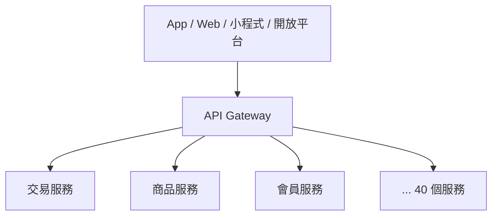
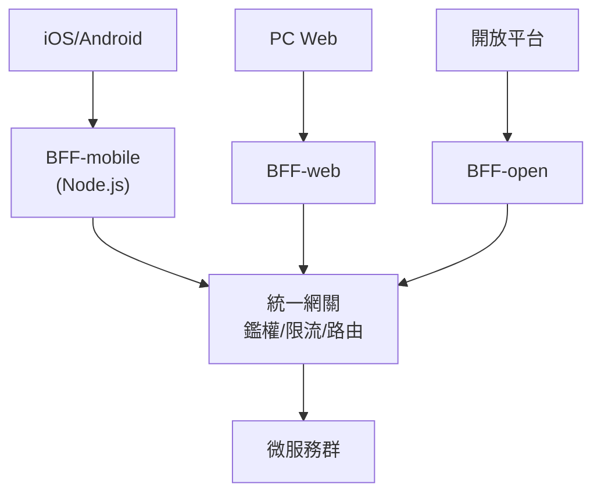

# 第六章　多樣化數據與服務治理

> **本章場景**：40 個服務、約 300 個進程、5 種語言想並存。
> 本章前三節補完「資料」與「通訊」的最後拼圖，
> **6.4 節則是全書的轉折點**——我們會把運維地獄完整攤開，讓 Docker 的必要性自己浮出來。

---

## 6.1 異構儲存：HDFS / HBase / Elasticsearch / 大數據場景

### 關聯式資料庫做不動的四類需求

| 需求 | 為什麼 MySQL 不行 |
|---|---|
| **全文搜尋**「無線 藍牙 耳機 降噪」 | `LIKE '%耳機%'` 無法走索引、無法分詞、無法算相關性排序 |
| **海量日誌/行為資料** 每天 500 億條 | 寫入吞吐與儲存成本都無法承受 |
| **超寬稀疏資料** 商品有 3,000 種屬性但每件只用 20 種 | 3,000 個欄位的表是災難 |
| **離線批次計算** 掃 3 年訂單算使用者畫像 | 一跑就把線上庫打死 |

### 「一種資料庫打天下」的時代結束了

這叫 **多語言持久化（Polyglot Persistence）**：**按查詢模式選儲存，而不是按習慣選**。

| 儲存 | 資料模型 | 強項 | 電商場景 |
|---|---|---|---|
| **MySQL** | 關聯式 | 事務、一致性 | 訂單、庫存、金流 |
| **Redis** | K-V + 資料結構 | 極低延遲 | 快取、排行榜、分散式鎖、計數 |
| **Elasticsearch** | 倒排索引 | 全文檢索、聚合分析 | 商品搜尋、日誌檢索 |
| **HBase** | 寬列（LSM Tree） | 海量寫入、按 rowkey 隨機讀 | 使用者行為、訂單歸檔、風控特徵 |
| **MongoDB** | 文件 | 彈性 schema | 商品詳情、內容 |
| **HDFS / OSS** | 分散式檔案/物件 | 便宜、海量 | 資料湖、圖片、離線數據 |
| **ClickHouse / Doris** | 列式 MPP | 聚合分析 | 即時報表、BI |
| **圖資料庫 Neo4j** | 圖 | 關係遍歷 | 風控關聯、社交推薦 |

### Elasticsearch：搜尋為什麼要倒排索引

```
正排索引（MySQL 的思路）：文件 → 詞
  doc1 → "藍牙 無線 耳機 降噪"
  doc2 → "有線 耳機 入耳式"
  查「耳機」要掃描全部文件 ❌

倒排索引（ES 的思路）：詞 → 文件
  "耳機" → [doc1, doc2, doc9, ...]
  "降噪" → [doc1, doc7, ...]
  查「耳機 AND 降噪」→ 兩個清單取交集，極快 ✅
```

再加上 **TF-IDF / BM25** 算相關性分數，就能做「相關度排序」——
這是 `LIKE` 永遠做不到的。

### 資料同步：異構儲存的核心工程問題

有了 6 種儲存，最大的問題不是選型，是**怎麼保持它們同步**。

**反模式（請勿模仿）**：

```java
@Transactional
public void createOrder(Order o) {
    orderMapper.insert(o);            // MySQL
    esClient.index(o);                // ES     ← 失敗了怎麼辦？
    hbaseClient.put(o);               // HBase  ← 事務回滾了它也不會回滾
    redis.del("user:orders:" + uid);  // Redis
}
```

這段程式有三個致命問題：把不可靠的外部呼叫塞進資料庫事務（拉長鎖時間）、
沒有任何一個失敗是可恢復的、而且每加一個下游就要改一次業務程式。

**正確做法：CDC + 訊息匯流排**



| 好處 | 說明 |
|---|---|
| **業務程式碼零負擔** | 應用只管寫 MySQL，一行同步程式都不用寫 |
| **順序正確** | binlog 是資料庫的權威變更序列 |
| **可補資料** | 從某個位點重放 binlog，就能重建下游 |
| **新增下游零成本** | 明天要加一個 AI 特徵庫？加一個消費者就好，不用碰業務系統 |

最後一點是**架構彈性**的典範：**把「資料變更」變成一個可訂閱的公共事件流之後，
擴充新能力的成本從「改所有寫入方」降為「加一個訂閱者」。**

### Lambda 與 Kappa 架構

| | Lambda | Kappa |
|---|---|---|
| 組成 | 離線批次層 + 即時串流層 + 服務層 | 只有串流層，重算就重放歷史訊息 |
| 優點 | 批次結果精確，可修正 | **只維護一套程式碼與邏輯** |
| 缺點 | **同一套業務邏輯要寫兩遍**（批 + 流），永遠不一致 | 重放歷史成本高 |
| 趨勢 | 逐漸被取代 | Flink + Kafka 成熟後成為主流 |

> Lambda 的「同一個指標寫兩套程式、算出兩個不同的數字」是資料團隊的經典痛苦。
> 現代做法（流批一體 / 湖倉一體）就是在消滅這件事。

---

## 6.2 訊息佇列：RocketMQ / Kafka 非同步解耦與削峰

訊息佇列是分散式系統裡用途最廣的元件，它只做三件事，但每件都極重要。

### 用途一：解耦

```java
// 😱 耦合版：下單要同步做 8 件事
public void createOrder(Order o) {
    orderMapper.insert(o);
    inventoryService.deduct(o);     // 扣庫存
    couponService.use(o);           // 核銷優惠券
    pointService.add(o);            // 加積分
    smsService.send(o);             // 簡訊
    riskService.check(o);           // 風控
    searchService.update(o);        // 更新搜尋
    bigDataService.report(o);       // 數據上報
}
// 耗時 = 8 個服務相加；任一個掛，訂單就下不了；新增需求就要改這段程式
```

```java
// ✅ 解耦版
@Transactional
public void createOrder(Order o) {
    orderMapper.insert(o);
    inventoryService.deduct(o);            // 只保留「必須同步」的
}
// 事務提交後發一個事件
mq.send("ORDER_CREATED", o);
// 積分、簡訊、搜尋、數據…各自訂閱，各自失敗各自重試，互不影響
```

**判斷標準**：這一步失敗，訂單該不該建立不成功？

| 步驟 | 同步 or 非同步 |
|---|---|
| 扣庫存 | **同步**（失敗就不能下單） |
| 核銷優惠券 | **同步** |
| 加積分 / 簡訊 / 更新搜尋 / 數據上報 | **非同步**（晚 3 秒沒人在意） |

從「8 個服務都要活著才能下單」變成「2 個服務活著就能下單」，
**可用性從 0.99^8 = 92% 變成 0.99^2 = 98%。**

### 用途二：削峰填谷

秒殺場景：1 秒湧入 50 萬請求，但資料庫只能處理 2,000 TPS。

```
不用 MQ：50 萬請求 → DB → 💥 直接打死

用 MQ：  50 萬請求 → MQ（瞬間吸收，寫入是順序 I/O，極快）
                       ↓ 消費者按 2,000 TPS 穩定消費
                     DB ✅ 全程健康
         使用者看到：「排隊中，請稍候」→ 3 秒後告知結果
```

**代價**：使用者體驗從「同步立即知道結果」變成「非同步稍後知道」。
這是**產品與架構的共同決策**，不是工程師能單方面決定的。
（秒殺場景下，使用者其實很能接受排隊——這是產品設計幫了架構的忙。）

### 用途三：廣播 / 事件驅動

一個事件，N 個訂閱者，發布方完全不知道有誰在聽。
**這是系統可擴充性的關鍵**：新增功能不用改老系統。

### Kafka vs RocketMQ vs RabbitMQ

| | Kafka | RocketMQ | RabbitMQ |
|---|---|---|---|
| 定位 | 日誌/串流平台 | **業務訊息** | 傳統企業訊息 |
| 吞吐 | 極高（百萬級/秒） | 高（十萬級） | 中 |
| 延遲 | 毫秒~數十毫秒 | 毫秒 | 微秒~毫秒 |
| **事務訊息** | 有（跨分區原子寫） | **有（半訊息 + 回查，業務友善）** | 無 |
| 延遲/定時訊息 | 需自建 | **原生支援** | 插件 |
| 訊息回溯 | 按 offset | 按 offset / **時間戳** | 弱 |
| 順序保證 | 分區內有序 | 分區內有序 + **順序訊息** | 佇列內有序 |
| 適合 | 日誌、埋點、CDC、數據管線 | **電商交易鏈路** | 中小規模、複雜路由 |

### 訊息系統的三個必考題

#### ① 訊息丟失怎麼辦

丟失可能發生在三個環節，各自要防：

```
生產者 →[1]→ Broker →[2]→ 磁碟 →[3]→ 消費者
```

| 環節 | 防護 |
|---|---|
| [1] 發送 | 用同步發送 + 確認；或用**本地訊息表/事務訊息**保證「業務成功則訊息必發」 |
| [2] 儲存 | 多副本（`replication.factor=3`）+ `acks=all`；刷盤策略（同步刷盤更安全但慢） |
| [3] 消費 | **業務處理成功後才提交 offset**（絕不能收到就提交） |

#### ② 重複消費怎麼辦

**必然會重複。** 因為「處理成功」與「提交 offset」之間一定有時間差，
消費者在這個縫隙裡掛掉，重啟後就會重放。

**所以：消費端必須冪等，這不是選項，是義務。**

```java
// 冪等的三種標準做法
// (a) 資料庫唯一索引 —— 最可靠
INSERT INTO point_log(order_id, points) VALUES (?, ?);  -- order_id 唯一鍵，重複直接失敗

// (b) 狀態機 —— 只允許合法躍遷
UPDATE `order` SET status='PAID' WHERE id=? AND status='UNPAID';  -- 影響 0 列即已處理

// (c) 去重表 / Redis SETNX —— 通用
if (!redis.set("msg:" + msgId, "1", "NX", "EX", 86400)) return;  // 已處理過
```

#### ③ 訊息堆積怎麼辦

```bash
# 消費者處理不過來，Lag 一路飆到 800 萬
```

| 原因 | 處置 |
|---|---|
| 消費者掛了 | 修復 + 重啟，靠 MQ 的持久化補回來（**這正是 MQ 的價值**） |
| 消費太慢 | 加消費者（**上限 = 分區數**，所以分區數要預留） |
| 分區數不夠 | 臨時方案：消費後轉寫到新 topic（更多分區）再消費 |
| 有毒訊息（處理必失敗） | **死信佇列 DLQ**，重試 N 次後丟進 DLQ 人工處理，不要卡住整條線 |

> **分區數是 Kafka 最重要的容量規劃參數**：消費者併發度的上限就是分區數。
> 一開始設 4 個分區，事後想擴到 32 個消費者？做不到，只能重建 topic。
> 實務建議：按「預期峰值吞吐 ÷ 單消費者吞吐 × 2~3 倍餘量」預留。

---

## 6.3 ESB 與 API Gateway：統一協議與路由

### 痛點：40 個服務各自為政

沒有統一入口時，每個服務都要自己實作：

```
鑑權、限流、日誌、監控、CORS、協議轉換、灰度、防重放、簽章驗證…
× 40 個服務 = 寫 40 遍，而且每個團隊的實作都不一樣、都有 bug
```

而且 App 端要打 40 個不同的網址，每次服務拆分或遷移，**客戶端都要跟著改並重新送審**。

### ESB（企業服務匯流排）：SOA 時代的答案

```
系統 A ↘                    ↗ 系統 D
系統 B → [ESB：路由/轉換/編排] → 系統 E
系統 C ↗                    ↘ 系統 F
```

ESB 的理念是把「協議轉換 + 訊息路由 + 流程編排」集中在一個匯流排上。
它在企業內部整合（SAP、Oracle、老系統）確實有效，但在網際網路場景失敗了：

| ESB 的問題 | 說明 |
|---|---|
| **智慧集中化** | 業務邏輯被寫進匯流排的設定裡，變成沒人敢動的黑盒 |
| **效能瓶頸** | 所有流量穿過同一個重型元件 |
| **開發效率低** | 改一個流程要動 ESB，要專門的 ESB 團隊排期 |

> 微服務對此的回應是一句名言：
> **「Smart endpoints and dumb pipes（智慧在端點，管道要笨）」**。
> 業務邏輯留在服務裡，中間的管道只管傳輸與通用治理。
> **API Gateway 就是一根「刻意保持笨」的管道。**

### API Gateway 的職責邊界



| ✅ 該做（通用、無業務語意） | ❌ 不該做（業務邏輯） |
|---|---|
| 鑑權（驗 token，解出 uid） | 判斷「這個使用者能不能買這件商品」 |
| 限流、熔斷 | 計算訂單金額 |
| 路由、負載均衡 | 編排「下單→扣庫存→發券」流程 |
| 協議轉換（HTTP ↔ gRPC/Dubbo） | 資料格式的業務轉換 |
| 日誌、鏈路追蹤注入 traceId | 業務審計 |
| 灰度發布、A/B 分流 | 業務規則的 A/B |
| 安全：WAF、防重放、簽章 | |

**一旦你在網關寫 if-else 判斷業務，你就在重造 ESB。** 這是實務上最常見的滑坡。

### BFF：給每個前端一個專屬網關

App、Web、小程式需要的資料組合不同。讓一個網關滿足所有人，它就會長成 ESB。



**BFF（Backend For Frontend）** 由**前端團隊自己維護**，負責「聚合與裁剪」：
一個 App 首頁需要 8 個服務的資料，BFF 併發呼叫後組成一個回應，
讓 App 只發一次請求（對行動網路極重要）。

> 這就是第 16.4 節「Node.js Serverless 核心鏈路」的前身：
> BFF 天生流量波動大、邏輯輕、無狀態——**是 Serverless 的完美場景**。

### 主流網關對照

| 網關 | 基礎 | 特點 |
|---|---|---|
| Nginx + Lua (OpenResty) | Nginx | 效能極高，開發成本高 |
| Kong | OpenResty | 插件生態豐富 |
| APISIX | OpenResty + etcd | **動態設定、高效能** |
| Spring Cloud Gateway | Netty/Reactor | Java 生態整合好 |
| **Envoy** | C++ | **雲原生標準資料面**（第十章主角） |
| **Higress** | Envoy + Istio + Nginx Ingress 相容 | 雲原生網關，K8s Ingress/AI 場景（第十六章） |

---

## 6.4 傳統微服務運維地獄：環境不一致與部署死胡同

> **全書的轉折點。** 前面 13 步我們一直在「把系統拆開」，
> 系統的**邏輯架構**已經非常先進了。但**運維方式還停在 2005 年**。
> 這一節不介紹任何新技術，只誠實記錄一天的生活。

### 現況盤點

```
40 個微服務
  × 平均 8 個實例        = 320 個進程
  × 4 套環境（開發/測試/預發/生產）
  ≈ 1,200 個需要管理的部署單元

技術棧：Java 8、Java 11、Java 17、Go 1.21、Python 3.9、Python 3.11、Node 16、Node 20
基礎設施：180 台實體/虛擬機，每台跑 2~6 個服務
```

### 地獄之一：「在我電腦上是好的」

```
週二 14:30  工程師 A：功能完成，本機測試通過 ✅
週二 15:00  推到測試環境 → 啟動失敗
            java.lang.NoSuchMethodError: com.google.common.base.Preconditions...
週二 17:00  查了兩小時：測試機的 /opt/lib 有個 2019 年裝的舊版 guava
            被某個共用啟動腳本加進了 classpath
週三 10:00  修好了。推到預發 → 又掛
            預發機是 JDK 8u181，本機是 8u351，某個 TLS 行為不同
週三 16:00  推到生產 → 40 台機器裡有 3 台失敗
            那 3 台是去年臨時擴容的，OS 版本、glibc、時區設定都跟別人不同
```

**根因**：軟體不是只有「你寫的程式碼」。它真正依賴的是：

```
你的程式碼
+ 執行環境（JDK/Python/Node 的精確版本）
+ 系統函式庫（glibc、openssl、時區資料庫、字型）
+ OS 設定（ulimit、核心參數、hosts、DNS、locale）
+ 環境變數、設定檔位置、檔案權限
+ 機器上其他程式留下的殘骸
```

**傳統部署只搬運了第一項，其餘全靠「祈禱各台機器長得一樣」。**
而機器永遠不會長得一樣——這叫**組態漂移（Configuration Drift）**：
每一次手動 SSH 上去改東西，都讓那台機器變得更獨特一點。
運行三年之後，你的 180 台機器就是 180 個雪花（snowflake servers），沒有兩片相同。

### 地獄之二：依賴衝突與資源打架

一台機器上跑 4 個服務：

```
搜尋服務    需要 Go 1.21
推薦服務    需要 Python 3.11 + PyTorch 2.x + CUDA 12
交易服務    需要 JDK 17
老報表      需要 JDK 8（用了已移除的 API，不能升）
```

一台機器上同時裝 JDK 8 和 17、兩個 Python 版本、一堆 `LD_LIBRARY_PATH`——
**這種機器沒人敢重裝，因為沒人知道完整的裝機步驟。**

而且它們**互相沒有資源隔離**：推薦服務的模型載入吃掉 40 GB 記憶體，
OOM Killer 隨手殺掉了交易服務。**回到第 1.2 節那個問題，只是規模大了 40 倍。**

### 地獄之三：擴容是人肉工程

大促前要把交易服務從 8 個實例擴到 40 個：

```
1. 提工單申請 32 台 VM              等 2 天
2. 裝 JDK、agent、監控、log 收集器   每台 20 分鐘 × 32 = 10.7 小時
   （腳本會跑失敗，因為 apt 源掛了 / 有台機器磁碟分區不同）
3. 部署應用、改設定檔                2 小時
4. 改 Nginx upstream，加 32 行       10 分鐘
5. nginx -s reload                   1 分鐘
6. 加監控、加告警規則                1 小時
7. 大促結束後，重複上述步驟「反過來做」一遍才能省錢
   （通常沒人做，機器就這樣閒置到明年）
```

**總計：3 天 + 大量人力，且每一步都可能出錯。**
更糟的是這件事**無法在流量突增時即時完成**——等你擴完，大促已經結束了。

### 地獄之四：發布沒有原子性，回滾靠運氣

```bash
# 典型的發布腳本
for host in $(cat hosts.txt); do
    ssh $host "cd /opt/app && ./stop.sh"
    scp app.jar $host:/opt/app/
    ssh $host "cd /opt/app && ./start.sh"
    sleep 30              # 祈禱 30 秒夠它啟動
done
```

問題清單：
- 第 17 台失敗了 → 現在 16 台新版、24 台舊版，**而且沒人知道是哪 16 台**。
- 要回滾？舊的 jar 還在嗎？某台機器上是 `app.jar.bak`，另一台是 `app-20250912.jar`。
- `sleep 30` 是什麼依據？沒有。**沒有健康檢查，只有時間。**
- 期間有使用者請求被打到「已停止但還在 upstream 裡」的機器 → 502。

### 地獄之五：資源利用率極低

```
180 台機器的平均 CPU 使用率：8%
為什麼不裝滿？因為：
  - 怕互相影響（沒有隔離）
  - 要留足峰值餘量（沒有彈性伸縮）
  - 服務與機器綁定（沒有調度器）
```

**你買了 100% 的機器，用了 8%。** 這筆錢在第十三章 FinOps 會再算一次。

### 攤開來看：我們到底缺什麼

把上面五個地獄歸納，缺的東西其實非常清楚：

| # | 痛點 | 我們真正需要的能力 | 誰來解決 |
|---|---|---|---|
| 1 | 環境不一致 | **把「程式 + 完整執行環境」打包成一個不可變的單元** | **Docker 鏡像**（第七章） |
| 2 | 依賴衝突、資源打架 | **在同一台機器上互相隔離地執行** | **容器（namespace + cgroup）**（第七章） |
| 3 | 擴容靠人肉 | **一條指令就能長出 N 個一模一樣的實例** | **容器 + 編排**（第九、十一章） |
| 4 | 發布無原子性、回滾困難 | **宣告式的版本管理、自動健康檢查、一鍵回滾** | **K8s Deployment**（第九章） |
| 5 | 服務 IP 變動要改 Nginx | **自動服務發現與流量接管** | **K8s Service / Ingress**（第十章） |
| 6 | 資源利用率 8% | **把機器變成一個資源池，由調度器決定誰跑在哪** | **K8s Scheduler**（第九、十三章） |

> **請留意最右欄——它就是本書後半的目錄。**
>
> Docker 與 Kubernetes 不是因為「先進」才被發明，
> 是因為 **2005 年的運維方式，撐不住 2015 年的微服務數量**。
>
> 微服務讓部署單元從 1 個變成 400 個。當數量增加 400 倍時，
> **「靠人與腳本管理伺服器」這個模式，在數學上就已經破產了。**
> 你需要的不是更勤勞的運維，而是**一個能替你做決策的系統**。

這就是第四篇與第五篇要講的事。

下一章：[第七章　打破部署地獄：Docker 容器技術登場](07-Docker容器技術登場.md)。

---

## 名詞速查

| 名詞 | 一句話 |
|---|---|
| 多語言持久化 | 按查詢模式選儲存，不用一種資料庫打天下 |
| 倒排索引 | 詞 → 文件的映射，全文檢索的基礎 |
| CDC | 變更資料捕獲；訂閱 binlog 同步到異構儲存 |
| Lambda / Kappa | 批流雙套 / 只有串流的資料架構 |
| 削峰填谷 | 用 MQ 吸收流量尖峰，下游按自身速度消費 |
| 死信佇列 DLQ | 重試多次仍失敗的訊息的隔離區 |
| ESB vs API Gateway | 智慧管道（已過時） vs 笨管道 + 智慧端點 |
| BFF | 為特定前端聚合裁剪資料的專屬後端 |
| 組態漂移 / 雪花伺服器 | 手動變更累積導致每台機器都獨一無二 |
