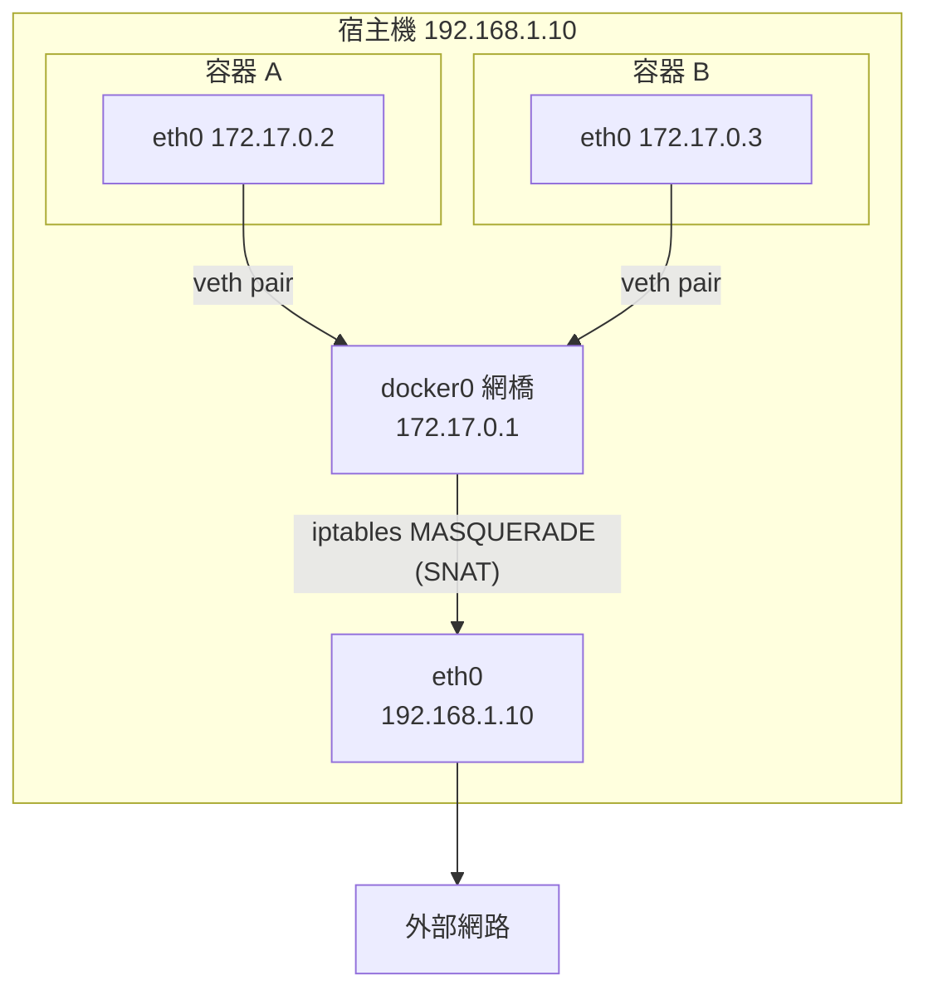

# 第八章　Docker 網路與儲存管理

> **本章場景**：服務都容器化了，立刻撞上兩件事——
> 容器之間怎麼連？資料放哪才不會被刪掉？
> 8.3 節則會證明：**單機容器化走到盡頭了，非上編排不可。**

---

## 8.1 Docker 網路模型：Bridge / Host / Overlay

### 容器的網路從哪來

每個容器有自己的 **NET namespace**：獨立的網卡、IP、路由表、iptables 規則、port 空間。
所以兩個容器都可以監聽 8080，互不衝突——**因為那是兩個不同的 8080**。

### 四種網路模式

| 模式 | 說明 | 用途 |
|---|---|---|
| **bridge**（預設） | 接到虛擬網橋 `docker0`，容器有私有 IP，出外走 NAT | 單機大部分場景 |
| **host** | **不做網路隔離**，直接用宿主機網路堆疊 | 極致效能、需要抓宿主網卡（監控 agent） |
| **none** | 只有 loopback | 完全隔離的批次運算 |
| **overlay** | **跨主機**的虛擬二層網路（VXLAN 封裝） | 多機集群（Swarm / K8s 的前身思路） |

### bridge 模式的封包路徑



- **容器 → 容器**（同主機）：走 `docker0` 網橋，二層直達。
- **容器 → 外網**：經 `docker0` → iptables SNAT 偽裝成宿主 IP 出去。
- **外網 → 容器**：**必須做 port 映射**（`-p 8080:8080`），
  底層是 iptables DNAT 規則把宿主的 8080 轉到容器的 8080。

```bash
# 親眼看見那條規則
$ sudo iptables -t nat -L DOCKER -n
DNAT  tcp -- 0.0.0.0/0  0.0.0.0/0  tcp dpt:8080 to:172.17.0.2:8080
```

### 預設 bridge vs 自訂 bridge：一個關鍵差異

```bash
docker run -d --name redis redis:7.2         # 預設 bridge
docker run -it alpine ping redis             # ❌ ping: bad address 'redis'

docker network create backend                # 自訂 bridge
docker run -d --name redis --network backend redis:7.2
docker run -it --network backend alpine ping redis   # ✅ 通！
```

> **自訂網路才有內建 DNS（服務名解析）。** 預設 `bridge` 沒有。
> 所以 Compose 一定會幫你建自訂網路——這也是 7.4 節「服務名即主機名」能運作的原因。

**永遠不要用容器 IP 互連**：容器重啟後 IP 會變。**一律用名字。**
這個「用名字而非 IP」的紀律，正是第十章 K8s Service 的核心價值。

### port 映射的三個細節

```bash
-p 8080:8080          # 綁 0.0.0.0，外網可直接存取 ⚠️
-p 127.0.0.1:8080:8080 # 只綁 localhost，安全得多（資料庫、管理介面必用）
-p 8080:8080/udp      # UDP
-P                    # 隨機分配宿主 port
```

> **資安提醒（真實事故來源）**：`-p 3306:3306` 會讓你的 MySQL 對整個網際網路開放。
> 更糟的是，**Docker 的 iptables 規則會繞過 UFW/firewalld**——
> 你以為防火牆擋住了，其實沒有。這是每年都造成資料外洩的經典配置錯誤。
> 資料庫類容器請一律綁 `127.0.0.1`，或根本不要做 port 映射（同網路內用服務名互連即可）。

### overlay：跨主機的關鍵

單機網路很簡單，跨主機才是真問題：

```
主機 A（192.168.1.10）的容器：172.17.0.2
主機 B（192.168.1.11）的容器：172.17.0.2   ← IP 撞了！而且彼此不通
```

**overlay 網路**用 **VXLAN** 把二層封包包在 UDP 裡，跨過三層網路傳到對面再解開：

```
容器 A 的封包 → [VXLAN 封裝] → UDP 4789 → 實體網路 → 主機 B → [解封裝] → 容器 B
```

效果：分散在 100 台主機上的容器，就像在同一個區域網路裡，可以直接用 IP 互通。

**K8s 的網路模型（CNI）要求更嚴格，它規定：**

| K8s 網路三大要求 |
|---|
| ① 每個 Pod 有自己唯一的 IP（不是共用宿主 IP） |
| ② **所有 Pod 之間可以直接互通，不需要 NAT** |
| ③ 節點上的進程可以直接與該節點的所有 Pod 通訊 |

第 ② 條是關鍵，它讓「容器網路」在邏輯上**扁平化**——
應用不需要知道對方在哪台機器上。實作這件事的是 CNI 插件：

| CNI 插件 | 做法 | 特點 |
|---|---|---|
| Flannel | VXLAN overlay | 最簡單 |
| **Calico** | BGP 路由（可不封裝） | **效能好、支援 NetworkPolicy** |
| Cilium | **eBPF** | 高效能、可觀測性強、可取代 kube-proxy |
| 雲端 VPC CNI | Pod 直接拿 VPC IP | 與雲網路原生整合，無封裝開銷 |

> **eBPF 是近年最重要的核心技術**：讓你在核心裡安全地執行自訂程式，
> 用於網路、可觀測性與安全。Cilium、Falco、Pixie 都建立在它上面。

---

## 8.2 資料持久化：Volume 與 Bind Mount

### 問題：容器的可寫層是暫時的

```bash
docker run -d --name db mysql:8.0
# ... 存了三個月的訂單資料 ...
docker rm -f db          # 💀 資料全沒了
```

容器的可寫層隨容器一起被刪。**任何要活得比容器久的資料，都必須放在容器外面。**

### 三種掛載方式

| | Volume（具名卷） | Bind Mount（綁定掛載） | tmpfs |
|---|---|---|---|
| 位置 | Docker 管理（`/var/lib/docker/volumes/`） | 宿主機任意路徑 | 記憶體 |
| 指令 | `-v mysql-data:/var/lib/mysql` | `-v /opt/conf:/etc/app:ro` | `--tmpfs /tmp` |
| 優點 | Docker 管理、可備份、支援驅動（NFS/雲盤）、**可移植** | 直接看得到檔案、開發時改了立刻生效 | 極快、不落盤（適合敏感資料） |
| 缺點 | 要用 docker 指令才能看內容 | **綁死宿主路徑**，換機器就壞 | 重啟即失、吃記憶體 |
| 用在 | **生產的資料** | **開發時掛原始碼、掛唯讀設定** | 暫存、secret |

```bash
# Volume：生產資料
docker volume create mysql-data
docker run -d -v mysql-data:/var/lib/mysql mysql:8.0

# Bind mount：開發時掛設定（唯讀）
docker run -d -v $(pwd)/nginx.conf:/etc/nginx/conf.d/default.conf:ro nginx

# 備份 volume（常見面試題）
docker run --rm -v mysql-data:/data -v $(pwd):/backup alpine \
    tar czf /backup/mysql-$(date +%F).tar.gz -C /data .
```

### 更重要的問題：有狀態服務該不該裝進容器

這是本節真正的重點，也是很多團隊踩過的大坑。

**容器的設計前提是「可隨時被殺掉重建」，而資料庫的前提是「我很珍貴，請小心對待」。**
兩者天然衝突。

| 情境 | 建議 |
|---|---|
| 本地開發、CI、測試 | ✅ **絕對要容器化**（一鍵起環境，用完即丟） |
| 生產的 MySQL / Redis 主庫 | ⚠️ **優先用雲端託管服務（RDS / ElastiCache）** |
| 生產、但必須自建 | 用 K8s StatefulSet + 網路儲存 + 專用 Operator，且要有人懂 |

**為什麼生產資料庫優先選託管**：

> 你容器化資料庫，並不會變成「不用管資料庫」。
> 你仍然要處理：主從複製、故障轉移、備份與還原演練、版本升級、慢查詢優化、
> 磁碟擴容、監控告警。**容器化沒有消除任何一項，只是多加了一層可能出錯的抽象。**
>
> 而雲端託管 RDS 用一個月幾千塊，幫你解決全部。
> **這不是技術偷懶，這是正確的資源配置**——你的團隊應該把時間花在業務上。

那什麼時候自建？資料量極大導致託管成本無法接受、有特殊核心/參數需求、
合規要求資料不出自有機房、或是你的公司本來就有資料庫團隊。

### 本地磁碟 vs 網路儲存

| | 本地盤（Local SSD/NVMe） | 網路儲存（雲盤 / NFS / Ceph） |
|---|---|---|
| 效能 | 極高（微秒級） | 較低（毫秒級，受網路影響） |
| **可遷移性** | ❌ **資料綁死在那台機器上** | ✅ **可掛到任一節點** |
| 節點故障 | 資料一起沒 | 資料還在，Pod 可以在別台重建 |
| 適合 | Kafka、ES 資料節點（自帶多副本） | 一般有狀態應用、K8s PV |

**關鍵取捨**：用本地盤時，「Pod 可以被調度到任何節點」這個前提就消失了——
Pod 必須固定在有資料的那台機器上。
這就是第十章 `StorageClass` 與 `volumeBindingMode: WaitForFirstConsumer` 要處理的事。

> **通則**：自身已有多副本機制的系統（Kafka、ES、Cassandra、TiKV）用本地盤，
> 讓它們自己負責資料冗餘；沒有的（MySQL 單機、一般應用）用網路儲存。

---

## 8.3 單機容器的極限：成百上千容器誰來管

> **本節是全書第二個轉折點。** 第七章給了我們一個完美的「部署單元」，
> 但我們仍然在用「人」來管理這些單元。現在來看，這條路在哪裡斷掉。

### 現況：容器化之後的第 180 天

```
180 台主機
每台跑 6~20 個容器
總計約 2,000 個容器
40 個服務 × 每個 20~200 個副本
```

每天要回答的問題：

### 問題一：新容器該放哪台機器？

```
交易服務要擴容 20 個實例，每個需要 2 核 4G。

現在有 180 台機器，每台剩餘資源都不一樣：
  host-001: 剩 1.2 核 2G   ← 放不下
  host-002: 剩 8 核 16G    ← 可以放 4 個
  host-003: 剩 3 核 30G    ← CPU 不夠但記憶體很多
  ...
  host-180: 剩 6 核 12G

而且還有約束：
  - 這 20 個實例不能全放同一台（那台掛了就全沒了）
  - 不能跟「搜尋服務」放一起（兩者都吃 CPU 會互相影響）
  - 要分散在至少 3 個機架 / 可用區
  - 有些服務需要 GPU，只能放特定機器
  - 有些服務要跟資料節點放一起（資料親和性）
```

**這是一個帶約束的裝箱問題（bin packing）。** 人腦每天算 50 次，
而且每次擴縮容、每次機器故障，答案都會變。

> 用 Excel 管理這件事的團隊真實存在過。那份 Excel 永遠是錯的，
> 因為現實比它更新得更快。

### 問題二：容器掛了誰來重啟？

`docker run --restart=always` 可以重啟容器。但：

- **整台機器掛了呢？** 那台上面的 40 個容器不會自己搬到別台。
- **容器還活著但已經沒反應了呢？**（死鎖、執行緒池耗盡、記憶體洩漏到 GC 爆炸）
  `docker ps` 顯示 `Up 3 days`，但它早就不處理請求了。
  **進程存活 ≠ 服務可用。**
- **半夜三點誰來看？**

### 問題三：擴縮容誰來決定與執行

```
20:00  晚間流量上升 → 需要從 20 個實例擴到 60 個
       誰發現？（有人盯著監控嗎）
       誰決定擴多少？（憑感覺）
       誰去執行？（登入 40 台機器跑指令）
       誰改負載均衡設定？（手動加 40 行 upstream + reload）
02:00  流量下來 → 誰記得要縮回去？
       （通常沒人，於是機器就這樣多開一整個月）
```

### 問題四：服務發現與流量接管

容器每次重建 IP 都變。現在有兩套機制在打架：

```
Nginx 的 upstream 清單（手動維護）
Nacos 的註冊資訊（應用自己註冊）
容器實際的 IP（Docker 分配）

三者經常不一致 → 流量打到已經不存在的 IP → 502
```

### 問題五：滾動更新

40 個服務要更新，每個 30 個副本。手寫腳本要處理：

```
① 先更新 10%（3 個），觀察錯誤率
② 從負載均衡摘除 → 等進行中的請求處理完 → 停止 → 拉新鏡像 → 啟動
③ 等新容器「真的就緒」（不是「進程起來了」）→ 加回負載均衡
④ 沒問題再更新下一批
⑤ 任何一批失敗 → 停止發布 → 把已更新的換回舊版
⑥ 全程不能讓可用副本數低於某個水位
```

**這個腳本每個團隊都寫過，每個團隊寫的都不一樣，每個都有 bug。**
（尤其是 ③ 與 ⑤：健康檢查與自動回滾，手寫版幾乎都做不好。）

### 問題六：設定與機密管理

2,000 個容器的環境變數、設定檔、資料庫密碼、TLS 憑證怎麼管？
密碼寫在 `docker-compose.yml` 裡然後 commit 進 Git？（**這正是大多數團隊的現況**）

### 歸納：我們缺的到底是什麼

把上面六個問題抽象一層，答案非常清楚：

| 我們缺的能力 | 一句話 |
|---|---|
| **調度器（Scheduler）** | 自動決定容器放哪台，考慮資源與約束 |
| **控制迴圈（Controller）** | 持續比對「現況」與「期望」，自動修正差異 |
| **健康探針** | 判斷「服務可用」而不只是「進程存活」 |
| **服務抽象** | 一個穩定的名字，背後的 IP 隨便怎麼變 |
| **宣告式 API** | 描述「我要什麼」，不是「怎麼做」 |
| **設定與機密的一等公民** | 與鏡像解耦、集中管理、可審計 |

**最後兩項是思想上的飛躍，值得單獨說明：**

```bash
# 命令式（Imperative）：告訴電腦「怎麼做」
ssh host-1 "docker stop app && docker rm app && docker run -d ... myapp:1.4.2"
ssh host-2 "..."
# 問題：中間失敗了怎麼辦？現在是什麼狀態？沒人知道。
```

```yaml
# 宣告式（Declarative）：告訴電腦「我要什麼」
apiVersion: apps/v1
kind: Deployment
spec:
  replicas: 30
  template:
    spec:
      containers:
      - image: myapp:1.4.2
# 「我要 30 個跑 1.4.2 的副本」——至於怎麼達成、中途掛了怎麼補、
# 現在差幾個，是系統的事，不是我的事。
```

> **宣告式 + 控制迴圈（control loop），是 Kubernetes 的靈魂。**
>
> ```
> while (true) {
>     actual = 觀察現況();        // 現在有 27 個 Pod
>     desired = 讀取期望狀態();    // 你說要 30 個
>     if (actual != desired) 採取行動();   // 那我去補 3 個
> }
> ```
>
> 這個迴圈**永不停止**。所以：
> - 你手動刪掉一個 Pod → 它自己長回來。
> - 一台機器爆炸，上面 8 個 Pod 沒了 → 30 秒後在別的機器上重建。
> - **不需要有人值班，因為系統自己在值班。**
>
> 這就是從「自動化腳本」到「自治系統（autonomous system）」的分野：
> 腳本是「執行一次動作」，控制迴圈是「持續維持一個狀態」。

**我們需要的東西有名字了，它叫「容器編排（Container Orchestration）」。**

### 編排之戰的結局

| 方案 | 結局 |
|---|---|
| Docker Swarm | 簡單易用，但功能與生態不足，逐漸邊緣化 |
| Apache Mesos + Marathon | 大規模資料中心調度，但太複雜，已淡出 |
| **Kubernetes** | **勝出，成為事實標準（CNCF 畢業，全雲廠商支援）** |

K8s 勝出的原因不只是功能，更是**可擴展的設計哲學**：
CRD（自訂資源）+ Operator 模式讓任何人都能把自己的運維知識寫成控制器，
於是整個生態（資料庫、監控、CI/CD、AI 平台）都長在 K8s 上。
**它不只是編排工具，它是「分散式系統的作業系統核心」。**

下一章：[第九章　雲原生指揮官：Kubernetes 核心架構](09-Kubernetes核心架構.md)。

---

## 名詞速查

| 名詞 | 一句話 |
|---|---|
| bridge / host / overlay | 單機網橋 / 共用宿主網路 / 跨主機虛擬二層網路 |
| veth pair | 連接容器 namespace 與宿主網橋的虛擬網線 |
| VXLAN | 把二層封包裝進 UDP 以跨越三層網路 |
| CNI | K8s 的容器網路介面規範（Flannel/Calico/Cilium） |
| eBPF | 在核心中安全執行自訂程式的技術 |
| Volume / Bind Mount | Docker 管理的持久卷 / 直接掛宿主路徑 |
| 裝箱問題 bin packing | 把容器放進機器的帶約束最佳化問題 |
| 宣告式 vs 命令式 | 描述「要什麼」 vs 描述「怎麼做」 |
| 控制迴圈 | 持續比對現況與期望並自動修正的無限迴圈 |
