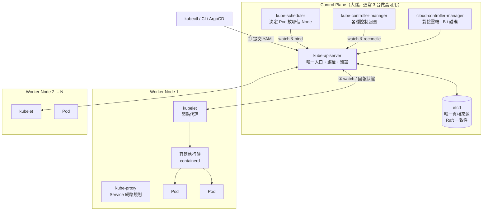

# 第九章　雲原生指揮官：Kubernetes 核心架構

> **本章場景**：2,000 個容器、180 台機器，靠人與腳本管理已經破產（8.3 節）。
> 本章給出答案：一個**持續維持期望狀態的自治系統**。
> 讀本章時請記住那個迴圈：**觀察現況 → 比對期望 → 採取行動 → 重複**。

---

## 9.1 為什麼需要容器編排

### 一句話定義

> **Kubernetes 是一個「宣告式的、以控制迴圈驅動的分散式系統作業系統」。**
>
> 你把整個資料中心（180 台機器）當成**一台大電腦**，
> K8s 就是那台電腦的核心：它負責調度「進程」（Pod）到「CPU」（Node）上，
> 管理「檔案系統」（Volume）、「網路」（Service）、「設定」（ConfigMap）。

### K8s 幫你做的六件事（對照 8.3 節的六個問題）

| 8.3 節的問題 | K8s 的答案 |
|---|---|
| ① 新容器放哪台？ | **Scheduler**：綜合資源、親和性、汙點容忍自動決策 |
| ② 容器掛了誰重啟？ | **ReplicaSet + kubelet**：Pod 掛了自動重建，節點掛了在別台重建 |
| ③ 誰決定與執行擴縮容？ | **HPA / Cluster Autoscaler**（第十一章） |
| ④ 服務發現與流量接管 | **Service + Endpoints**（第十章） |
| ⑤ 滾動更新與回滾 | **Deployment**：內建滾動策略、健康門檻與 `rollout undo` |
| ⑥ 設定與機密管理 | **ConfigMap / Secret**（第十章） |

### 要先破除的三個誤解

| 誤解 | 事實 |
|---|---|
| 「K8s 會讓系統變快」 | ❌ 它增加了網路跳數與抽象層，單請求**可能更慢**。它買的是**彈性與自動化**。 |
| 「上了 K8s 就不用運維」 | ❌ 運維的**內容改變了**：從管機器變成管 YAML、管集群、管平台。**複雜度上升，但可以規模化。** |
| 「所有系統都該上 K8s」 | ❌ 3 個服務、流量穩定的系統，上 K8s 是**淨損失**（見第十七章 17.3） |

> **誠實的成本評估**：導入 K8s 大約需要 1–2 個懂它的人全職投入數個月，
> 且團隊所有人都要重新學習除錯方式。
> **值得的前提是：你的部署單元數量夠多、變動夠頻繁、流量夠有彈性需求。**
> 這正是我們走過前八章才到這裡的原因——**先有 40 個服務的痛，才有 K8s 的價值。**

---

## 9.2 K8s 架構解密：Control Plane 與 Worker Node



### Control Plane 五大元件

| 元件 | 職責 | 掛掉會怎樣 |
|---|---|---|
| **kube-apiserver** | **唯一入口**。所有元件都只跟它說話，彼此不直接通訊 | 無法做任何變更；**但已在跑的 Pod 繼續跑** |
| **etcd** | 分散式 KV，存放**整個集群的狀態**（唯一真相來源） | 集群失憶；**必須備份** |
| **kube-scheduler** | 為新 Pod 挑選節點 | 新 Pod 卡在 `Pending`；舊的不受影響 |
| **kube-controller-manager** | 跑幾十個控制迴圈（Deployment、ReplicaSet、Node、Job…） | 自癒與擴縮容停擺 |
| **cloud-controller-manager** | 對接雲端：建立 LB、掛載雲盤、節點生命週期 | 雲資源無法自動建立 |

**「所有元件只跟 apiserver 說話」這個設計極其重要**，它帶來：
- 統一的鑑權、審計、准入控制（Admission Webhook）。
- 元件之間完全解耦，可獨立升級、可替換。
- **可擴展性**：任何人都能寫一個 controller 來 watch apiserver，實作自己的邏輯（Operator 模式）。

> **注意那個高可用性質**：Control Plane 全掛，**已經在跑的服務不會中斷**。
> kubelet 會繼續維持本機的 Pod，kube-proxy 的網路規則還在。
> 失去的只是「變更能力」與「自癒能力」。這是刻意的設計：
> **控制面故障不應該擴散成資料面故障。**

### Worker Node 三大元件

| 元件 | 職責 |
|---|---|
| **kubelet** | 節點上的代理。watch apiserver 拿到「本節點該跑哪些 Pod」，呼叫容器執行時建立/銷毀，執行**健康探針**，回報狀態 |
| **kube-proxy** | 在節點上維護 Service 的網路轉發規則（iptables / **IPVS**）。注意：IPVS 就是第 3.3 節的 LVS |
| **容器執行時 CRI** | 真正跑容器的東西：**containerd**（主流）、CRI-O。Docker 在 K8s 1.24 後不再直接支援（dockershim 移除），但 Docker 建的鏡像照樣能用（都是 OCI 標準） |

### 一個 Pod 誕生的完整流程

這是理解 K8s 最好的一條路徑，請務必看懂：

```
1. 你 kubectl apply -f deployment.yaml
2. apiserver 鑑權 → 驗證 → 執行 Admission Webhook → 寫入 etcd
       「期望：要有 3 個 nginx Pod」
3. Deployment Controller watch 到新的 Deployment → 建立一個 ReplicaSet
4. ReplicaSet Controller watch 到 → 發現現況 0 個、期望 3 個
       → 建立 3 個 Pod 物件（此時 nodeName 是空的！還沒人知道要放哪）
5. Scheduler watch 到「有 Pod 沒有 nodeName」
       → 過濾階段：哪些節點資源夠、符合親和性/汙點規則？（180 → 42 台）
       → 打分階段：哪台最好？（資源最均衡、鏡像已存在、拓撲分散）
       → 綁定：把 nodeName=node-57 寫回 apiserver
6. node-57 上的 kubelet watch 到「有我的 Pod」
       → 透過 CRI 呼叫 containerd
       → 拉鏡像（有本地快取就跳過）
       → 呼叫 CNI 插件設定網路，分配 Pod IP
       → 掛載 Volume（CSI）
       → 啟動容器
7. kubelet 持續執行探針，回報 Pod status 給 apiserver
8. Endpoint Controller watch 到「Pod ready 了」→ 把 Pod IP 加進 Service 的 Endpoints
9. 每個節點的 kube-proxy watch 到 Endpoints 變化 → 更新 iptables/IPVS 規則
10. 流量開始進來
```

> **看清楚了嗎？沒有任何一個元件在「指揮」另一個元件。**
> 每個控制器都只是在 watch apiserver、比對自己關心的「期望 vs 現況」、然後採取行動。
> **這種「事件驅動 + 最終一致」的設計，就是 K8s 能管理十萬個物件而不崩潰的原因。**
>
> 也因此，K8s 的每個操作都是**非同步**的：`kubectl apply` 回傳成功，
> 只表示「你的期望被記錄了」，不表示「事情做完了」。這是新手最常見的誤解來源。

### 除錯的第一原則

```bash
kubectl get pod -o wide            # 在哪台、什麼狀態、重啟幾次
kubectl describe pod <name>        # ⭐ 最重要：看底部的 Events（90% 的問題在這）
kubectl logs <pod> -c <container>  # 日誌
kubectl logs <pod> --previous      # ⭐ 上一次崩潰的日誌（CrashLoopBackOff 必用）
kubectl get events --sort-by=.metadata.creationTimestamp -A
```

常見狀態與病因：

| 狀態 | 意思 | 常見原因 |
|---|---|---|
| `Pending` | 還沒被調度 | 資源不足、沒有符合的節點、PVC 綁不到 |
| `ImagePullBackOff` | 拉不到鏡像 | tag 錯、私有倉庫沒設 `imagePullSecrets`、網路不通 |
| `CrashLoopBackOff` | 一直啟動又崩潰 | 應用啟動報錯（看 `--previous`）、缺設定、探針太嚴 |
| `OOMKilled` | 記憶體超過 limit 被殺 | limit 太小、JVM 參數沒容器化、記憶體洩漏 |
| `Running` 但 not ready | 就緒探針沒過 | 依賴沒好、探針路徑錯、`initialDelaySeconds` 太短 |
| `Terminating` 卡住 | 無法刪除 | finalizer 沒清、優雅關閉逾時、volume 卸載失敗 |

---

## 9.3 核心物件入門：Pod / ReplicaSet / Deployment

### Pod：最小調度單位

**Pod 是一組「共享網路與儲存」的容器**，不是「一個容器」。

```
Pod
├── 共享 NET namespace  → 容器間可用 localhost 互連，共用同一個 Pod IP
├── 共享 IPC / 可共享 Volume
└── 容器
    ├── pause 容器（infra 容器，持有 namespace，你不會看到它）
    ├── 主容器 my-app
    └── Sidecar 容器 log-agent / istio-proxy
```

> **為什麼要有 Pod 這層？為什麼不直接調度容器？**
>
> 因為有些進程必須「生死與共、同機同網」：日誌收集 agent 要讀主容器的 log 目錄；
> service mesh 的 proxy 要攔截主容器的所有網路流量。
> 如果它們被調度到不同機器，就完全無法運作。
> **Pod 就是「一定要待在一起的東西」的最小包裝。**

**Sidecar 模式**是雲原生最重要的設計模式之一：
把橫切關注點（日誌、監控、網路代理、憑證輪換）從應用程式裡搬出來，
變成一個獨立容器。**應用程式碼不用改，就獲得了新能力。**（第 10.3 節的 Istio 就靠這個。）

**重要紀律：不要直接建立 Pod。**
裸 Pod 沒有任何自癒能力——它掛了就是掛了，沒人會重建它。
永遠用 Deployment / StatefulSet / DaemonSet / Job 這些**控制器**來管理 Pod。

### 工作負載控制器對照

| 控制器 | 用途 | Pod 特性 |
|---|---|---|
| **Deployment** | **無狀態應用**（90% 的場景） | Pod 名稱隨機、可任意替換、無序 |
| **StatefulSet** | 有狀態應用（MySQL、Kafka、ES） | **固定名稱**（`mysql-0,1,2`）、**固定儲存**、**有序啟停** |
| **DaemonSet** | 每個節點跑一份（日誌收集、監控、CNI） | 每節點恰好一個 |
| **Job / CronJob** | 一次性 / 定時任務 | 跑完就結束 |

### Deployment 完整範例（逐行註解）

```yaml
apiVersion: apps/v1
kind: Deployment
metadata:
  name: item-service
  namespace: shop
  labels: { app: item-service }
spec:
  replicas: 6                          # 期望副本數
  revisionHistoryLimit: 10             # 保留 10 個歷史版本供回滾
  selector:
    matchLabels: { app: item-service }  # 我管理哪些 Pod（不可修改）
  strategy:
    type: RollingUpdate
    rollingUpdate:
      maxSurge: 2                      # 更新時最多超出 2 個（臨時 8 個）
      maxUnavailable: 0                # ⭐ 任何時刻可用數不低於 6，零中斷
  template:                            # ↓↓↓ Pod 模板 ↓↓↓
    metadata:
      labels: { app: item-service, version: v1 }
    spec:
      terminationGracePeriodSeconds: 45   # 收到 SIGTERM 後給 45 秒收工
      securityContext:
        runAsNonRoot: true
        runAsUser: 10001
      containers:
      - name: app
        image: registry.example.com/shop/item-service:1.4.2   # ⭐ 絕不用 latest
        imagePullPolicy: IfNotPresent
        ports:
        - { name: http, containerPort: 8080 }

        resources:                      # ⭐ 必填，見 11.3
          requests: { cpu: "500m", memory: "1Gi" }   # 調度依據 + 保底
          limits:   { cpu: "2",    memory: "2Gi" }   # 上限

        env:
        - name: SPRING_PROFILES_ACTIVE
          value: prod
        - name: POD_NAME                # 從 K8s 注入自己的資訊
          valueFrom: { fieldRef: { fieldPath: metadata.name } }
        - name: JAVA_OPTS
          value: "-XX:MaxRAMPercentage=70 -XX:+ExitOnOutOfMemoryError"
        envFrom:
        - configMapRef: { name: item-service-config }
        - secretRef:    { name: item-service-secret }

        startupProbe:                   # ⭐ 慢啟動應用必備，見 11.1
          httpGet: { path: /actuator/health/liveness, port: http }
          failureThreshold: 30
          periodSeconds: 5              # 最多容忍 150 秒啟動
        livenessProbe:
          httpGet: { path: /actuator/health/liveness, port: http }
          periodSeconds: 10
          failureThreshold: 3
        readinessProbe:
          httpGet: { path: /actuator/health/readiness, port: http }
          periodSeconds: 5
          failureThreshold: 2

        lifecycle:
          preStop:
            exec: { command: ["sh","-c","sleep 5"] }   # ⭐ 見下方說明

      topologySpreadConstraints:        # 打散到不同節點/可用區，見 11.4
      - maxSkew: 1
        topologyKey: topology.kubernetes.io/zone
        whenUnsatisfiable: ScheduleAnyway
        labelSelector:
          matchLabels: { app: item-service }
```

#### 那個 `preStop: sleep 5` 是什麼？

這是 K8s 最經典的坑，**幾乎每個團隊都踩過**。

Pod 被刪除時，兩件事**並行**發生（不是循序）：

```
A. kubelet 對容器發 SIGTERM
B. Endpoint Controller 把 Pod IP 從 Service 移除
   → kube-proxy 更新 iptables（每個節點）
   → Ingress / 服務網格更新自己的後端清單
```

B 的傳播需要時間（通常 1–3 秒，大集群更久）。如果 A 比 B 快，
**應用已經關閉了，但流量還在往它送 → 使用者收到連線被拒**。

`preStop: sleep 5` 的作用是**延後 SIGTERM**，給 B 足夠時間傳播完。
這 5 秒內容器仍正常服務，只是不再接收新的連線分配。

> **零停機發布的完整配方**：
> 1. `preStop: sleep 5`（等待端點移除傳播）
> 2. 應用支援優雅關閉（`server.shutdown=graceful`）
> 3. `terminationGracePeriodSeconds` > preStop + 最長請求處理時間
> 4. `maxUnavailable: 0`
> 5. `readinessProbe` 準確反映「我能處理請求了」
>
> **缺任何一項，你的每次發布都會產生一批錯誤請求。**

---

## 9.4 重新定義部署：滾動更新與版本回滾

### 滾動更新的運作

```bash
kubectl set image deployment/item-service app=registry.example.com/shop/item-service:1.4.3
# 或直接改 YAML 後 kubectl apply -f
```

K8s 的動作：**建立一個新的 ReplicaSet，然後逐步「新的加、舊的減」**。

```
時間 →   舊 RS(1.4.2)   新 RS(1.4.3)   可用總數
t0          6              0              6
t1          6              2              6 (新的還沒 ready)
t2          6              2              8  ← maxSurge=2 生效
t3          4              2              6  ← 新的 ready 了，才減舊的
t4          4              4              8
...
t8          0              6              6  ✅
```

**關鍵：K8s 只有在新 Pod 通過 `readinessProbe` 之後，才會去終止舊 Pod。**
所以就緒探針寫得對不對，直接決定你的發布是「零中斷」還是「全站掛掉」。

```bash
kubectl rollout status deployment/item-service      # 盯著看，會卡住直到成功或逾時
kubectl rollout history deployment/item-service     # 版本歷史
kubectl rollout undo deployment/item-service        # ⭐ 一鍵回滾上一版
kubectl rollout undo deployment/item-service --to-revision=3
kubectl rollout pause deployment/item-service       # 暫停（金絲雀觀察用）
kubectl rollout resume deployment/item-service
```

> **回顧 8.3 節的問題五**：那個每個團隊都寫過、都有 bug 的發布腳本，
> 現在變成 `strategy` 底下的三行設定 + 一個 `kubectl rollout undo`。
> **而且它是原子的、可觀測的、可重複的。**

### 新版有 bug 但不會崩潰時怎麼辦

滾動更新只能偵測「Pod 起不來」。如果新版能啟動、探針也過，
但業務邏輯錯了（訂單金額算錯），K8s 會**開心地把它推到 100%**。

所以需要**漸進式交付（Progressive Delivery）**：

| 策略 | 做法 | 優點 | 代價 |
|---|---|---|---|
| **滾動更新** | 逐批替換 | 資源省 | 無法按比例控流量、回滾需時間 |
| **藍綠部署** | 兩套完整環境，切換流量 | **秒級切換與回滾** | **需要兩倍資源** |
| **金絲雀 Canary** | 新版先接 1% 流量，逐步加碼 | **風險最小**，可觀察真實指標 | 需要流量控制能力 + 兩版本相容 |
| **A/B 測試** | 按使用者特徵分流 | 可做業務實驗 | 需要更精細的路由 |

金絲雀的關鍵是**自動化的指標門檻**：

```yaml
# Flagger（配合 Istio/Linkerd 自動做金絲雀）
analysis:
  interval: 1m
  threshold: 5            # 連續 5 次不達標就自動回滾
  maxWeight: 50
  stepWeight: 10          # 每次加 10% 流量
  metrics:
  - name: request-success-rate
    thresholdRange: { min: 99 }      # 成功率低於 99% → 自動回滾
  - name: request-duration
    thresholdRange: { max: 500 }     # P99 超過 500ms → 自動回滾
```

> **這是本書「自治系統」思想的又一次體現**：
> 不是「發布後人工盯著 Grafana，覺得不對就回滾」，
> 而是「把『什麼叫不對』寫成程式，讓系統自己判斷、自己回滾」。

**注意**：資料庫 schema 變更無法用這些策略回滾。
所以有另一條鐵律：**資料庫變更必須向前相容**
（先加欄位 → 部署能用新舊欄位的程式 → 確認穩定 → 才刪舊欄位，三次發布完成一次改名）。

---

## 本章代價與下一章的痛

**我們做了什麼**：把 8.3 節的六個問題中的 ①②⑤ 交給 K8s——
調度、自癒、滾動更新與回滾。

**我們買進的新問題**：

| 新問題 | 說明 |
|---|---|
| 學習曲線陡峭 | 團隊要學一套全新的概念與除錯方式 |
| YAML 爆炸 | 40 個服務 × 4 環境 × 5 種資源 = 800 個 YAML（第 13.1 節 Helm/Kustomize） |
| 抽象層變多 | 一個 502 要查：Ingress → Service → Endpoints → Pod → 容器 → 應用 |
| 集群本身要維運 | etcd 備份、版本升級、憑證輪換、容量規劃 |

**新的痛點**：Pod 起來了，但是：

1. **Pod IP 每次重建都變**，服務之間怎麼互相找到？
2. **外部使用者怎麼進來？** Pod IP 只在集群內部有效。
3. **設定與密碼還寫在 YAML 裡**，密碼就這樣 commit 進 Git？
4. **MySQL 的資料放哪？** Pod 一重建資料就沒了。

下一章：[第十章　K8s 服務發現、路由與儲存](10-K8s服務發現路由與儲存.md)。

---

## 名詞速查

| 名詞 | 一句話 |
|---|---|
| Control Plane | apiserver + etcd + scheduler + controller-manager |
| etcd | 集群唯一真相來源；必須備份 |
| kubelet / kube-proxy | 節點代理 / 維護 Service 轉發規則 |
| CRI / containerd | 容器執行時介面 / 主流實作 |
| Pod | 共享網路與儲存的一組容器；最小調度單位 |
| Sidecar | 與主容器同 Pod、提供橫切能力的輔助容器 |
| ReplicaSet | 維持指定數量 Pod 的控制器 |
| maxSurge / maxUnavailable | 滾動更新時允許超出/不可用的副本數 |
| preStop | 容器停止前執行的鉤子；零停機發布必備 |
| 漸進式交付 | 藍綠 / 金絲雀 / A-B，按比例放流量並自動評估 |
