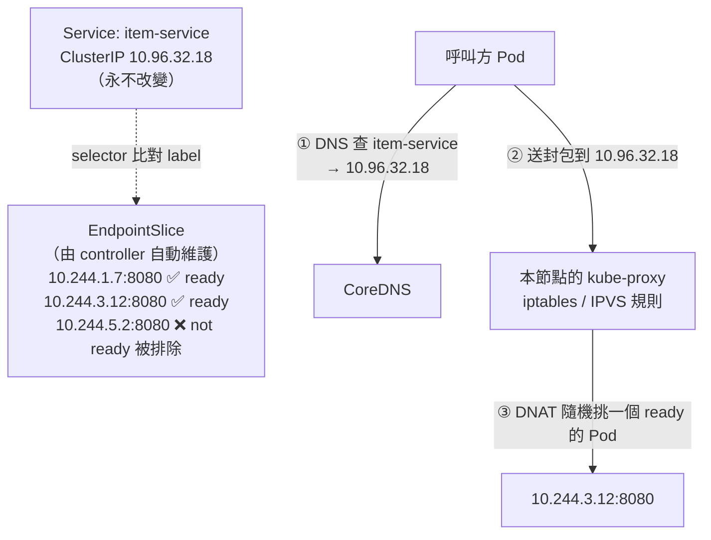
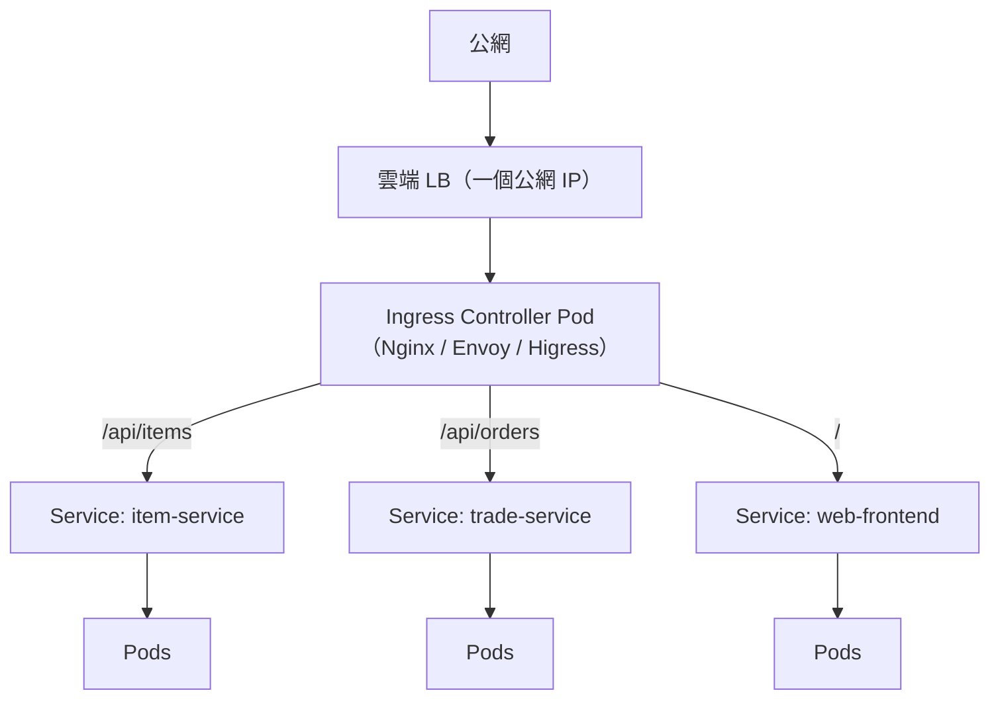
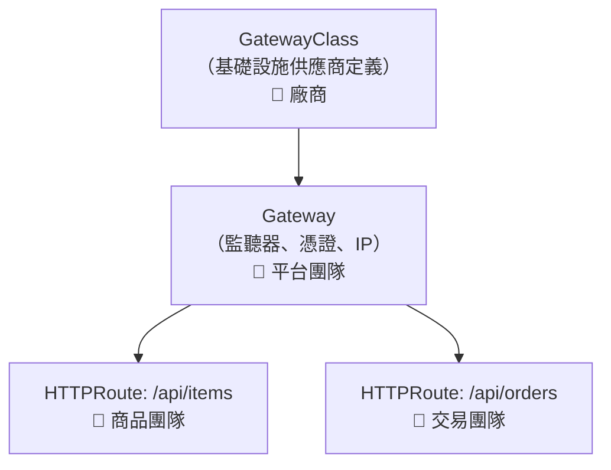
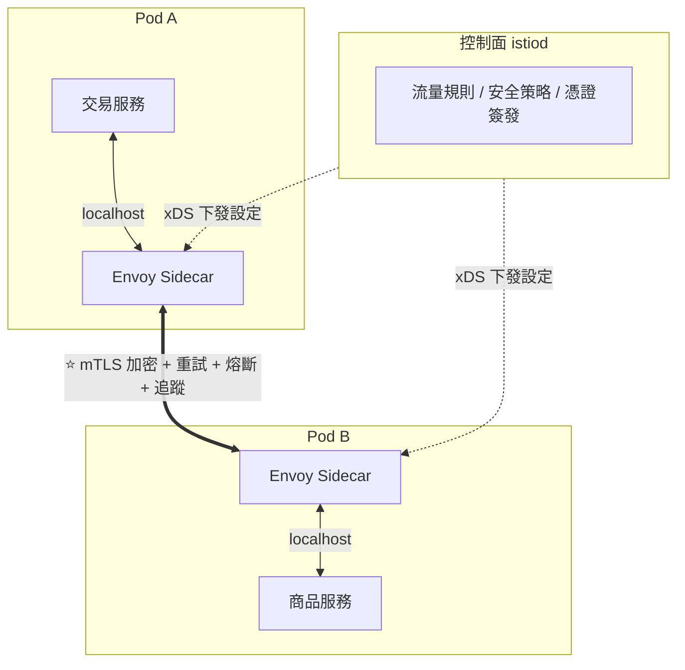
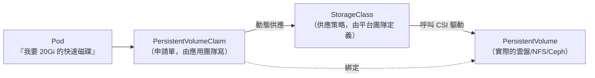

# 第十章　K8s 服務發現、路由與儲存

> **本章場景**：Pod 跑起來了，但 IP 一直變、外面進不來、密碼還寫在 YAML 裡、資料一重啟就沒。
> 本章解決 8.3 節的問題 ④ 與 ⑥，並把第 3 章、第 5.3 節的老朋友（負載均衡、服務發現）
> 用雲原生的方式重新實作一遍。

---

## 10.1 Service：ClusterIP / NodePort / LoadBalancer

### 問題回顧

```
item-service 有 6 個 Pod，IP 分別是 10.244.1.7, 10.244.3.12, ...
每次滾動更新，這 6 個 IP 全部換掉。
trade-service 要呼叫它——怎麼找？
```

**這就是第 5.3 節的服務發現問題，只是現在由基礎設施來解決，應用不用改任何程式碼。**

### Service：一個永遠不變的虛擬 IP + DNS 名稱

```yaml
apiVersion: v1
kind: Service
metadata:
  name: item-service
  namespace: shop
spec:
  type: ClusterIP
  selector:
    app: item-service        # ⭐ 靠 label 動態選中 Pod，不是寫死 IP
  ports:
  - name: http
    port: 80                 # Service 對外的 port
    targetPort: 8080         # Pod 內容器的 port
```

```java
// trade-service 的程式碼，永遠不用改
String url = "http://item-service.shop.svc.cluster.local/api/items/8899";
// 同 namespace 內可以直接簡寫：http://item-service/api/items/8899
```

### 運作原理：Service → Endpoints → iptables/IPVS



**三個關鍵認知**：

1. **ClusterIP 是一個「不存在的 IP」。** 沒有任何網卡綁著它，
   它只存在於每個節點的 iptables/IPVS 規則裡。你 ping 它可能不會通，但連接埠是通的。

2. **沒有中心化的代理。** 負載均衡發生在**發起請求的那個節點上**，
   由該節點的 kube-proxy 規則直接 DNAT 到目標 Pod。
   **沒有單點、沒有多餘的網路跳數。**

3. **只有 Ready 的 Pod 會進 Endpoints。** 這就是就緒探針（`readinessProbe`）的全部意義：
   **它控制「這個 Pod 要不要接流量」。**
   探針失敗 → 從 Endpoints 移除 → 不再收到流量，但 Pod 不會被重啟（那是 liveness 的事）。

> **kube-proxy 的 IPVS 模式，底層就是第 3.3 節的 LVS。**
> iptables 模式在規則數量大（數千個 Service）時是 O(n) 線性匹配，效能會下滑；
> IPVS 用雜湊表，是 O(1)。**生產集群請用 IPVS 模式。**
>
> 更新的方案是用 **Cilium 的 eBPF** 完全取代 kube-proxy，效能更好且可觀測性更強。

### 四種 Service 類型

| type | 可存取範圍 | 用途 |
|---|---|---|
| **ClusterIP**（預設） | 僅集群內 | **服務之間互相呼叫**（90% 的場景） |
| **NodePort** | 每個節點的 30000–32767 | 測試、自建機房的臨時對外 |
| **LoadBalancer** | 公網 | 讓 cloud-controller-manager 去雲端建一個 LB |
| **ExternalName** | — | DNS CNAME 到外部網域（接外部 RDS 用） |

還有一種特殊的：

```yaml
spec:
  clusterIP: None          # Headless Service
```

**Headless Service** 不分配 ClusterIP，DNS 直接回傳**所有 Pod IP 的清單**。
用於：
- 客戶端要自己做負載均衡（gRPC 長連線的場景，見下）
- **StatefulSet 要定位到特定成員**（`mysql-0.mysql.shop.svc.cluster.local`）

> ⚠️ **gRPC / HTTP2 長連線的經典坑**：
> Service 的負載均衡發生在 **TCP 連線建立時**，不是每個請求。
> gRPC 建立一條長連線後，**所有請求都送往同一個 Pod**，
> 於是你擴容到 20 個 Pod，流量卻集中在 3 個上。
>
> 解法：(a) 用 Headless Service + 客戶端負載均衡；(b) 用服務網格（10.3 節）；
> (c) 設定連線最大存活時間強制重連。**這是實務上非常常見的效能問題。**

---

## 10.2 對外入口：Ingress 與雲原生網關 Envoy / Higress

### 為什麼不能每個服務都開一個 LoadBalancer

40 個服務 × 一個雲端 LB = 40 個公網 IP、40 筆帳單、40 份 TLS 憑證要管。
而且它們其實應該共用同一個網域，只是路徑不同。

### Ingress：七層路由的集中入口

```yaml
apiVersion: networking.k8s.io/v1
kind: Ingress
metadata:
  name: shop-ingress
  annotations:
    nginx.ingress.kubernetes.io/proxy-body-size: "20m"
    nginx.ingress.kubernetes.io/canary: "false"
spec:
  ingressClassName: nginx
  tls:
  - hosts: [shop.example.com]
    secretName: shop-tls          # TLS 憑證在此統一卸載
  rules:
  - host: shop.example.com
    http:
      paths:
      - { path: /api/items,  pathType: Prefix, backend: { service: { name: item-service,  port: { number: 80 } } } }
      - { path: /api/orders, pathType: Prefix, backend: { service: { name: trade-service, port: { number: 80 } } } }
      - { path: /,           pathType: Prefix, backend: { service: { name: web-frontend,  port: { number: 80 } } } }
```



**Ingress 資源本身只是一份設定。** 真正幹活的是 **Ingress Controller**
（一組跑在集群裡的 Pod），它 watch Ingress 資源，把規則翻譯成自己的設定。

> **回顧第 3.1 節那個痛點**：「後端擴縮容要改 Nginx upstream 並 reload」。
> 現在 Ingress Controller 會自動 watch Endpoints 變化並動態更新後端清單，
> **完全不需要人介入，也不需要 reload。**
> 這就是第 3.1 節結尾那句「當後端會自動擴縮容時，改設定檔 + reload 的模式就崩潰了」的解答。

### Ingress Controller 選型

| Controller | 基礎 | 特點 |
|---|---|---|
| **ingress-nginx** | Nginx | 最普及、最穩、社群大；動態性受 Nginx 架構限制 |
| **Envoy 系**（Contour、Emissary） | Envoy | **xDS 動態設定、無需 reload**、可觀測性強 |
| **Higress** | Envoy + Istio 控制面 | 相容 Nginx Ingress 註解，**主打 AI 網關能力**（第十六章） |
| **APISIX Ingress** | OpenResty + etcd | 插件豐富、動態性好 |
| **Traefik** | Go | 設定簡單、自動 TLS |
| 雲端原生（ALB/GKE Ingress） | 雲端 LB | 免維運，但綁定該雲 |

### Gateway API：Ingress 的正式接班人

Ingress 的先天缺陷：
- 表達能力太弱（只有 host + path），進階功能全靠**各家不相容的 annotation**。
- 沒有角色分離：平台團隊與應用團隊改同一個物件，權限無法切分。
- 不支援 TCP/UDP/gRPC 的完整語意。

**Gateway API** 是 K8s 官方的新標準（已進入 GA），用三層資源做**角色分離**：



```yaml
apiVersion: gateway.networking.k8s.io/v1
kind: HTTPRoute
metadata: { name: item-route }
spec:
  parentRefs: [{ name: shop-gateway }]
  rules:
  - matches: [{ path: { type: PathPrefix, value: /api/items } }]
    backendRefs:
    - { name: item-service-v1, port: 80, weight: 90 }    # ⭐ 原生支援流量權重
    - { name: item-service-v2, port: 80, weight: 10 }    #    金絲雀不再靠 annotation
```

> **為什麼這對架構師重要**：`weight` 這個欄位是原生的、標準的、跨廠商的。
> 你的金絲雀發布邏輯不再綁定某個 Ingress Controller 的專有註解。
> Gateway API 也是第十六章 **AI 網關（Gateway API Inference Extension）** 的基礎。

---

## 10.3 服務網格：Istio 無侵入治理與 mTLS

### 問題：第 5.4 節的三板斧要寫幾遍

限流、熔斷、重試、逾時、鏈路追蹤、mTLS——這些能力：

- 用 SDK 實作（Sentinel、Resilience4j）→ **只有 Java 能用**。
  搜尋團隊的 Go、推薦團隊的 Python 怎麼辦？每種語言實作一遍？
- SDK 要升級 → **40 個服務全部改依賴、全部重新發版**。
  一次「治理框架升級」變成跨 8 個團隊、歷時 3 個月的專案。

### 解法：把治理能力下沉到網路層

**Service Mesh（服務網格）** 的核心思想：

> 每個 Pod 旁邊放一個 Sidecar 代理，**攔截所有進出流量**。
> 治理邏輯全部在代理裡執行，**應用程式完全不知情、不用改一行程式碼**。



應用以為自己在呼叫 `http://item-service`，
實際上封包被 iptables 劫持到 Sidecar，由 Sidecar 完成所有治理後才真正送出去。

### 能力矩陣

| 面向 | 能力 |
|---|---|
| **流量管理** | 金絲雀（按權重/Header/使用者）、逾時、重試、熔斷、鏡像流量（把生產流量複製到新版做驗證）、故障注入 |
| **安全** | **自動 mTLS**（零改造的服務間雙向加密）、細粒度授權（誰能呼叫誰的哪個方法） |
| **可觀測性** | **自動產生**所有服務間的 metrics、access log、分散式追蹤 span、服務拓撲圖 |

```yaml
# 金絲雀：不改任何程式碼、不改 Deployment
apiVersion: networking.istio.io/v1
kind: VirtualService
spec:
  hosts: [item-service]
  http:
  - match: [{ headers: { x-canary: { exact: "true" } } }]   # 內部測試走 v2
    route: [{ destination: { host: item-service, subset: v2 } }]
  - route:
    - { destination: { host: item-service, subset: v1 }, weight: 95 }
    - { destination: { host: item-service, subset: v2 }, weight: 5 }
    retries: { attempts: 3, perTryTimeout: 2s, retryOn: "5xx,reset" }
    timeout: 5s
---
# 熔斷：連續 5 次 5xx 就把該實例踢出 30 秒
apiVersion: networking.istio.io/v1
kind: DestinationRule
spec:
  host: item-service
  trafficPolicy:
    connectionPool:
      tcp: { maxConnections: 100 }
      http: { http2MaxRequests: 1000, maxRequestsPerConnection: 10 }
    outlierDetection:
      consecutive5xxErrors: 5
      interval: 10s
      baseEjectionTime: 30s
      maxEjectionPercent: 50      # ⭐ 最多踢掉一半，避免全踢光造成雪崩
```

> **注意 `maxEjectionPercent: 50`**：如果下游全部都在回 5xx（例如它的資料庫掛了），
> 沒有這個上限就會把所有實例都踢掉，變成 100% 失敗。
> **保護機制本身也需要保護機制**——這是可靠性工程的普遍規律。

### mTLS：零信任的落地

```yaml
apiVersion: security.istio.io/v1
kind: PeerAuthentication
metadata: { name: default, namespace: shop }
spec:
  mtls: { mode: STRICT }      # 該命名空間內所有服務間通訊強制雙向 TLS
```

**一行設定，40 個服務之間的流量全部加密 + 雙向身分驗證，而且憑證自動輪換。**
用傳統做法（每個服務自己管憑證）這是幾個月的工程。

配合授權策略：

```yaml
apiVersion: security.istio.io/v1
kind: AuthorizationPolicy
spec:
  selector: { matchLabels: { app: payment-service } }
  action: ALLOW
  rules:
  - from: [{ source: { principals: ["cluster.local/ns/shop/sa/trade-service"] } }]
    to:   [{ operation: { methods: ["POST"], paths: ["/api/pay"] } }]
# 只有交易服務能呼叫支付服務的 POST /api/pay，其他一律拒絕
```

> **這是「零信任（Zero Trust）」架構的精髓**：
> 不因為「你在我的內網」就信任你。**每一次呼叫都要證明身分、都要被授權。**
> 傳統架構假設「內網是安全的」，但只要有一台機器被攻陷，攻擊者就能橫向移動到所有系統。

### 誠實評估：服務網格的代價

| 代價 | 說明 |
|---|---|
| **延遲增加** | 每次呼叫多穿過 2 個 proxy，**約 +1~3 ms**（Ambient 模式可降低） |
| **資源開銷** | 每個 Pod 多一個 Sidecar（50–200 MB 記憶體）。500 個 Pod = 多消耗 50 GB |
| **複雜度暴增** | 出問題要查 Envoy 設定（xDS dump 極其冗長）、Istio 版本升級是大工程 |
| **學習曲線** | VirtualService、DestinationRule、Gateway、Sidecar… 又一套心智模型 |

**什麼時候該上服務網格？**

| 該上 | 不該上 |
|---|---|
| 多語言服務（Java + Go + Python） | 清一色 Java 且 SDK 治理已經夠用 |
| 需要零信任 mTLS（合規要求） | 服務數 < 20 |
| 需要無侵入的金絲雀與流量鏡像 | 團隊沒有人能深入除錯 Envoy |
| 需要統一的全局可觀測性 | 延遲預算極度敏感 |

> **Istio Ambient Mode（無 Sidecar 模式）** 是近年重要進展：
> 用節點級的 ztunnel 處理 L4 與 mTLS，只有需要 L7 功能時才額外加 waypoint proxy。
> **大幅降低資源開銷與升級痛苦**，讓服務網格的門檻降低了一個等級。

---

## 10.4 儲存與配置：PV / PVC / StorageClass / ConfigMap / Secret

### ConfigMap：設定與鏡像解耦

```yaml
apiVersion: v1
kind: ConfigMap
metadata: { name: item-service-config, namespace: shop }
data:
  SPRING_PROFILES_ACTIVE: "prod"
  CACHE_TTL_SECONDS: "1800"
  application-prod.yml: |
    server:
      port: 8080
    logging:
      level:
        com.shop: INFO
```

兩種用法：

```yaml
# ① 當環境變數（改了需要重啟 Pod 才生效）
envFrom: [{ configMapRef: { name: item-service-config } }]

# ② 當檔案掛載（改了會自動同步到容器內，約 1 分鐘；但應用要自己 reload 才會生效）
volumeMounts:
- { name: config, mountPath: /app/config }
volumes:
- name: config
  configMap: { name: item-service-config }
```

> **實務上最乾淨的做法**：把 ConfigMap 的內容 hash 寫進 Pod 模板的 annotation，
> 這樣**設定一改，Deployment 就會自動觸發滾動更新**（Helm 的標準技巧）：
> ```yaml
> template:
>   metadata:
>     annotations:
>       checksum/config: {{ include (print $.Template.BasePath "/configmap.yaml") . | sha256sum }}
> ```

### Secret：必須誠實面對的真相

```yaml
apiVersion: v1
kind: Secret
metadata: { name: item-service-secret }
type: Opaque
data:
  DB_PASSWORD: cGFzc3dvcmQxMjM=     # ⚠️ 這只是 base64，不是加密！
```

> **K8s Secret 預設只是 base64 編碼，任何能讀取它的人都能還原出明文。**
> `echo cGFzc3dvcmQxMjM= | base64 -d` 就結束了。

生產環境必做的三件事：

| 措施 | 說明 |
|---|---|
| **etcd 靜態加密** | `EncryptionConfiguration` 讓 Secret 在 etcd 裡是加密的 |
| **RBAC 嚴格限制** | 只有必要的 ServiceAccount 能讀特定 Secret |
| **外部機密管理** | **正解**：用 Vault / 雲端 KMS / Secrets Manager，
搭配 **External Secrets Operator** 或 CSI Secret Store 動態注入 |

```yaml
# External Secrets Operator：Git 裡只有「去哪裡拿」，沒有密碼本身
apiVersion: external-secrets.io/v1
kind: ExternalSecret
spec:
  secretStoreRef: { name: vault-backend, kind: ClusterSecretStore }
  target: { name: item-service-secret }
  data:
  - secretKey: DB_PASSWORD
    remoteRef: { key: prod/shop/mysql, property: password }
```

**這是 GitOps（第 13.1 節）能成立的前提**：所有東西都進 Git，
但密碼絕對不能進 Git。（另一個方案是 **Sealed Secrets**：把加密後的密文放進 Git，
只有集群內的控制器持有私鑰能解開。）

### 儲存三件套：PV / PVC / StorageClass



**這個分層的價值是「關注點分離」**：
- 應用團隊只需說「我要 20 GB 快的儲存」（PVC）。
- 平台團隊定義「快的儲存是什麼」（StorageClass → 阿里雲 ESSD / AWS gp3 / Ceph）。
- **同一份 YAML 可以跑在不同雲上**，只要那裡有同名的 StorageClass。

```yaml
apiVersion: storage.k8s.io/v1
kind: StorageClass
metadata: { name: fast-ssd }
provisioner: disk.csi.aliyun.com          # 換成 ebs.csi.aws.com 就跑在 AWS
parameters: { type: cloud_essd }
reclaimPolicy: Retain                      # ⭐ PVC 刪掉時「保留」磁碟，防手滑
allowVolumeExpansion: true                 # 允許線上擴容
volumeBindingMode: WaitForFirstConsumer    # ⭐ 等 Pod 調度後才建磁碟，確保同可用區
```

> **`volumeBindingMode: WaitForFirstConsumer` 是必設的。**
> 否則可能先在可用區 A 建了磁碟，Pod 卻被調度到可用區 B，
> 結果 Pod 永遠 `Pending`（跨可用區掛不了雲盤）。這是新手最常卡住的問題之一。

**存取模式（Access Mode）**：

| 模式 | 意思 | 支援情況 |
|---|---|---|
| `ReadWriteOnce` (RWO) | 單節點讀寫 | **雲盤只支援這個** |
| `ReadOnlyMany` (ROX) | 多節點唯讀 | 部分支援 |
| `ReadWriteMany` (RWX) | **多節點同時讀寫** | 只有 NFS/CephFS/雲端檔案儲存支援 |

> **常見誤解**：想讓 3 個 Pod 共享一個雲盤來存上傳的圖片——**做不到**，雲盤是 RWO。
> **正解**：上傳檔案應該存物件儲存（OSS/S3），不是存檔案系統。
> 這也呼應第 3.2 節的無狀態化清單。

### StatefulSet：有狀態應用的專用控制器

```yaml
apiVersion: apps/v1
kind: StatefulSet
metadata: { name: mysql }
spec:
  serviceName: mysql            # 必須搭配 Headless Service
  replicas: 3
  template: { ... }
  volumeClaimTemplates:         # ⭐ 每個 Pod 自動獲得專屬的 PVC
  - metadata: { name: data }
    spec:
      accessModes: [ReadWriteOnce]
      storageClassName: fast-ssd
      resources: { requests: { storage: 200Gi } }
```

與 Deployment 的關鍵差異：

| | Deployment | StatefulSet |
|---|---|---|
| Pod 名稱 | `item-service-7d9f-x8k2p`（隨機） | `mysql-0`、`mysql-1`、`mysql-2`（**固定有序**） |
| DNS | 只有 Service | **每個 Pod 有獨立 DNS**：`mysql-0.mysql.shop.svc` |
| 儲存 | 共享或無 | **每個 Pod 綁定自己的 PVC，重建後仍是同一顆磁碟** |
| 啟停順序 | 無序、並行 | **有序**：0 → 1 → 2 啟動；2 → 1 → 0 關閉 |

有序性是為了什麼？因為叢集型有狀態應用需要「先有主再有從」：
`mysql-0` 當主庫，`mysql-1`、`mysql-2` 啟動時去找 `mysql-0` 做複製。

> **但請回顧第 8.2 節的結論**：StatefulSet 只解決了「身分與儲存的穩定」，
> **它不會幫你做主從切換、備份、版本升級**。那些要靠 **Operator**
> （把 DBA 的知識寫成控制器）——例如 Vitess、Percona Operator、KubeBlocks。
>
> **生產資料庫仍然優先選雲端託管服務。**

---

## 本章代價與下一章的痛

**我們做了什麼**：Service 解決服務發現、Ingress/Gateway API 解決外部入口、
Istio 提供無侵入治理、ConfigMap/Secret/PV 解決設定與儲存。

**8.3 節六大問題的完成度**：

| 問題 | 狀態 |
|---|---|
| ① 調度 | ✅ 第九章 |
| ② 自癒（重啟） | ✅ 第九章，但**「怎麼判斷不健康」還沒講** → 11.1 |
| ③ 自動擴縮容 | ❌ **還是人工改 replicas** → 11.2 |
| ④ 服務發現 | ✅ 本章 |
| ⑤ 滾動更新 | ✅ 第九章 |
| ⑥ 資源利用率 | 🟡 有 requests/limits 了，但**不會用** → 11.3 |

**我們買進的新問題**：抽象層更多了。一個請求現在要穿過：
`雲端 LB → Ingress Pod → Service(iptables) → Sidecar → 應用容器`。
**任何一層出問題，症狀都是「502」。**

**新的痛點**：雙十一還有 30 天。

```
預估峰值流量：平日的 40 倍
目前做法：兩週前手動把所有 Deployment 的 replicas 改大 40 倍，大促後改回來

問題：
  - 40 倍資源要開兩週 → 成本無法接受
  - 零點那一瞬間的尖峰，手動根本來不及反應
  - 有些服務其實只需要 5 倍，有些需要 60 倍，憑感覺調
  - 節點資源也不夠 —— Pod 開得出來，但沒有機器放
  - 而且：有個 Pod 明明還活著，卻已經不處理請求了，K8s 也沒重啟它
```

下一章：[第十一章　彈性擴縮與自癒系統](11-彈性擴縮與自癒系統.md)。

---

## 名詞速查

| 名詞 | 一句話 |
|---|---|
| ClusterIP | 集群內不變的虛擬 IP，由各節點 iptables/IPVS 實作 |
| EndpointSlice | Service 背後所有 **Ready** Pod 的位址清單 |
| Headless Service | 不分配 ClusterIP，DNS 直接回傳所有 Pod IP |
| Ingress / Gateway API | 七層入口路由 / 官方新一代標準（含角色分離與權重） |
| Service Mesh / Sidecar | 用代理攔截流量，無侵入地提供治理能力 |
| mTLS / 零信任 | 服務間雙向驗證加密；不因在內網就信任 |
| PV / PVC / StorageClass | 實際儲存 / 申請單 / 供應策略 |
| WaitForFirstConsumer | 等 Pod 調度後才建磁碟，確保同可用區 |
| StatefulSet | 固定名稱、固定儲存、有序啟停的控制器 |
| Operator | 把運維知識寫成控制器的擴展模式 |
