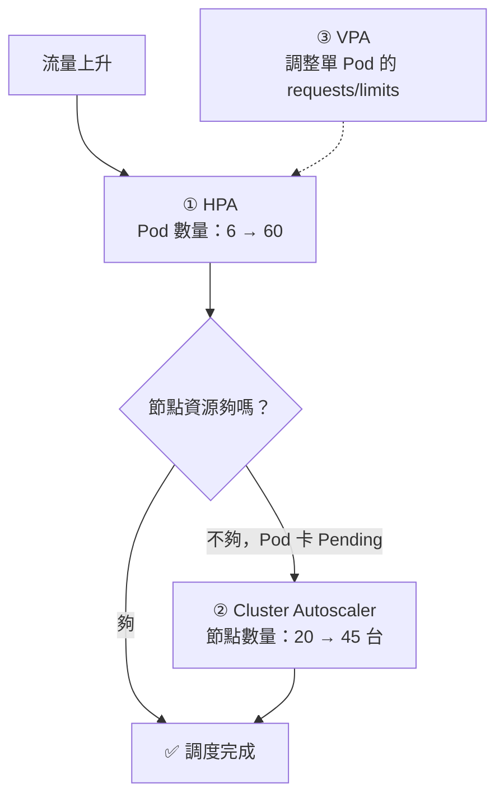

# 第十一章　彈性擴縮與自癒系統

> **本章場景**：雙十一還有 30 天，預估峰值是平日的 40 倍。
> 手動改 `replicas` 撐不住，而且有 Pod「活著但不工作」，K8s 也沒發現。
> 本章完成 8.3 節六大問題的最後三項：**健康判定、自動擴縮、資源治理**。

---

## 11.1 自癒：Liveness 與 Readiness 探針

### 核心區別（面試必考，實務必錯）

| 探針 | 問的問題 | 失敗後的動作 | 用途 |
|---|---|---|---|
| **livenessProbe** | 「你**還活著**嗎？」 | **殺掉容器並重啟** | 從死鎖、假死中恢復 |
| **readinessProbe** | 「你**能接請求**了嗎？」 | **從 Service Endpoints 移除**（不重啟） | 控制流量進出 |
| **startupProbe** | 「你**啟動完了**嗎？」 | 殺掉重啟；**通過前會停用另外兩個探針** | 保護慢啟動應用 |

### 三者的時間軸

```
容器啟動
  │
  ├─ startupProbe 開始探測（每 5 秒，最多 30 次 = 容忍 150 秒啟動）
  │    此期間 liveness 與 readiness 完全不執行 ← ⭐ 關鍵
  │
  ├─ startupProbe 首次成功 → 交棒
  │
  ├─ livenessProbe  開始（掛了就重啟）
  └─ readinessProbe 開始（失敗只是不給流量）
```

### 實務上最常見的三個錯誤

#### 錯誤一：沒有 startupProbe，導致無限重啟

```yaml
# ❌ 一個 JVM 應用要 90 秒才啟動完
livenessProbe:
  httpGet: { path: /health, port: 8080 }
  initialDelaySeconds: 30          # 30 秒就開始探測
  failureThreshold: 3
  periodSeconds: 10
# 結果：60 秒時判定失敗 → 殺掉重啟 → 又是 60 秒失敗 → CrashLoopBackOff 永遠起不來
```

```yaml
# ✅ 用 startupProbe 保護啟動期
startupProbe:
  httpGet: { path: /health/liveness, port: 8080 }
  failureThreshold: 30
  periodSeconds: 5                 # 容忍 150 秒
livenessProbe:
  httpGet: { path: /health/liveness, port: 8080 }
  periodSeconds: 10
  failureThreshold: 3              # 啟動後只容忍 30 秒異常
```

#### 錯誤二：liveness 探針檢查了外部依賴（後果最嚴重）

```java
// ❌ 災難性寫法
@GetMapping("/health/liveness")
public String liveness() {
    jdbcTemplate.queryForObject("SELECT 1", Integer.class);   // 檢查資料庫
    redisTemplate.opsForValue().get("ping");                  // 檢查 Redis
    return "OK";
}
```

**為什麼是災難**：資料庫抖動 3 分鐘 →
所有 200 個 Pod 的 liveness 同時失敗 → **K8s 同時重啟全部 200 個 Pod** →
重啟後仍連不上 DB → 繼續重啟 → 等資料庫恢復時，你的服務全部在 `CrashLoopBackOff`，
**需要更長時間才能恢復，而且重啟風暴會給資料庫更大壓力。**

> **原本只是資料庫慢了 3 分鐘，現在變成全站掛掉 30 分鐘。**
> 這是真實世界中最經典的「自癒機制反而造成災難」案例。

**正確的分工**：

```java
// ✅ liveness：只檢查「我這個進程本身還正常嗎」
@GetMapping("/health/liveness")
public String liveness() {
    return "OK";     // 能回應 HTTP 就代表執行緒池沒被耗盡、沒有死鎖
}

// ✅ readiness：可以檢查依賴 —— 因為它只會讓我「暫時不接流量」，不會殺我
@GetMapping("/health/readiness")
public ResponseEntity<?> readiness() {
    if (!dbHealthy() || !redisHealthy()) {
        return ResponseEntity.status(503).body("NOT_READY");
    }
    return ResponseEntity.ok("READY");
}
```

**記憶法**：
> **liveness 失敗 = 「請把我殺掉」。所以只在「重啟真的能解決問題」時才回失敗。**
> 資料庫掛了，重啟你的應用有幫助嗎？**沒有。** 所以那不該進 liveness。

⚠️ 但 readiness 檢查依賴也要小心：如果所有 Pod 都因為 DB 抖動而 not ready，
Service 就沒有任何後端了，**連降級回應都送不出去**。
更穩健的做法是：readiness 只檢查「本服務核心功能可用性」，
外部依賴故障交給第 5.4 節的熔斷降級處理，讓服務仍能回傳降級內容。

#### 錯誤三：Spring Boot 的正確配置

```properties
management.endpoint.health.probes.enabled=true
management.health.livenessState.enabled=true
management.health.readinessState.enabled=true
# → 自動提供 /actuator/health/liveness 與 /actuator/health/readiness
# liveness 只反映應用內部狀態；readiness 包含 DB/Redis 等依賴檢查
```

### PodDisruptionBudget：保護你不被自己的維運殺死

```yaml
apiVersion: policy/v1
kind: PodDisruptionBudget
metadata: { name: item-service-pdb }
spec:
  minAvailable: 80%          # 或 maxUnavailable: 2
  selector:
    matchLabels: { app: item-service }
```

**場景**：運維要升級節點，執行 `kubectl drain node-57` 把上面的 Pod 趕走。
如果 20 個節點同時 drain，可能把某個服務的所有 Pod 都趕走 → **服務中斷**。

PDB 告訴 K8s：「**驅逐可以，但任何時候至少要留 80% 可用**」，
超過就阻止驅逐、等待新 Pod 起來。

> **PDB 保護的是「自願中斷」**（節點升級、集群縮容、drain），
> **不保護「非自願中斷」**（節點突然爆炸、OOM）。後者靠多副本 + 拓撲分散。

---

## 11.2 應對大促：HPA / Cluster Autoscaler / KEDA

### 三層彈性



| 層級 | 調整什麼 | 反應時間 |
|---|---|---|
| **HPA**（水平 Pod 擴縮） | **Pod 數量** | 15 秒 – 2 分鐘 |
| **VPA**（垂直 Pod 擴縮） | 單 Pod 的 CPU/記憶體規格 | 需重建 Pod |
| **Cluster Autoscaler** | **節點數量** | 2 – 5 分鐘（要開機） |

### HPA 實戰

```yaml
apiVersion: autoscaling/v2
kind: HorizontalPodAutoscaler
metadata: { name: item-service-hpa }
spec:
  scaleTargetRef:
    apiVersion: apps/v1
    kind: Deployment
    name: item-service
  minReplicas: 6
  maxReplicas: 200
  metrics:
  - type: Resource
    resource:
      name: cpu
      target: { type: Utilization, averageUtilization: 60 }   # 目標 CPU 60%
  - type: Pods                                    # 自訂指標：每個 Pod 的 QPS
    pods:
      metric: { name: http_requests_per_second }
      target: { type: AverageValue, averageValue: "200" }
  behavior:
    scaleUp:
      stabilizationWindowSeconds: 0               # ⭐ 擴容要快，不猶豫
      policies:
      - { type: Percent, value: 100, periodSeconds: 30 }   # 每 30 秒最多翻倍
      - { type: Pods,    value: 20,  periodSeconds: 30 }   # 或每 30 秒加 20 個
      selectPolicy: Max
    scaleDown:
      stabilizationWindowSeconds: 600             # ⭐ 縮容要慢，觀察 10 分鐘
      policies:
      - { type: Percent, value: 10, periodSeconds: 60 }    # 每分鐘最多縮 10%
```

**擴容公式**：

```
期望副本數 = ceil( 當前副本數 × ( 當前指標值 / 目標指標值 ) )
例：目前 10 個 Pod，CPU 平均 85%，目標 60%
    → ceil(10 × 85/60) = ceil(14.2) = 15 個
```

#### HPA 的四個坑

| 坑 | 說明與對策 |
|---|---|
| **沒設 requests 就不能用 CPU 指標** | HPA 的「CPU 使用率」= 實際用量 ÷ **requests**。沒設 requests，HPA 完全無法工作 |
| **抖動（thrashing）** | 擴了又縮、縮了又擴。對策：`scaleDown.stabilizationWindowSeconds` 設長（600s） |
| **CPU 不是好指標** | I/O 密集型服務（大量等待下游）CPU 很低但已經處理不過來。**用 QPS 或佇列長度更準** |
| **來不及** | 從偵測到 Pod 就緒要 1–3 分鐘。秒殺的瞬間尖峰，HPA **趕不上** |

**最後一點最重要**：

> **HPA 應對的是「分鐘級的流量變化」，不是「秒級的尖峰」。**
> 雙十一零點的做法一定是**預擴容（pre-scaling）**：
> 提前 30 分鐘把 `minReplicas` 拉到預估峰值，用 HPA 處理預估之外的部分。
>
> **彈性不能取代容量規劃，只能補足容量規劃的誤差。**

### KEDA：事件驅動的擴縮容

HPA 只看 CPU/記憶體/自訂指標。但很多場景的真正訊號在別處：

```yaml
apiVersion: keda.sh/v1alpha1
kind: ScaledObject
metadata: { name: order-consumer-scaler }
spec:
  scaleTargetRef: { name: order-consumer }
  minReplicaCount: 2
  maxReplicaCount: 100
  pollingInterval: 15
  cooldownPeriod: 300
  triggers:
  - type: kafka                       # ⭐ 按 Kafka 消費積壓量擴縮
    metadata:
      bootstrapServers: kafka:9092
      consumerGroup: order-group
      topic: order-created
      lagThreshold: "1000"            # 每個消費者背 1000 條就加一個
```

KEDA 支援 60+ 種觸發源：Kafka/RocketMQ lag、RabbitMQ 佇列長度、
Redis List 長度、Prometheus 查詢、雲端佇列、cron 排程……

**而且 KEDA 支援 `minReplicaCount: 0`——縮到零。**
沒有訊息時一個 Pod 都不留，訊息來了才啟動。
**這就是 Serverless 的核心特徵**（第 12.3 節）。

> **回顧第 6.2 節的削峰填谷**：MQ 吸收了尖峰，消費者慢慢處理。
> 現在加上 KEDA，**消費者數量可以跟著積壓量自動伸縮**——
> 尖峰時 100 個消費者快速消化，平時 2 個待命。
> 這是「MQ + K8s + KEDA」的黃金組合。

### Cluster Autoscaler：節點也要自動伸縮

HPA 把 Pod 從 6 個擴到 60 個，但如果節點資源不夠，多出來的 Pod 就卡在 `Pending`。

```yaml
# Cluster Autoscaler 的邏輯
擴容觸發：有 Pod 因資源不足而 Pending → 計算需要什麼規格的節點 → 呼叫雲 API 開機
縮容觸發：節點使用率 < 50% 持續 10 分鐘，且上面的 Pod 都能搬到別處 → 驅逐並關機
```

**阻止節點縮容的常見原因**（排查用）：

- Pod 沒有控制器管理（裸 Pod）
- 使用了本地儲存（emptyDir/hostPath）
- PDB 不允許驅逐
- 有 `cluster-autoscaler.kubernetes.io/safe-to-evict: "false"` 註解
- kube-system 的 Pod 沒有 PDB

**更快的方案**：

| 方案 | 特點 |
|---|---|
| **Karpenter** | 不用預先定義節點組，**直接按 Pending Pod 的需求挑最便宜的機型**，開機更快、裝箱更緊 |
| **Virtual Kubelet / 彈性容器實例** | 把 Pod 直接跑在雲端的無伺服器容器服務上，**沒有節點概念，秒級就緒**（第 17.1 節） |

### 雙十一的完整彈性方案

| 時間 | 動作 |
|---|---|
| T-30 天 | 全鏈路壓測，找出真實瓶頸；確定各服務的擴容倍數 |
| T-7 天 | 預熱快取、檢查 PDB 與探針、演練降級開關、準備回滾預案 |
| T-2 小時 | **預擴容**：`minReplicas` 拉高；Cluster Autoscaler 提前開節點（節點開機要 5 分鐘） |
| T-30 分 | 關閉 P2/P3 服務（第 5.4 節的服務分級）；停止所有非必要的批次任務 |
| T-0 | HPA 處理預估外的波動；MQ 削峰；限流兜底 |
| T+2 小時 | 逐步恢復 P2/P3 |
| T+1 天 | 縮容（**別忘了這一步，這是錢**） |

---

## 11.3 資源治理：Requests & Limits 與 OOM 防護

### 兩個數字的完整含義

```yaml
resources:
  requests: { cpu: "500m", memory: "1Gi" }    # 保證給你的
  limits:   { cpu: "2",    memory: "2Gi" }    # 最多讓你用的
```

| | requests | limits |
|---|---|---|
| 用途 | **調度依據**（Scheduler 用它算節點裝不裝得下） | **執行時上限**（cgroup 強制） |
| CPU 超過時 | — | **節流（throttle）**，變慢但不死 |
| 記憶體超過時 | — | **OOMKilled**，直接殺掉 |

> **CPU 是可壓縮資源**（超了就慢），**記憶體是不可壓縮資源**（超了就死）。
> 這個差異決定了它們的設定策略完全不同。

### QoS 等級：資源不足時誰先死

| QoS | 條件 | 節點記憶體不足時的驅逐順序 |
|---|---|---|
| **Guaranteed** | requests **==** limits（CPU 與記憶體都是） | **最後被殺** |
| **Burstable** | 有設 requests，但 < limits | 中間 |
| **BestEffort** | **完全沒設** | **最先被殺** |

```yaml
# 核心服務（交易、支付）→ Guaranteed
resources:
  requests: { cpu: "2", memory: "4Gi" }
  limits:   { cpu: "2", memory: "4Gi" }      # 完全相等
```

> **P0 核心服務一律設成 Guaranteed。** 這是第 5.4 節「服務分級」在資源層的落實：
> 節點記憶體吃緊時，K8s 會先殺掉那些 BestEffort 的推薦服務、報表服務，
> **保護你的下單鏈路。**

### CPU limits 的爭議

這是雲原生社群最有名的辯論之一，架構師應該知道兩邊的理由：

| 立場 | 理由 |
|---|---|
| **設 CPU limits** | 防止單一容器吃光節點；效能可預測、可重現 |
| **不設 CPU limits** | CFS 配額會造成**無謂的節流**：即使節點 CPU 很閒，容器一到配額就被強制停住，**P99 延遲暴增** |

**JVM 的特殊問題**：GC、JIT 編譯都是多執行緒突發性任務，
`cpu.limit=1` 會讓 GC 執行緒被嚴重節流，導致 **STW 停頓從 50 ms 變成 2 秒**。

**實務建議**：

```yaml
# 延遲敏感的服務：CPU 只設 requests（保底），不設 limits（允許借用閒置資源）
resources:
  requests: { cpu: "1",    memory: "2Gi" }
  limits:   {              memory: "2Gi" }   # ⭐ 記憶體一定要設，CPU 可不設
```
記憶體**一定要設 limits**（不設就可能撐爆整個節點，害死所有鄰居）；
CPU 則視情況——**批次任務設，線上延遲敏感服務可以不設**。

診斷 CPU 節流：

```promql
rate(container_cpu_cfs_throttled_periods_total[5m])
  / rate(container_cpu_cfs_periods_total[5m]) > 0.2     # 超過 20% 就該調整
```

### 記憶體 OOM 的完整排查

```bash
kubectl describe pod <name> | grep -A5 "Last State"
#   Last State:  Terminated
#     Reason:    OOMKilled
#     Exit Code: 137          ← 137 = 128 + 9(SIGKILL)
```

| 原因 | 對策 |
|---|---|
| limits 設太小 | 壓測後按 P99 用量 × 1.3 設定 |
| **JVM 沒容器化感知** | `-XX:MaxRAMPercentage=70`（JDK 11+） |
| **忽略了堆外記憶體** | JVM 總用量 = 堆 + Metaspace + 執行緒堆疊 + Direct Buffer + JIT code cache + GC 結構。**Netty 的直接記憶體是常見兇手** |
| 真的記憶體洩漏 | `-XX:+HeapDumpOnOutOfMemoryError` 存到掛載的 volume 分析 |

**Java 容器記憶體配置經驗值**：

```
容器 limit 4 GB
  ├── 堆（MaxRAMPercentage=70）  2.8 GB
  ├── Metaspace                  256 MB
  ├── 執行緒堆疊（200 × 1 MB）   200 MB
  ├── Direct Buffer / Netty      256 MB
  ├── JIT code cache + GC 結構   ~300 MB
  └── 餘量                       ~200 MB
```

### 命名空間配額與 LimitRange

```yaml
apiVersion: v1
kind: ResourceQuota
metadata: { name: shop-quota, namespace: shop }
spec:
  hard:
    requests.cpu: "200"
    requests.memory: 400Gi
    limits.cpu: "400"
    pods: "500"
    persistentvolumeclaims: "50"
---
apiVersion: v1
kind: LimitRange
metadata: { name: shop-limits, namespace: shop }
spec:
  limits:
  - type: Container
    default:        { cpu: "500m", memory: 512Mi }     # 沒寫 limits 時的預設
    defaultRequest: { cpu: "100m", memory: 256Mi }
    max:            { cpu: "8",    memory: 16Gi }
```

**LimitRange 的價值**：防止有人忘記寫 resources（變成 BestEffort 到處亂飄），
也防止有人手滑寫 `memory: 500Gi` 把整個節點池佔光。

### 利用率：回到第 6.4 節那個 8%

```
傳統：180 台機器，平均 CPU 利用率 8%
K8s + requests/limits + HPA + 混部：可提升到 30–50%
```

為什麼還不是 80%？因為：
- requests 通常設得比實際用量高（工程師怕 OOM，都會多要）
- 要保留故障容量（N+1）
- 有碎片（節點剩 0.5 核放不下需要 1 核的 Pod）

**進一步提升的手段在第 13.3 節（FinOps）**：
在離線混部、超賣（overcommit）、VPA 自動調整 requests、Spot 實例。

---

## 11.4 多機房多集群：Affinity / Taints / Tolerations / Karmada

### 調度約束的四種工具

| 工具 | 誰用 | 語意 |
|---|---|---|
| **nodeSelector / nodeAffinity** | Pod | 「**我想去**有這種標籤的節點」 |
| **podAffinity / podAntiAffinity** | Pod | 「我想/不想跟**某些 Pod** 待在一起」 |
| **Taints（汙點）** | **Node** | 「**我不歡迎**一般 Pod」 |
| **Tolerations（容忍）** | Pod | 「我**可以忍受**這種汙點」 |

**Taint/Toleration 是「節點主動排斥」，Affinity 是「Pod 主動選擇」——方向相反，經常搭配使用。**

```yaml
# 節點：只給 GPU 工作負載用
kubectl taint nodes gpu-node-01 workload=gpu:NoSchedule

# Pod：我容忍這個汙點，而且我要去有 GPU 的節點
spec:
  tolerations:
  - { key: workload, operator: Equal, value: gpu, effect: NoSchedule }
  affinity:
    nodeAffinity:
      requiredDuringSchedulingIgnoredDuringExecution:
        nodeSelectorTerms:
        - matchExpressions:
          - { key: accelerator, operator: In, values: [nvidia-a100] }
```

三種 taint effect：

| effect | 作用 |
|---|---|
| `NoSchedule` | 新 Pod 不調度過來，已有的不動 |
| `PreferNoSchedule` | 盡量不要（軟性） |
| `NoExecute` | **連已經在跑的也要趕走** |

### 高可用的核心：反親和 + 拓撲分散

```yaml
# ❌ 只設 replicas: 6 是不夠的 —— 6 個 Pod 可能全被調度到同一台機器
# ✅ 硬性反親和：同一個服務的 Pod 絕不同節點
affinity:
  podAntiAffinity:
    requiredDuringSchedulingIgnoredDuringExecution:
    - labelSelector:
        matchLabels: { app: item-service }
      topologyKey: kubernetes.io/hostname
```

更現代、更彈性的寫法是 **topologySpreadConstraints**：

```yaml
topologySpreadConstraints:
- maxSkew: 1                                    # 各可用區的 Pod 數差距最多 1
  topologyKey: topology.kubernetes.io/zone
  whenUnsatisfiable: DoNotSchedule              # 硬性要求
  labelSelector: { matchLabels: { app: item-service } }
- maxSkew: 2
  topologyKey: kubernetes.io/hostname
  whenUnsatisfiable: ScheduleAnyway             # 軟性偏好
  labelSelector: { matchLabels: { app: item-service } }
# 效果：6 個 Pod 均勻分散在 3 個可用區（各 2 個），且盡量不同節點
```

> **`requiredDuringScheduling` 的風險**：如果只有 4 個節點卻要 6 個 Pod 且硬性要求不同節點，
> 就會有 2 個 Pod 永遠 `Pending`。**硬性約束要配合足夠的節點數量**，
> 或改用 `ScheduleAnyway`（盡力而為）。

### 多集群：為什麼一個集群不夠

| 理由 | 說明 |
|---|---|
| **故障隔離** | 集群級故障（etcd 損毀、控制面升級失敗、CNI 故障）會影響**整個集群**。**一個集群就是一個爆炸半徑** |
| **地理分佈** | 多地域部署，就近服務（第 3.4 節） |
| **規模上限** | 單集群官方建議上限約 5,000 節點 / 15 萬 Pod |
| **合規隔離** | 生產/測試、不同法規區域必須物理隔離 |
| **升級風險** | 藍綠式集群升級：起一個新版本集群，流量逐步切過去 |

> **最重要的是第一條。** 很多團隊把所有東西放進一個大集群，
> 然後在某次控制面故障中失去全部服務。
> **「集群」本身就是一個需要被冗餘的單位。**

### 多集群管理方案

| 方案 | 特點 |
|---|---|
| **Karmada** | CNCF 專案，**K8s 原生 API**，支援跨集群調度、故障轉移、資源分發 |
| **Clusternet / OCM** | 多集群管理與應用分發 |
| 雲廠商多集群艦隊（如 ACK One、GKE Fleet） | 託管、與該雲整合好 |
| **GitOps 多集群**（ArgoCD ApplicationSet） | **最簡單實用**：同一份 Git 部署到 N 個集群 |

```yaml
# Karmada：一份 Deployment，自動分發到多個集群，並指定權重
apiVersion: policy.karmada.io/v1alpha1
kind: PropagationPolicy
metadata: { name: item-service-policy }
spec:
  resourceSelectors:
  - { apiVersion: apps/v1, kind: Deployment, name: item-service }
  placement:
    clusterAffinity:
      clusterNames: [hangzhou, shanghai, shenzhen]
    replicaScheduling:
      replicaSchedulingType: Divided
      replicaDivisionPreference: Weighted
      weightPreference:
        staticWeightList:
        - { targetCluster: { clusterNames: [hangzhou] },  weight: 3 }
        - { targetCluster: { clusterNames: [shanghai] },  weight: 2 }
        - { targetCluster: { clusterNames: [shenzhen] },  weight: 1 }
```

> **但請回顧第 3.4 節**：多集群解決的是「計算資源的分佈」，
> **真正的難題永遠是資料**。跨地域的資料一致性、單元化路由、
> 跨集群的服務發現，這些都不是 Karmada 能自動解決的。
> **多活是一個資料架構問題，不是一個編排問題。**

### 務實的建議

大多數團隊應該從這個配置開始，而不是一上來就多集群：

```
一個生產集群
  ├── 節點分散在 3 個可用區（同城）
  ├── 控制面 3 副本高可用
  ├── 核心服務用 topologySpreadConstraints 跨可用區分散
  ├── 資料庫用雲端託管（跨可用區主備）
  └── 另有一個獨立的測試/預發集群
```

這已經能抵禦「單一可用區故障」，而複雜度遠低於多集群。
**等到你真的遇到「集群級故障」或「跨地域需求」時，再往上走。**

---

## 本章代價與下一章的痛

**我們做了什麼**：探針讓自癒判斷變準確、HPA/KEDA/CA 三層彈性、
requests/limits 治理資源、親和性與多集群提升可用性。

**🎉 8.3 節的六大問題，全部解決：**

| 問題 | 解法 |
|---|---|
| ① 容器放哪台 | Scheduler + Affinity/Taints/TopologySpread |
| ② 掛了誰重啟 | ReplicaSet + 探針 |
| ③ 誰擴縮容 | HPA / KEDA / Cluster Autoscaler |
| ④ 服務發現 | Service / Ingress / Gateway API |
| ⑤ 滾動更新與回滾 | Deployment + 漸進式交付 |
| ⑥ 資源利用率 | requests/limits + QoS + 混部 |

**我們買進的新問題**（這是第六篇的起點）：

| 新問題 | 章節 |
|---|---|
| YAML 爆炸：40 服務 × 4 環境 × 8 種資源 = 上千個檔案，誰是真相？ | 13.1 GitOps |
| 一個請求穿過 6 層抽象，出事怎麼查？ | 13.2 可觀測性 |
| 帳單來了：K8s 讓開資源變得太容易，成本失控 | 13.3 FinOps |
| 集群本身要維運：升級、憑證、etcd 備份 | 13.4 託管 K8s |
| **而且——我們是不是拆太細了？** | **12.1 微服務反思** |

最後一條是最深刻的反思。我們花了 11 章把單體拆成 40 個服務，
然後花了 5 章建立一整套基礎設施來管理它們。
**現在該誠實地問：這一切值得嗎？有沒有拆過頭？**

下一章：[第十二章　現代微服務反思：Serverless 與模組化單體](12-現代微服務反思.md)。

---

## 名詞速查

| 名詞 | 一句話 |
|---|---|
| liveness / readiness / startup | 要不要重啟 / 要不要給流量 / 啟動期保護 |
| PodDisruptionBudget | 自願中斷期間必須保留的最小可用數 |
| HPA / VPA / Cluster Autoscaler | 調 Pod 數 / 調 Pod 規格 / 調節點數 |
| KEDA | 事件驅動擴縮容，支援縮到零 |
| requests / limits | 調度依據與保底 / 執行時上限 |
| QoS: Guaranteed/Burstable/BestEffort | 資源不足時的驅逐優先序 |
| CPU 節流 throttling | CPU 超過 limits 時被 CFS 強制暫停 |
| Taints / Tolerations | 節點排斥 Pod / Pod 容忍排斥 |
| topologySpreadConstraints | 讓副本均勻分散在可用區/節點 |
| Karmada | CNCF 的多集群調度與資源分發專案 |
