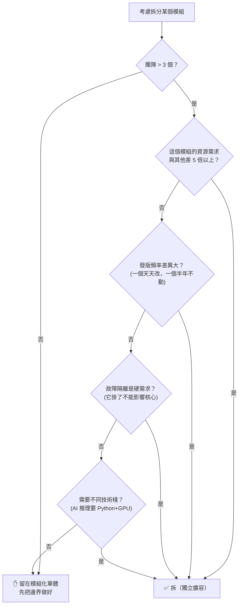
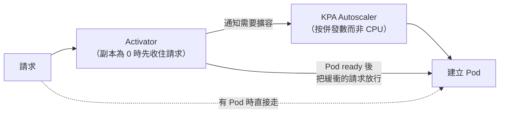
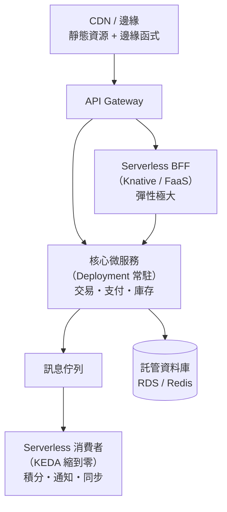

# 第十二章　現代微服務反思：Serverless 與模組化單體

> **本章場景**：我們花了 11 章把單體拆成 40 個服務，又花了 5 章建立基礎設施來管理它們。
> 現在誠實地問：**這一切值得嗎？有沒有拆過頭？**
> 本章是全書唯一「往回走」的一章，而它可能是最重要的一章。

---

## 12.1 微服務過度拆分的技術債

### 業界的集體覺醒

2014–2018 年是微服務的狂熱期，「拆得越細越先進」。
2020 年之後，大量公司開始**合併服務**。連微服務的重要推廣者都公開表示：
「微服務應該是最後手段，不是預設選項。」

### 症狀清單：你拆過頭了嗎

| 症狀 | 說明 |
|---|---|
| **分散式單體** | 40 個服務，但改一個功能要同時改 6 個、按順序發布 6 次。**拆開了卻沒解耦——這是最糟的情況**：既有單體的耦合，又有微服務的複雜度 |
| **鏈路過長** | 首頁請求扇出 47 個服務，P99 是所有依賴中最慢的那個的累積 |
| **服務比人多** | 12 個工程師維護 60 個服務。每人 5 個服務的 CI/CD、監控、on-call |
| **共享資料庫** | 5 個「微服務」連同一個 MySQL 同一張表。**這不是微服務，是有網路開銷的單體** |
| **貧血服務** | 一個服務只有 3 個 CRUD 介面、200 行程式碼，卻要一整套基礎設施 |
| **除錯地獄** | 查一個 bug 要在 8 個服務的日誌裡穿梭 |
| **改一個欄位要開會** | 加一個欄位要協調 4 個團隊、排 3 週 |

### 隱藏成本的量化

拆出一個新服務的真實成本：

| 項目 | 一次性 | 持續 |
|---|---|---|
| repo、CI/CD、部署設定 | 2–5 人日 | 每次基礎設施升級都要跟 |
| 監控、告警、儀表板 | 1–2 人日 | 持續調整 |
| 介面契約、SDK、文件 | 2–3 人日 | 每次變更 |
| 上下游聯調與測試環境 | 3–5 人日 | 每次發版 |
| **on-call 責任** | — | **永久** |
| 跨服務事務與一致性 | 5–20 人日 | 永久的 bug 來源 |

> **每個服務約有 15–35 人日的一次性成本，以及永久的維護稅。**
> 如果這個服務只有 200 行業務邏輯，**你付的稅是本金的 50 倍。**

### 根因：把「組織問題」當成「技術問題」解

康威定律（Conway's Law）：

> **「系統的架構，會複製設計它的組織的溝通結構。」**

微服務真正解決的是**組織擴展問題**——讓 8 個團隊可以獨立工作。
如果你只有 12 個人（2 個團隊），你根本沒有那個問題，
**卻付出了為 8 個團隊設計的架構成本。**

> **本書最重要的判斷句：**
>
> **微服務的收益與「團隊數量」成正比，成本與「服務數量」成正比。**
>
> 所以合理的服務數量約等於團隊數量（逆康威定律：先設計團隊，再設計架構）。
> 12 個人拆 60 個服務，注定是災難。

---

## 12.2 模組化單體的復興：幾時該拆、幾時該合

### 模組化單體（Modular Monolith）

**一個部署單元，但內部有嚴格的模組邊界。**

```
shop-app （單一部署單元、單一進程）
├── modules/
│   ├── catalog/          ← 商品上下文
│   │   ├── api/          ← ⭐ 唯一對外公開的介面
│   │   └── internal/     ← ⭐ 其他模組禁止 import
│   ├── ordering/
│   │   ├── api/
│   │   └── internal/
│   └── payment/
└── shared-kernel/        ← 極小的共用核心（ID 型別、事件基類）
```

**模組之間只能透過 `api` 套件通訊，`internal` 完全不可見。**
而且要**用工具強制執行**，不能只靠約定：

```java
// ArchUnit：把架構規則寫成測試，違反就讓 CI 紅燈
@ArchTest
static final ArchRule modules_must_not_touch_internals =
    noClasses().that().resideOutsideOfPackage("..catalog..")
        .should().accessClassesThat().resideInAPackage("..catalog.internal..");

@ArchTest
static final ArchRule no_cycles =
    slices().matching("com.shop.modules.(*)..").should().beFreeOfCycles();
```

> **關鍵洞察：模組化的紀律，跟「是否分開部署」是兩件獨立的事。**
>
> 很多人以為「拆成微服務」才能獲得邊界清晰。錯了——
> **邊界來自設計紀律，不是來自網路。**
> 把一團爛泥拆成 20 個服務，只會得到 20 團用 HTTP 連起來的爛泥。
>
> 反過來，一個模組邊界清晰的單體，**隨時可以在需要時把某個模組拆出去**
> （因為介面已經明確了）。這叫 **「為拆分做好準備，但不急著拆」**。

### 對照表

| | 模組化單體 | 微服務 |
|---|---|---|
| 部署單元 | 1 個 | N 個 |
| 模組間呼叫 | **方法呼叫（奈秒、不會失敗）** | 網路（毫秒、會失敗） |
| 交易 | **本地 ACID** | 分散式，要 Saga/訊息 |
| 除錯 | **一條 stack trace** | 分散式追蹤 |
| 獨立發版 | ❌ | ✅ |
| 獨立擴容 | ❌ | ✅ |
| 故障隔離 | ❌（同進程） | ✅ |
| 技術異構 | ❌ | ✅ |
| 基礎設施成本 | **低** | 高 |
| 適合團隊規模 | **1–3 個團隊** | 4 個以上 |

### 決策流程



### 合併服務也是進步

**把兩個服務合併回去，不是技術倒退，是誠實地修正錯誤。**

合併的訊號：
- 兩個服務**總是一起發版**（表示它們的變更軸是同一條）
- 它們之間的呼叫量遠大於對外的呼叫量（**內聚性高**）
- 它們共用資料模型
- 它們由同一個團隊維護

> 業界已有不少公開案例：把過度拆分的微服務重新整合回較大的服務，
> 大幅降低跨服務呼叫的延遲與成本。
> **這些案例的共同結論不是「微服務錯了」，而是「拆分的粒度要服務於真實約束」。**

---

## 12.3 全面 Serverless 化：Knative 與冷啟動優化

### Serverless 的本質

**不是「沒有伺服器」，是「你不需要思考伺服器」：**

| 特徵 | 說明 |
|---|---|
| **免容量規劃** | 不用決定要幾個副本、幾台機器 |
| **縮到零（Scale to Zero）** | 沒請求時不佔任何資源 |
| **按用量計費** | 按請求數 × 執行時間 × 記憶體，不是按機器小時 |
| **事件驅動** | 由 HTTP、訊息、排程、檔案上傳觸發 |

### Knative：K8s 上的 Serverless

```yaml
apiVersion: serving.knative.dev/v1
kind: Service
metadata: { name: coupon-service }
spec:
  template:
    metadata:
      annotations:
        autoscaling.knative.dev/minScale: "0"      # ⭐ 可縮到零
        autoscaling.knative.dev/maxScale: "500"
        autoscaling.knative.dev/target: "50"       # 每個 Pod 目標併發 50
    spec:
      containerConcurrency: 100
      containers:
      - image: registry.example.com/shop/coupon:2.1.0
        resources:
          requests: { cpu: "200m", memory: 256Mi }
```

這份 YAML 取代了：Deployment + Service + Ingress + HPA + 一堆設定。

**Knative 的關鍵元件**：



**Activator 的價值**：副本為 0 時，請求不會失敗——它會被**暫存住**，
等 Pod 起來再送過去。使用者只感受到「第一次比較慢」，不是「錯誤」。

**KPA 與 HPA 的差異**：KPA 按**併發請求數**擴縮（而非 CPU），對 I/O 密集型服務準確得多，
而且反應更快（秒級）。

### 冷啟動：Serverless 的阿基里斯腱

```
請求到達（副本為 0）
  ├─ 調度 Pod                    0.5 – 2 秒
  ├─ 拉取鏡像（有快取則跳過）    0 – 30 秒  ← 最大變數
  ├─ 啟動容器                    0.1 秒
  ├─ 應用初始化（JVM 最痛）      1 – 60 秒  ← 最大變數
  └─ 就緒探針通過                0.5 – 5 秒
總計：2 秒（Go）～ 90 秒（Spring Boot + 大鏡像）
```

**優化手段（依效果排序）**：

| 手段 | 效果 | 說明 |
|---|---|---|
| **換語言** | ⭐⭐⭐⭐⭐ | Go / Node.js / Rust 冷啟動 < 500 ms |
| **GraalVM 原生鏡像** | ⭐⭐⭐⭐⭐ | Spring Boot 從 30 秒 → **50 毫秒**，記憶體省 80%。代價：建置慢、反射需設定 |
| **`minScale: 1`（預留實例）** | ⭐⭐⭐⭐ | 保留 1 個常駐，**不是真的 Serverless 了，但實用** |
| **鏡像瘦身 + 鏡像預熱/懶加載** | ⭐⭐⭐ | distroless、分層快取、按需載入鏡像層 |
| **CRaC / 檢查點還原** | ⭐⭐⭐⭐ | 把 JVM 暖機後的記憶體快照存下來，啟動時直接還原 |
| **輕量沙箱** | ⭐⭐⭐ | Firecracker microVM（~125 ms）、WASM（**< 1 ms**） |

```dockerfile
# GraalVM 原生鏡像（Spring Boot 3）
FROM ghcr.io/graalvm/native-image-community:21 AS builder
COPY . /build
WORKDIR /build
RUN ./mvnw -Pnative native:compile -DskipTests

FROM gcr.io/distroless/base-debian12
COPY --from=builder /build/target/coupon /app/coupon
ENTRYPOINT ["/app/coupon"]
# 結果：鏡像 80 MB、啟動 50 ms、記憶體 64 MB
```

### 什麼適合 Serverless

| ✅ 適合 | ❌ 不適合 |
|---|---|
| **流量波動極大**（大促活動頁、秒殺報名） | 流量穩定且高（常駐更便宜） |
| **低頻但要隨時可用**（後台任務、webhook） | 對延遲極度敏感（冷啟動不可接受） |
| **事件處理**（圖片上傳後產縮圖、訊息消費） | 長連線（WebSocket、gRPC streaming） |
| **BFF / 前端渲染**（第 6.3 節） | 有大量本機狀態或需要 GPU 常駐 |
| 內部工具、定時任務 | 需要精細控制執行環境 |

> **成本的分水嶺**：Serverless 單位計算成本比常駐容器**貴 2–5 倍**，
> 但它**只在有流量時計費**。
> 所以：**利用率低於 ~15% 的服務，Serverless 更便宜；高於 40% 的，常駐更便宜。**
> 這正是第 13.3 節 FinOps 的核心算式。

---

## 12.4 從微服務到 FaaS：前端與業務平台實踐

### 最適合 Serverless 的場景：BFF

回顧第 6.3 節：BFF 負責聚合與裁剪，它的特徵是：

| BFF 特徵 | 為什麼適合 Serverless |
|---|---|
| 完全無狀態 | 隨時可殺可建 |
| 邏輯輕（主要是 I/O 聚合） | 執行時間短，計費低 |
| **流量波動大**（跟前端活動強相關） | 彈性收益最大 |
| 變更頻繁（跟隨前端迭代） | 部署快最有價值 |
| Node.js/TypeScript（前端團隊自己寫） | 冷啟動快 |

```javascript
// 一個 BFF 函式：聚合 4 個後端服務
export default async function handler(req, res) {
  const uid = req.user.uid;
  // 併發呼叫，不要用 await 串行（這是 BFF 最重要的效能紀律）
  const [profile, cart, recommend, coupons] = await Promise.allSettled([
    fetch(`${USER_SVC}/profile/${uid}`).then(r => r.json()),
    fetch(`${CART_SVC}/items?uid=${uid}`).then(r => r.json()),
    fetch(`${RECO_SVC}/feed?uid=${uid}`).then(r => r.json()),
    fetch(`${PROMO_SVC}/coupons?uid=${uid}`).then(r => r.json()),
  ]);
  // ⭐ allSettled 而非 all：任一失敗都降級，不讓整個首頁掛掉（第 5.4 節的降級）
  res.json({
    profile:   profile.status   === 'fulfilled' ? profile.value   : null,
    cart:      cart.status      === 'fulfilled' ? cart.value      : { items: [] },
    recommend: recommend.status === 'fulfilled' ? recommend.value : HOT_ITEMS_FALLBACK,
    coupons:   coupons.status   === 'fulfilled' ? coupons.value   : [],
  });
}
```

### 混合架構才是現實

**沒有公司是「純微服務」或「純 Serverless」。** 成熟的架構長這樣：



**分配原則**：

| 層 | 選擇 | 理由 |
|---|---|---|
| 邊緣/靜態 | CDN + 邊緣函式 | 離使用者最近，最便宜 |
| BFF / 活動頁 | **Serverless** | 波動大、變更頻繁 |
| **核心交易鏈路** | **常駐容器（Deployment）** | 流量穩定高、延遲敏感、要精細控制 |
| 非同步任務 | **Serverless + KEDA** | 按積壓量伸縮、可縮到零 |
| 資料層 | **雲端託管服務** | 第 8.2 節的結論 |

> **這張圖是全書架構觀的具體化：不存在「最好的架構」，
> 只存在「對這個模組、這個流量特徵、這個團隊規模最合適的選擇」。**

---

## 本章代價與下一章的痛

**我們做了什麼**：誠實地檢討了微服務的成本，
給出了「模組化單體 → 微服務 → Serverless」的選擇框架。

**核心結論**：

| 結論 |
|---|
| 服務數量應該約等於團隊數量，不是越多越好 |
| 邊界來自設計紀律，不是來自網路 |
| 合併服務是進步，不是倒退 |
| 混合架構是現實：核心常駐、邊緣彈性 |
| 拆分的正當理由只有五個（獨立發版、故障隔離、獨立擴容、團隊自治、技術異構） |

**新的痛點**：架構選對了，但**運維與治理的問題全面浮現**：

```
① 40 個服務 × 4 環境 × 8 種 K8s 資源 = 1,280 個 YAML 檔
   誰是真相？線上跑的跟 Git 裡的一樣嗎？上週誰手動改了什麼？

② 使用者說「下單很慢」
   查了 8 個服務的日誌，花了 3 小時，發現是某個服務的某次 Redis 呼叫偶發 2 秒
   —— 為什麼要花 3 小時？

③ 這個月雲端帳單 $180,000，比去年同期高 140%
   誰花的？花在哪？哪些是浪費？CFO 在等答案。

④ K8s 1.28 要 EOL 了，要升級
   誰來升？升級期間服務會中斷嗎？etcd 備份試過還原嗎？
```

下一章：[第十三章　雲原生生態：GitOps、可觀測性與 FinOps](13-GitOps可觀測性與FinOps.md)。

---

## 名詞速查

| 名詞 | 一句話 |
|---|---|
| 分散式單體 | 拆開了卻沒解耦，要一起改一起發的多服務 |
| 康威定律 | 系統架構會複製組織的溝通結構 |
| 模組化單體 | 單一部署單元，但內部有工具強制的模組邊界 |
| ArchUnit | 把架構規則寫成測試在 CI 中強制執行 |
| Knative / KPA | K8s 上的 Serverless 平台 / 按併發數擴縮的自動擴縮器 |
| 縮到零 Scale to Zero | 無流量時不保留任何副本 |
| 冷啟動 | 從零副本到能服務第一個請求的延遲 |
| GraalVM 原生鏡像 | AOT 編譯成原生執行檔，啟動毫秒級 |
| CRaC | 把暖機後的進程狀態快照化以加速啟動 |
