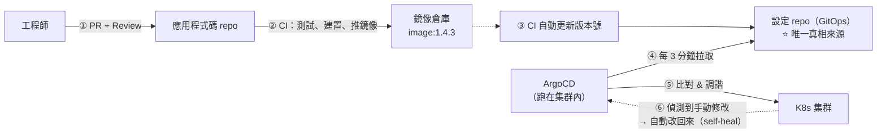
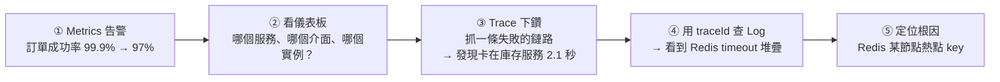
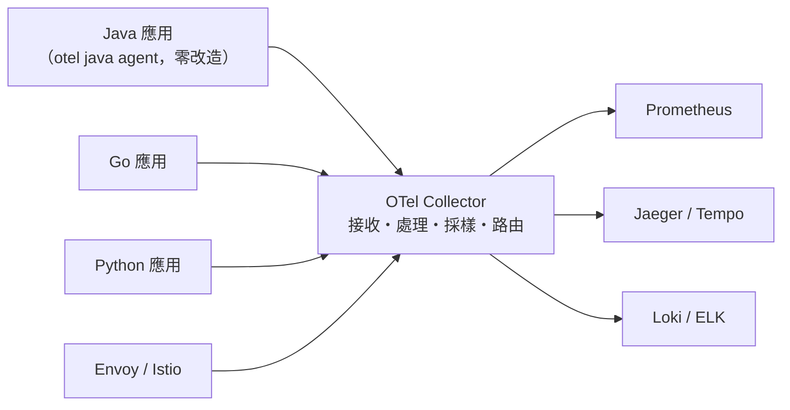
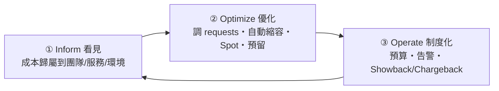

# 第十三章　雲原生生態：GitOps、可觀測性與 FinOps

> **本章場景**：1,280 個 YAML 沒人知道哪份是真相；查一個慢請求要 3 小時；
> 雲端帳單漲了 140% 沒人說得出花在哪；集群要升級但沒人敢動。
> 本章講的是**讓一切可控**的三件事：**可重現、可觀測、可計價**。

---

## 13.1 GitOps 持續部署：ArgoCD 實戰

### 傳統 CI/CD 的問題

```
CI（建置測試）→ CD（腳本 kubectl apply / helm upgrade）
```

| 問題 | 說明 |
|---|---|
| **CI 系統需要集群的最高權限** | Jenkins 被入侵 = 整個生產集群失守 |
| **無法回答「線上現在是什麼狀態」** | 有人手動 `kubectl edit` 改過，Git 裡看不到 |
| **配置漂移** | 緊急事故時手動改的設定，下次部署又被蓋回去（或忘了同步而永遠不一致） |
| **回滾靠 CI 重跑** | 要重新走一遍流程，慢且可能失敗 |

### GitOps 的四個原則

> 1. **宣告式**：整個系統的期望狀態用宣告式設定描述。
> 2. **版本化且不可變**：狀態存在 Git 裡，有完整歷史、可審計、可回滾。
> 3. **自動拉取（Pull）**：**集群內的 Agent 主動去拉 Git**，而不是外部 CI 推進來。
> 4. **持續調諧（Reconcile）**：Agent 持續比對 Git 與實際狀態，**自動修正差異**。

**注意第 3、4 條——這正是第 8.3 節「控制迴圈」思想的延伸：**
**把 K8s 的 reconcile 迴圈，從「集群內」延伸到「Git ↔ 集群」之間。**



**關鍵：CI 系統不再需要集群憑證。** 它只需要能推鏡像、能提交 Git。
**集群的寫入權限只有集群內的 ArgoCD 持有。** 安全性大幅提升。

### 兩個 repo 的分工

| repo | 內容 | 誰改 |
|---|---|---|
| **應用 repo** | 業務程式碼、Dockerfile、單元測試 | 開發工程師 |
| **設定 repo** | K8s YAML / Helm values / Kustomize overlay | CI 自動更新版本號；人工改設定（走 PR） |

### ArgoCD 設定

```yaml
apiVersion: argoproj.io/v1alpha1
kind: Application
metadata:
  name: item-service-prod
  namespace: argocd
spec:
  project: shop
  source:
    repoURL: https://git.example.com/shop/k8s-config.git
    targetRevision: main
    path: overlays/prod/item-service
  destination:
    server: https://kubernetes.default.svc
    namespace: shop
  syncPolicy:
    automated:
      prune: true        # ⭐ Git 裡刪掉的資源，集群裡也刪掉
      selfHeal: true     # ⭐ 有人手動改 → 自動改回 Git 的狀態
    syncOptions: [CreateNamespace=true]
    retry:
      limit: 5
      backoff: { duration: 5s, factor: 2, maxDuration: 3m }
```

> **`selfHeal: true` 是 GitOps 的靈魂**：它讓「手動改生產環境」這件事**在物理上不可能**。
> 你改了，3 分鐘後它就變回去。
> **想改？去提 PR。** ——這就是把「流程紀律」變成「系統強制」。

### YAML 爆炸的解法：Helm 與 Kustomize

| | Helm | Kustomize |
|---|---|---|
| 方式 | **模板引擎**（Go template + values） | **覆蓋補丁**（base + overlays） |
| 優點 | 打包分發強、生態豐富（安裝第三方元件） | **無模板語法**，YAML 就是 YAML；K8s 內建（`kubectl -k`） |
| 缺點 | 模板複雜後難讀難除錯 | 不適合做「可分發的套件」 |
| 適合 | **安裝第三方元件**（Prometheus、Istio） | **管理自家應用的多環境差異** |

```
# Kustomize 的典型結構
base/
  deployment.yaml        # 共同部分
  service.yaml
  kustomization.yaml
overlays/
  dev/kustomization.yaml       # replicas: 1, image tag: dev
  staging/kustomization.yaml
  prod/
    kustomization.yaml
    replicas-patch.yaml        # replicas: 20
    resources-patch.yaml       # 更大的 requests/limits
```

```yaml
# overlays/prod/kustomization.yaml
resources: [../../base]
namespace: shop
images:
- name: item-service
  newTag: 1.4.3                # ⭐ CI 只需要改這一行
replicas:
- { name: item-service, count: 20 }
patches:
- path: resources-patch.yaml
```

**實務上常見的組合**：用 Helm 裝第三方元件，用 Kustomize 管自家應用。

### 多集群：ApplicationSet

```yaml
apiVersion: argoproj.io/v1alpha1
kind: ApplicationSet
spec:
  generators:
  - list:
      elements:
      - { cluster: hangzhou, url: https://hz.k8s.example.com }
      - { cluster: shanghai, url: https://sh.k8s.example.com }
      - { cluster: shenzhen, url: https://sz.k8s.example.com }
  template:
    metadata: { name: 'item-service-{{cluster}}' }
    spec:
      source:
        repoURL: https://git.example.com/shop/k8s-config.git
        path: 'overlays/prod/{{cluster}}/item-service'
      destination: { server: '{{url}}' }
```
一份定義，部署到三個集群——這是第 11.4 節多集群管理最務實的做法。

---

## 13.2 可觀測性三支柱：Log / Metric / Trace 與 OpenTelemetry

### 監控 vs 可觀測性

| | 監控（Monitoring） | 可觀測性（Observability） |
|---|---|---|
| 回答 | **「已知的問題」**：CPU 高不高？服務活著嗎？ | **「未知的問題」**：為什麼只有這批使用者在這個時段變慢？ |
| 方式 | 預先定義的指標與告警 | 事後任意維度的探索與下鑽 |
| 比喻 | 儀表板上的警示燈 | 完整的行車記錄器 + 可回放 |

**微服務讓「未知的未知（unknown unknowns）」大量增加**，
所以我們需要的不只是監控。

### 三支柱

| | Metrics 指標 | Logs 日誌 | Traces 追蹤 |
|---|---|---|---|
| 是什麼 | 時序數值（QPS、延遲、錯誤率） | 離散事件記錄 | 一個請求在各服務間的完整路徑 |
| 回答 | **「有沒有問題」** | **「發生了什麼細節」** | **「慢在哪一段」** |
| 成本 | 低（聚合後很小） | **高**（量最大） | 中（通常要採樣） |
| 工具 | Prometheus / VictoriaMetrics | Loki / ELK / ClickHouse | Jaeger / Tempo / SkyWalking |

### 排查流程（把三者串起來）



**這條路徑能不能走通，取決於一件事：`traceId` 有沒有貫穿全部三者。**

> **可觀測性工程的第一件事，不是買工具，是讓 traceId 出現在每一條日誌裡。**

```java
// 日誌必須帶 traceId（OpenTelemetry 會自動注入 MDC）
// logback-spring.xml
// <pattern>%d{HH:mm:ss.SSS} [%thread] %-5level [trace=%X{trace_id} span=%X{span_id}] %logger{36} - %msg%n</pattern>
```

### 分散式追蹤的原理

```
Trace ID: 7f3a9c2e...（一個請求全程唯一）
│
├─ Span: gateway            [====================================] 820 ms
│   ├─ Span: trade-service      [==============================] 790 ms
│   │   ├─ Span: item-service       [===]  25 ms
│   │   ├─ Span: inventory-service        [==================] 610 ms  ⚠️
│   │   │   └─ Span: redis GET stock:8899     [=============] 580 ms  ⚠️⚠️ 找到了
│   │   └─ Span: mysql INSERT order              [==] 40 ms
│   └─ Span: promo-service      [=] 15 ms
```

傳播靠 **W3C Trace Context** 標準的 HTTP header：

```
traceparent: 00-7f3a9c2e5b1d4a8f9c0e2d6b8a4f1c3e-a1b2c3d4e5f6a7b8-01
             │  └─ trace-id (32 hex) ─────────┘ └─ span-id ──┘  └ flags
             └ version
```

> **跨執行緒/非同步的傳播是最容易斷掉的地方**：
> 丟進執行緒池、發到 MQ 之後，context 常常就丟了。
> 送 MQ 時要把 traceparent 放進訊息 header，消費時取出來延續。

### OpenTelemetry：終結供應商鎖定

過去每種工具都有自己的 SDK：換一次 APM 廠商要改所有應用的程式碼。
**OpenTelemetry（OTel）** 是 CNCF 的統一標準（API + SDK + 協議 OTLP + Collector）。



```bash
# Java 零程式碼接入
java -javaagent:opentelemetry-javaagent.jar \
     -Dotel.service.name=item-service \
     -Dotel.exporter.otlp.endpoint=http://otel-collector:4317 \
     -Dotel.traces.sampler=parentbased_traceidratio \
     -Dotel.traces.sampler.arg=0.1 \
     -jar app.jar
```

**Collector 的價值**：應用只需要送到一個地方，
後端要換（Jaeger → Tempo）只改 Collector 設定，**應用完全不動**。
它還能做**採樣、過濾、脫敏（移除 PII）、限流**——這些不該寫在應用裡。

### 該監控什麼：黃金訊號與 SLO

**Google SRE 的四個黃金訊號**：

| 訊號 | 意思 | PromQL 範例 |
|---|---|---|
| **Latency 延遲** | 請求耗時（**要分開統計成功與失敗**） | `histogram_quantile(0.99, sum(rate(http_duration_bucket[5m])) by (le))` |
| **Traffic 流量** | QPS | `sum(rate(http_requests_total[5m]))` |
| **Errors 錯誤** | 錯誤率 | `sum(rate(http_requests_total{code=~"5.."}[5m])) / sum(rate(http_requests_total[5m]))` |
| **Saturation 飽和度** | 資源使用程度（最受限的那個） | 執行緒池使用率、連線池使用率、佇列長度 |

> **一定要用 P99/P95，不要用平均值。**
> 平均 100 ms 可能是「99% 的人 50 ms，1% 的人 5 秒」。
> 那 1% 是你最活躍的使用者（資料多、查詢重），也是最會抱怨的人。

**SLI / SLO / 錯誤預算**：

```
SLI（指標）：過去 30 天，成功且 < 500ms 的請求比例
SLO（目標）：99.9%
錯誤預算  ：0.1% × 30 天 = 43 分鐘的不可用額度
```

**錯誤預算的管理意義（這是 SRE 最精妙的設計）**：

| 狀態 | 行動 |
|---|---|
| 預算還剩很多 | **可以大膽發布新功能、做實驗** |
| 預算快用完 | **凍結發布，全力做穩定性** |

> 它把「要速度還是要穩定」這個永恆的爭吵，變成一個**雙方都同意的數字**。
> 產品經理與 SRE 不用再吵架，只要看預算剩多少。

**告警原則**：

| ✅ 該告警 | ❌ 不該告警 |
|---|---|
| **對使用者有影響**（錯誤率上升、延遲飆高） | CPU 80%（如果使用者沒感覺，那是正常運作） |
| 錯誤預算即將耗盡 | 單一 Pod 重啟（K8s 會自癒） |
| 容量即將見底（磁碟 7 天內會滿） | 任何「看看就好」的指標 |

**告警疲勞是可靠性的頭號敵人**：一天 200 條告警，等於沒有告警。
**每一條告警都必須是「需要人類立刻介入」的。**

---

## 13.3 成本治理 FinOps：混部與資源利用率

### 帳單為什麼失控

K8s 讓「開資源」變得極其容易——改一個數字就多 50 個 Pod。
**但沒有任何機制讓人感受到成本。**

典型的浪費結構：

| 浪費 | 佔比（經驗值） | 原因 |
|---|---|---|
| **requests 過度申請** | 30–50% | 工程師怕 OOM，申請 4 核實際用 0.3 核 |
| 沒有縮容 | 10–20% | 大促擴容後忘了縮回去 |
| 閒置資源 | 10–15% | 測試環境整晚整週跑著 |
| 儲存與快照未清理 | 5–10% | PVC 刪了但磁碟設 `Retain`、舊快照堆積 |
| 跨可用區流量費 | 3–8% | 服務呼叫沒有拓撲親和性 |
| 未使用預留/節省方案 | 15–30% | 全部用隨需計費 |

### FinOps 的三階段循環



**第一步永遠是「看見」。** 沒有成本歸屬，一切優化都是空談。

```yaml
# 一切從標籤開始 —— 沒有標籤就沒有歸屬
metadata:
  labels:
    app: item-service
    team: catalog                 # ⭐ 哪個團隊
    cost-center: ecommerce        # ⭐ 哪個成本中心
    env: prod
    business-unit: marketplace
```

工具：**OpenCost / Kubecost**（CNCF），把 K8s 資源用量換算成金額，
按 namespace / label / 團隊出報表。

### 優化手段

#### ① 修正 requests（效果最大）

```promql
# 找出 requests 遠大於實際用量的浪費大戶
(
  sum by (namespace, pod) (kube_pod_container_resource_requests{resource="cpu"})
  -
  sum by (namespace, pod) (rate(container_cpu_usage_seconds_total[7d]))
) > 1
```

用 **VPA 的 recommender 模式**（只建議、不自動改）拿到建議值，人工審核後套用：

```
建議公式：
  CPU requests    = P95 用量 × 1.2
  Memory requests = P99 用量 × 1.3   （記憶體超了會死，要保守）
```

#### ② 用便宜的算力

| 手段 | 省多少 | 風險 |
|---|---|---|
| **Spot / 搶占式實例** | **60–90%** | 隨時可能被回收（2 分鐘通知） |
| 預留實例 / 節省計畫 | 30–60% | 需承諾 1–3 年 |
| ARM 架構節點（Graviton 等） | 20–40% | 需要多架構鏡像（`docker buildx`） |

**Spot 的正確用法**：

```yaml
# 無狀態、可中斷的工作負載放 Spot；核心服務放隨需
nodeSelector: { node-lifecycle: spot }
tolerations:
- { key: spot, operator: Exists, effect: NoSchedule }
# 搭配 PDB + 多可用區 + 節點中斷處理器（優雅驅逐）
```

> **原則：核心 P0 服務跑隨需/預留實例，批次任務與 P2/P3 服務跑 Spot。**
> 這又是第 5.4 節「服務分級」的一次應用——**分級是架構治理的通用工具。**

#### ③ 在離線混部（大廠的殺手鐧）

```
線上服務（交易）：白天高峰，夜間閒置。為了尖峰保留大量餘量
離線任務（訓練、報表）：什麼時候跑都行，但要吃很多資源

混部：把離線任務調度到線上服務的閒置資源上
      線上流量來了 → 壓制/驅逐離線任務，優先保障線上
```

K8s 生態的實作：**Koordinator、Volcano、Katalyst**。
核心技術是**資源超賣 + QoS 分級 + 干擾偵測**：

```yaml
# Koordinator：把離線任務標記為低優先級
labels:
  koordinator.sh/qosClass: BE        # Best Effort，可被壓制
priorityClassName: koord-batch
```

> 這能把集群利用率從 30% 推到 50–65%。
> 但它需要**核心級的資源隔離**（CPU 組、記憶體頻寬、L3 cache 隔離），
> 是大廠才玩得起的技術。中小團隊的主要收益仍在「修正 requests + Spot + 關掉沒用的東西」。

#### ④ 非生產環境定時關機

```yaml
# 測試環境每天晚上 8 點縮到 0，早上 9 點起來
# 一週 168 小時只用 55 小時 → 省 67%
apiVersion: batch/v1
kind: CronJob
metadata: { name: scale-down-dev }
spec:
  schedule: "0 12 * * 1-5"     # UTC 12:00 = 台北 20:00
  jobTemplate:
    spec:
      template:
        spec:
          containers:
          - name: kubectl
            image: bitnami/kubectl
            command: ["kubectl","scale","deploy","--all","--replicas=0","-n","dev"]
          restartPolicy: OnFailure
```

**這是投入 1 小時、立刻省下數萬元的優化。** 通常也是最先被忽略的。

### 成本文化

> **FinOps 不是「省錢」，是「讓工程師看得到自己的決策要花多少錢」。**
>
> 當工程師在 PR 裡看到「這個改動會讓每月成本增加 $3,200」時，
> 他自然會想想是不是真的需要 8 核。
> **把成本變成可見的回饋迴路，比任何節流政策都有效。**

---

## 13.4 公有雲託管 K8s：ACK / EKS / GKE 最佳實踐

### 自建 vs 託管

| 面向 | 自建 K8s | 託管 K8s |
|---|---|---|
| 控制面維運 | **你自己來**（etcd 備份、升級、憑證輪換、高可用） | 雲廠商負責 |
| 控制面費用 | 3 台機器的成本 | 通常免費或每小時 $0.10 |
| 版本升級 | 高風險大工程 | 幾乎一鍵（仍需驗證相容性） |
| 雲服務整合 | 要自己裝 CSI/CCM/CNI | 開箱即用（LB、雲盤、IAM、日誌） |
| 需要的人力 | **1–2 名全職 K8s 專家** | 0.5 名 |

> **結論很明確：除非有極特殊需求（合規、自有機房、成本規模極大），
> 一律用託管 K8s。**
>
> **etcd 備份與還原演練**這一件事，就足以說服大多數團隊：
> 你敢保證自己的 etcd 備份真的能還原嗎？你上次演練是什麼時候？
> （沒演練過的備份 = 沒有備份。）

### 託管 K8s 的實踐清單

```
□ 控制面
  □ 選擇有 SLA 保證的等級
  □ API Server 存取限制（私網 / 白名單）
  □ 啟用審計日誌（Audit Log）並保存 180 天
□ 節點
  □ 至少 3 個可用區
  □ 分節點池：核心服務池（隨需）/ 批次池（Spot）/ GPU 池
  □ 節點自動修復與自動升級（分批）
  □ 用託管節點組或 Karpenter，別手動管機器
□ 網路
  □ CNI 選型（VPC 原生 IP 效能最好，但要注意 IP 位址規劃）
  □ NetworkPolicy 預設拒絕，明確放行（零信任）
  □ 出口流量統一走 NAT 網關，方便審計
□ 安全
  □ RBAC 最小權限；禁用長效 token，用雲端身分（IRSA / RRSA / Workload Identity）
  □ Secret 走外部機密管理（第 10.4 節）
  □ 鏡像掃描 + 簽章驗證（准入控制擋下未簽章鏡像）
  □ Pod Security Standards: restricted
□ 可靠性
  □ 所有 Deployment 有 PDB、探針、resources、topologySpreadConstraints
  □ etcd/集群層級備份（Velero）
  □ 定期做災難演練（混沌工程）
□ 成本
  □ 全資源打標籤
  □ OpenCost/Kubecost 成本可見
  □ 非生產環境定時關機
```

### 升級策略

```
① 讀 changelog，特別注意 API 棄用（用 kubent / pluto 掃描）
② 先升測試集群，跑完整回歸
③ 升級控制面（雲廠商通常滾動升級，無中斷）
④ 節點池「藍綠升級」：建新版本節點池 → 逐步 drain 舊節點池 → 觀察 → 刪除舊池
   （比原地升級安全，隨時可回退）
⑤ 全程確認 PDB 生效，避免 drain 造成服務中斷
```

> **K8s 的支援週期約一年，一年至少要升一次。**
> 把升級變成常規演練（每季一次小版本），而不是三年一次的大冒險。
> **架構的可維護性，很大程度上就是「升級有多痛」。**

---

## 本章代價與下一章的痛

**我們做了什麼**：GitOps 讓部署可重現可審計、OTel 讓系統可觀測、
FinOps 讓成本可見、託管 K8s 讓集群本身有人管。

**至此，一個成熟的雲原生平台完成了。**

**新的痛點**：2023 年之後，一種全新的工作負載闖進了這套體系：

```
推薦團隊：我們要跑一個 70B 參數的模型，需要 8 張 A100，
          而且要用 RDMA 網路做多機推理
搜尋團隊：我們要把商品搜尋改成向量檢索 + LLM 重排
客服團隊：我們要上生成式對話，要求首字回應 < 800 ms
前端團隊：我們要做生成式 UI，頁面由模型即時產生

運維團隊：……我們的 K8s 是為了跑「無狀態的 Java 微服務」設計的。
          這些東西的資源模型、彈性模型、成本模型、故障模式，
          跟我們過去 10 年做的事，完全不一樣。
```

下一章：[第十四章　AI 時代的架構革新](14-AI時代的架構革新.md)。

---

## 名詞速查

| 名詞 | 一句話 |
|---|---|
| GitOps | Git 為唯一真相來源，集群內 Agent 拉取並持續調諧 |
| selfHeal / prune | 自動修正手動變更 / 自動刪除 Git 中已移除的資源 |
| Helm / Kustomize | 模板引擎 / 無模板的覆蓋補丁 |
| 可觀測性三支柱 | Metrics（有沒有事）/ Logs（細節）/ Traces（慢在哪） |
| OpenTelemetry | 統一的遙測標準與 Collector，避免廠商鎖定 |
| W3C Trace Context | `traceparent` header，跨服務傳遞追蹤上下文 |
| 四個黃金訊號 | 延遲、流量、錯誤、飽和度 |
| SLI / SLO / 錯誤預算 | 指標 / 目標 / 可用來換取發布速度的額度 |
| FinOps | 讓成本可見、可歸屬、可優化的工程實踐 |
| 在離線混部 | 用線上服務的閒置資源跑離線任務 |
