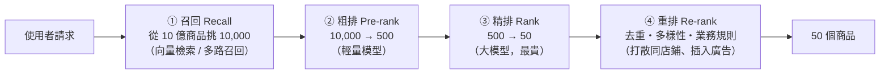
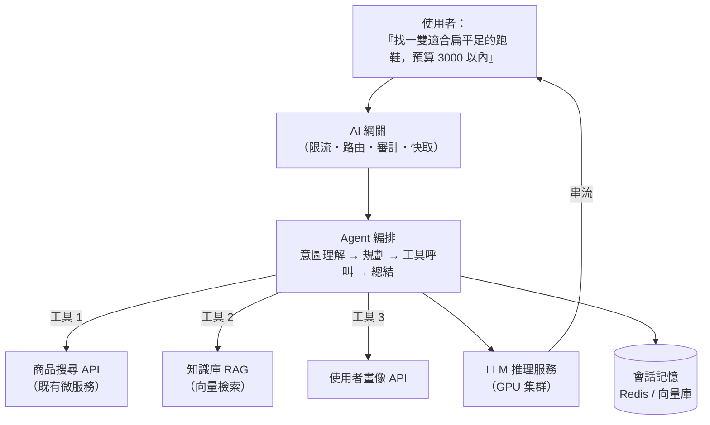
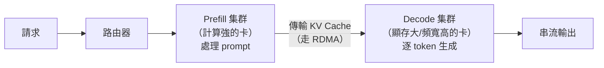

# 第十四章　AI 時代的架構革新

> **本章場景**：我們的 K8s 是為「無狀態 Java 微服務」設計的。
> 現在闖進來一種新的工作負載：**要 GPU、要幾十 GB 記憶體、啟動要 5 分鐘、
> 一個請求要跑 3 秒、成本是普通 Pod 的 50 倍。**
> 本章要回答：雲原生的那套方法論，有哪些還能用、哪些必須重寫。

> ⚠️ **本章與第十五、十六章涉及快速變動的技術。**
> 具體產品能力與命名請以官方文件當前版本為準；本書的重點在
> **「它解決哪個老問題」與「架構取捨」**，這部分不會過時。

---

## 14.1 從千人千面到生成式 UI 與 AI Agent 導購

### 三個世代的「個人化」

| 世代 | 技術 | 架構特徵 | 延遲預算 |
|---|---|---|---|
| **① 規則/協同過濾**（2010s 初） | 「買了 A 的人也買了 B」 | 離線批次算好，線上查表 | < 10 ms |
| **② 深度學習推薦**（2015–2022） | 召回 → 粗排 → 精排 → 重排 | 線上即時推論，**毫秒級小模型** | 10–100 ms |
| **③ 生成式**（2023–） | LLM 理解意圖、生成內容與介面 | **秒級大模型推論，串流輸出** | 800 ms 首字 |

### 世代二的經典架構（仍然是今天的主力）



**為什麼要分四層？** 因為**計算量守恆**：
精排模型每個商品要算 5 ms，10 億個商品要算 58 天。
所以用「便宜的模型篩掉大部分，昂貴的模型只看少數」——
**這是一個經典的「漏斗式資源分配」架構模式**，值得記住。

**特徵儲存（Feature Store）** 是這條鏈路的關鍵基礎設施：

| 特徵類型 | 來源 | 儲存 | 延遲要求 |
|---|---|---|---|
| 離線特徵（近 30 天購買品類） | 數倉批次計算 | HBase / Redis | < 5 ms |
| 近線特徵（近 1 小時瀏覽） | Flink 串流 | Redis | < 3 ms |
| **即時特徵**（本次 session 點了什麼） | 請求上下文 | 記憶體 | 0 |

> **訓練/服務偏斜（training-serving skew）** 是這裡最惡名昭彰的 bug：
> 離線訓練用 Spark 算特徵，線上服務用 Java 算特徵，兩份程式碼算出的結果有細微差異，
> 模型線上效果就莫名其妙變差。
> **解法：特徵計算邏輯必須只有一份**（統一的 Feature Store 或共用的 UDF）。
> 這與第 6.1 節 Lambda 架構「同一邏輯寫兩遍」是完全相同的病。

### 世代三：生成式帶來的架構衝擊

| 面向 | 傳統微服務 | LLM 推理服務 |
|---|---|---|
| 單請求耗時 | 10–100 ms | **1–30 秒** |
| 回應方式 | 一次回完 | **串流（SSE / WebSocket）逐字吐** |
| 資源 | CPU 密集 | **GPU 記憶體（HBM）密集** |
| 單實例併發 | 數百 | **數個到數十個** |
| 成本/請求 | ~$0.000001 | **~$0.001–0.1（貴 1000 倍以上）** |
| 冷啟動 | 秒級 | **分鐘級（載入數十 GB 權重）** |
| 結果 | **確定性** | **非確定性**（同輸入可能不同輸出） |
| 失敗模式 | 超時、5xx | **幻覺、格式錯誤、安全違規** |

**最後一列最關鍵**：傳統服務的錯誤是「有沒有回應」，
LLM 的錯誤是「回應了，但內容是錯的/危險的」。
**這是一種傳統可觀測性完全捕捉不到的故障。**

### 生成式 UI 與 Agent 導購的架構



> **請注意一件事**：中間那些「工具」，就是我們前 13 章辛苦建立的微服務。
>
> **AI 沒有取代微服務架構，它變成了微服務架構的一個新前端。**
> 你的商品搜尋 API、庫存 API、訂單 API 依然是真相來源，
> 只是呼叫方從「App 的 UI 程式碼」變成了「模型的工具呼叫」。
>
> **這意味著：前 13 章的功夫沒有白費，而且變得更重要了**——
> 因為 Agent 呼叫 API 的頻率與不可預測性，遠高於人類點擊 UI。
> 你的限流、冪等、降級設計，現在要面對一個「會自己重試、會併發呼叫 20 次」的客戶端。

---

## 14.2 K8s 調度 GPU：vGPU / MIG / RDMA 高速網路

### GPU 為什麼難調度

| CPU | GPU |
|---|---|
| 可壓縮資源，超了變慢 | **不可分割**（預設一張卡只能給一個容器） |
| 便宜（每核每小時幾分錢） | **極貴**（A100/H100 每小時數美元） |
| 隨處可得 | **供給有限，經常搶不到** |
| 用量可即時伸縮 | 模型載入要數分鐘，無法快速伸縮 |

**核心矛盾**：一張 80 GB 的 A100 給一個只需要 8 GB 的小模型用，**浪費 90%**。
但 K8s 預設的 GPU 調度是整卡分配。

### 基本用法

```yaml
spec:
  containers:
  - name: inference
    image: vllm/vllm-openai:latest
    resources:
      limits:
        nvidia.com/gpu: 2          # ⭐ 只能是整數，不能是 0.5
  nodeSelector:
    accelerator: nvidia-a100
  tolerations:
  - { key: nvidia.com/gpu, operator: Exists, effect: NoSchedule }
```

底層是 **Device Plugin** 機制：NVIDIA 的 device plugin 以 DaemonSet 跑在每個 GPU 節點上，
向 kubelet 註冊 `nvidia.com/gpu` 這個可分配資源。

### GPU 共享的三條路

| 方案 | 隔離強度 | 粒度 | 說明 |
|---|---|---|---|
| **時間切片（Time-slicing）** | ❌ 無隔離 | 任意份數 | 多容器輪流用同一張卡。**會互相干擾**，適合開發測試 |
| **MIG**（Multi-Instance GPU） | ✅ **硬體級隔離** | A100 最多 7 份 | 把一張卡在硬體上切成多個獨立實例，**各有專屬 SM 與記憶體頻寬**。只有 A100/H100 等支援 |
| **vGPU / 軟體虛擬化** | 🟡 中等 | 按記憶體與算力比例 | 如 NVIDIA vGPU、開源的 HAMi/rCUDA 等，可限制顯存與算力配額 |

```yaml
# MIG：把 A100 切成 7 份，每份 10GB
resources:
  limits:
    nvidia.com/mig-1g.10gb: 1
```

> **選擇原則**：
> **線上推理服務用 MIG 或整卡**（需要效能可預測）；
> **開發、測試、批次任務用時間切片**（可以忍受互相干擾）。

### RDMA：多機推理的命脈

當模型大到單機放不下（如 400B 參數），必須**張量並行**切到多台機器。
此時 GPU 之間要頻繁交換中間結果（all-reduce），**網路成為瓶頸**。

| 網路 | 頻寬 | 延遲 | CPU 開銷 |
|---|---|---|---|
| 傳統 TCP/IP 25 GbE | 25 Gbps | 50–100 μs | 高（要經過核心） |
| **RDMA（RoCE / InfiniBand）** | 100–400 Gbps | **1–5 μs** | **極低（繞過核心與 CPU）** |

**RDMA（Remote Direct Memory Access）** 讓一台機器的網卡直接讀寫另一台機器的記憶體，
完全繞過作業系統核心。

K8s 上要用 RDMA，需要：

```yaml
# 透過 Multus CNI 給 Pod 加上第二張高速網卡
metadata:
  annotations:
    k8s.v1.cni.cncf.io/networks: rdma-net
spec:
  containers:
  - resources:
      limits:
        nvidia.com/gpu: 8
        rdma/hca: 1              # SR-IOV 虛擬功能
```

還需要 **Gang Scheduling（成組調度）**——這是傳統 K8s 調度器的一大缺陷：

> **問題**：一個 8 Pod 的訓練任務，K8s 預設會一個一個調度。
> 如果只有 6 台機器有空，它會先起 6 個 Pod（**佔住 6 台 GPU 機器**），
> 然後這 6 個永遠等不到另外 2 個，**任務永遠不會開始，資源永遠不會釋放**。
> 更糟的是，如果有兩個任務同時這樣，就會**互相死鎖**。
>
> **解法**：`Volcano` 或 `Kueue` 提供「要嘛全部一起調度，要嘛都不調度」的語意。

```yaml
# Volcano：全有或全無
apiVersion: scheduling.volcano.sh/v1beta1
kind: PodGroup
spec:
  minMember: 8              # 湊不齊 8 個就一個都不起
  queue: training
```

> **這是本書「架構思想」的又一個例子**：
> K8s 的預設調度器是為「相互獨立的無狀態 Pod」設計的。
> AI 工作負載的 Pod **彼此相依**，於是整個調度模型必須擴展。
> 幸好 K8s 的可擴展設計（調度器框架 + CRD）讓這件事可以由社群完成，
> **不用換掉整個平台**——這正是第 8.3 節說 K8s 勝出的深層原因。

---

## 14.3 推理服務雲原生部署：vLLM / Triton + K8s

### 推理服務與普通服務的差別

LLM 推理分兩個階段，資源特性完全不同：

| 階段 | 做什麼 | 特性 |
|---|---|---|
| **Prefill（預填充）** | 處理輸入 prompt，產生 KV Cache | **計算密集**，可高度並行 |
| **Decode（解碼）** | 逐個 token 生成 | **記憶體頻寬密集**，序列化，慢 |

**KV Cache** 是關鍵：它把已計算的注意力鍵值存起來，避免重複計算，
但它**極度消耗顯存**——一個長對話的 KV Cache 可能佔用數 GB。

### vLLM 的兩個關鍵技術

| 技術 | 解決什麼 |
|---|---|
| **PagedAttention** | 像作業系統的虛擬記憶體分頁一樣管理 KV Cache，**大幅減少顯存碎片**，讓同一張卡能服務更多併發 |
| **Continuous Batching** | 不等湊滿一批才處理；**某個請求生成完就立刻讓新請求插進來**，GPU 利用率大幅提升 |

> 傳統的靜態批次：一批 8 個請求，最長的那個要 30 秒，**其他 7 個算完也要等它**。
> Continuous Batching：算完就走，空位立刻補新的。**這是吞吐量的數量級差異。**

### 部署範例

```yaml
apiVersion: apps/v1
kind: Deployment
metadata: { name: llm-inference }
spec:
  replicas: 4
  template:
    spec:
      containers:
      - name: vllm
        image: vllm/vllm-openai:latest
        args:
        - --model=/models/qwen-14b
        - --tensor-parallel-size=2        # 單機兩張卡做張量並行
        - --gpu-memory-utilization=0.90
        - --max-model-len=8192
        - --enable-prefix-caching         # ⭐ 共同前綴的 KV Cache 重用
        resources:
          limits:
            nvidia.com/gpu: 2
            memory: 64Gi
        volumeMounts:
        - { name: models, mountPath: /models, readOnly: true }
        - { name: shm, mountPath: /dev/shm }         # ⭐ 多卡通訊需要大 shm
        startupProbe:
          httpGet: { path: /health, port: 8000 }
          failureThreshold: 60
          periodSeconds: 10                          # ⭐ 容忍 10 分鐘載入模型
        readinessProbe:
          httpGet: { path: /health, port: 8000 }
      volumes:
      - name: models
        persistentVolumeClaim: { claimName: model-store }     # 唯讀共享儲存
      - name: shm
        emptyDir: { medium: Memory, sizeLimit: 16Gi }
```

### 四個必須重新思考的設計

#### ① 冷啟動：模型載入是分鐘級

| 手段 | 說明 |
|---|---|
| 模型存共享儲存（RWX）並預熱到節點本地快取 | 避免每個 Pod 從物件儲存拉 30 GB |
| 節點層級的模型快取 + 鏡像預拉取 | DaemonSet 預先把模型拉到本地 NVMe |
| **保留最小副本（不縮到零）** | 對延遲敏感的線上推理，`minReplicas >= 1` |
| 模型與鏡像分離 | 模型不要打進鏡像（鏡像會變成 40 GB） |

#### ② 擴縮容指標：CPU 完全無用

```yaml
# ❌ CPU 使用率對 GPU 服務毫無意義
# ✅ 用推理專屬指標
metrics:
- type: Pods
  pods:
    metric: { name: vllm_num_requests_waiting }   # 排隊中的請求數
    target: { type: AverageValue, averageValue: "5" }
- type: Pods
  pods:
    metric: { name: vllm_gpu_cache_usage_perc }   # KV Cache 使用率
    target: { type: AverageValue, averageValue: "80" }
```

#### ③ 負載均衡：輪詢是錯的

普通服務輪詢沒問題，因為每個請求成本差不多。
**LLM 請求的成本可以差 100 倍**（生成 10 個 token vs 4000 個 token）。

| 更好的策略 | 說明 |
|---|---|
| **最少排隊請求數** | 看各實例的實際佇列 |
| **KV Cache 使用率感知** | 避開快滿的實例 |
| **前綴親和（Prefix-aware）** | 同一個對話路由到同一實例，**重用已有的 KV Cache**（命中可省 50%+ 的 prefill 成本） |

**這正是第十六章「AI 網關」要解決的核心問題。**

#### ④ 優雅關閉：一個請求可能跑 60 秒

```yaml
terminationGracePeriodSeconds: 120      # ⭐ 遠大於一般服務的 30 秒
lifecycle:
  preStop:
    exec: { command: ["sh","-c","sleep 10"] }
```
否則滾動更新會把使用者正在生成到一半的回答硬砍掉。

### 成本才是真正的架構約束

```
一張 A100 每小時約 $2–4
4 個副本 × 2 張卡 × 24h × 30 天 ≈ $11,500–23,000 / 月

而同樣預算可以買 300 台 8C16G 的普通機器。
```

> **在 AI 時代，「架構設計」有很大一部分變成了「成本設計」**：
>
> | 手段 | 省多少 |
> |---|---|
> | 語意快取（相同/相似問題直接回快取） | 20–40% |
> | 模型路由（簡單問題用小模型） | 30–60% |
> | 量化（INT8 / FP8 / INT4） | 顯存省 50–75%，吞吐提升 |
> | 批次處理離線任務（非即時） | 50%+ |
> | Prompt 壓縮（減少輸入 token） | 10–30% |
>
> **注意第一項：快取又回來了。** 第二章那些「穿透、擊穿、雪崩、一致性」的知識，
> 在 LLM 語意快取上**幾乎原封不動地適用**，只是「命中」的判定從
> 「key 相等」變成「向量相似度 > 0.95」。
> **好的架構思想會不斷復用，這就是為什麼第二章值得認真讀。**

---

## 14.4 邊緣與 WASM：輕量容器在邊緣路由的應用

### 為什麼要往邊緣走

| 理由 | 說明 |
|---|---|
| **延遲** | 使用者到中心機房 50–200 ms，到邊緣節點 5–20 ms |
| **頻寬成本** | 在邊緣處理掉，不用回源 |
| **合規** | 資料不出境 |
| **可用性** | 中心掛了，邊緣仍能提供降級服務 |

邊緣能做的事：A/B 分流、個人化改寫 HTML、鑑權、限流、
圖片即時裁切、簡單的推薦排序、機器人偵測。

### 為什麼邊緣不適合用容器

| 限制 | 容器 | WASM |
|---|---|---|
| 冷啟動 | 50 ms – 2 秒 | **< 1 ms** |
| 記憶體佔用 | 20–200 MB | **< 1 MB** |
| 鏡像大小 | 50–500 MB | **幾百 KB** |
| 隔離 | namespace（共用核心） | **沙箱（預設什麼都不能碰）** |
| 跨平台 | 需對應 CPU 架構 | **同一份 .wasm 到處跑** |

**WebAssembly（WASM）** 原本是給瀏覽器的，現在成為伺服器端的輕量沙箱：
它是**能力安全（capability-based security）**模型——
預設不能存取檔案、網路、環境變數，必須明確授予。
**這對「執行第三方或使用者提供的程式碼」是理想的。**

```rust
// Envoy/Higress 的 WASM 插件：在邊緣做 A/B 分流
impl HttpContext for AbTestFilter {
    fn on_http_request_headers(&mut self, _: usize, _: bool) -> Action {
        let uid = self.get_http_request_header("x-user-id").unwrap_or_default();
        let bucket = hash(&uid) % 100;
        if bucket < 5 {
            self.set_http_request_header("x-variant", Some("treatment"));
        }
        Action::Continue
    }
}
```

### K8s 在邊緣：KubeEdge / K3s / OpenYurt

邊緣環境的特殊挑戰：網路不穩、節點資源小、數量極多（可能上萬個）、可能離線。

| 方案 | 特點 |
|---|---|
| **K3s** | 極簡 K8s 發行版（單一二進位，< 100 MB），適合邊緣節點 |
| **KubeEdge** | 雲邊協同，**邊緣節點離線時仍能自治運行** |
| **OpenYurt** | 「非侵入式」改造原生 K8s 以支援邊緣自治 |

> **邊緣自治是關鍵能力**：邊緣節點與中心斷線 3 小時，
> 上面的 Pod 必須繼續正常服務，而不是被判定為 NotReady 然後全部驅逐。
> 這需要修改 K8s 的預設行為（第 9.2 節說過控制面掛了資料面仍運行，
> 但節點失聯超過 `pod-eviction-timeout` 仍會觸發驅逐）。

---

## 14.5 雲原生 AI 推理棧新進展：AI Serving Stack / 機密推理 / GPU 彈性

> 本節整理 2024–2026 期間較明確的幾個方向。細節請以官方文件為準。

### ① 推理棧的標準化

社群正在把「LLM 推理服務」變成一組標準化的 K8s 元件，
類似當年「無狀態服務」被標準化成 Deployment + Service + Ingress：

| 層 | 元件（代表） | 職責 |
|---|---|---|
| 路由層 | **Gateway API Inference Extension** | 感知模型、KV Cache、佇列的智慧路由（第 16.1 節） |
| 編排層 | **KServe / KubeAI / llm-d** | 模型的宣告式部署、版本管理、自動擴縮 |
| 執行層 | **vLLM / SGLang / TensorRT-LLM** | 高吞吐推理引擎 |
| 資源層 | **DRA（動態資源分配）/ Kueue / Volcano** | GPU 的細粒度分配與排隊 |

**DRA（Dynamic Resource Allocation）** 是 K8s 較新的資源模型，
比 Device Plugin 更靈活：可以描述「我要兩張同一個 NVLink 域內的 GPU」這類拓撲需求。

### ② Prefill / Decode 分離（P/D Disaggregation）

回顧 14.3 節：Prefill 是計算密集、Decode 是記憶體頻寬密集。
把它們放在同一個實例上，總有一邊在浪費。



**這是一個非常「雲原生」的思路**：把一個混合負載拆成兩種同質負載，
各自獨立擴縮、各自用最適合的硬體。
**跟第 4.4 節把 OLTP 與 OLAP 分開，是同一個架構直覺。**

### ③ 機密推理（Confidential Inference）

當你把商業資料或使用者隱私送進模型時，怎麼保證雲廠商也看不到？

| 技術 | 說明 |
|---|---|
| **TEE / 機密運算** | CPU 側（Intel TDX、AMD SEV）與 **GPU 側（NVIDIA Confidential Computing）** 提供加密的執行環境 |
| **遠端證明（Remote Attestation）** | 用密碼學證明「我跑的確實是你指定的那份程式碼與模型」 |
| 機密容器（Confidential Containers） | K8s 上把 Pod 跑在 TEE 中的專案 |

> **為什麼這對架構師重要**：它讓「把敏感業務放上公有雲的 AI 服務」
> 從合規上不可能變成可能。這會直接影響你的部署位置決策。

### ④ GPU 彈性與成本

| 方向 | 說明 |
|---|---|
| **Serverless GPU** | 按秒計費的 GPU 推理，配合模型快取把冷啟動壓到可接受範圍 |
| **Spot GPU + 檢查點** | 訓練任務用 Spot GPU，定期存 checkpoint，被回收就從斷點續跑 |
| **推理服務縮到零** | 低頻模型無請求時釋放 GPU，配合快速載入機制 |
| **異構卡混合調度** | 同一服務跑在不同型號的 GPU 上，按效能加權分流 |

---

## 本章代價與下一章的痛

**我們做了什麼**：讓 K8s 學會調度 GPU、部署推理服務、
理解 LLM 工作負載與傳統服務的本質差異。

**核心結論**：

| 結論 |
|---|
| AI 沒有取代微服務，它成為微服務的新前端（工具呼叫） |
| GPU 的不可分割性與高成本，讓「調度」與「成本」成為架構的核心約束 |
| 推理服務的擴縮容、負載均衡、優雅關閉，全部要重新設計 |
| 快取、分級、漏斗、削峰這些老思想，在 AI 場景幾乎原封不動地適用 |

**新的痛點**：我們現在能「跑模型」了，但要做的是**一個 AI 應用**：

```
① 對話有多輪，狀態存哪？使用者切換設備要接續，Session 怎麼保持親和性？
② Agent 呼叫工具會失敗、會重試、會無限迴圈，誰來管控？
③ 一個 Agent 任務要跑 20 分鐘，這跟「HTTP 請求 30 秒逾時」的模型完全衝突
④ 模型會輸出錯的東西，怎麼評估？怎麼在上線前知道新 prompt 比舊的好？
⑤ 使用者可能用 prompt injection 讓 Agent 呼叫它不該呼叫的 API
⑥ 三個團隊各自接了不同的模型廠商，帳單、限流、審計全是分裂的
```

**這些問題，都不是「把模型部署起來」能解決的。**
它們需要一層新的基礎設施——就像當年微服務需要註冊中心、配置中心、網關一樣。

下一章：[第十五章　最新進展一：AI 原生應用架構與 Agent Infra](15-AI原生應用架構與AgentInfra.md)。

---

## 名詞速查

| 名詞 | 一句話 |
|---|---|
| 召回/粗排/精排/重排 | 推薦系統的漏斗式資源分配 |
| 訓練/服務偏斜 | 離線與線上特徵計算不一致導致效果下降 |
| MIG / 時間切片 / vGPU | GPU 共享的硬體隔離 / 無隔離 / 軟體配額三種方案 |
| RDMA | 繞過核心直讀遠端記憶體的高速網路 |
| Gang Scheduling | 全有或全無的成組調度，避免資源死鎖 |
| KV Cache / PagedAttention | 注意力鍵值快取 / 用分頁方式管理它 |
| Continuous Batching | 請求算完即走、空位即補的動態批次 |
| Prefill / Decode | 處理 prompt（計算密集）/ 逐 token 生成（頻寬密集） |
| 前綴親和路由 | 同對話路由到同實例以重用 KV Cache |
| WASM | 毫秒級冷啟動、能力安全的輕量沙箱 |
| 機密推理 / TEE | 在加密執行環境中推理，雲廠商也看不到明文 |
