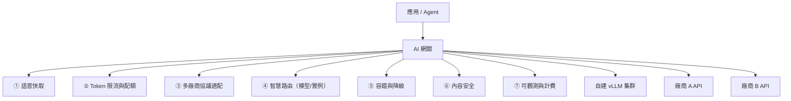
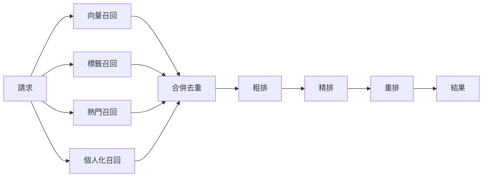

# 第十六章　最新進展二：AI 網關、AIOps 與淘寶實戰 🆕

> **本章場景**：6 個 Agent、3 家模型廠商、20 個 MCP Server、每天 $4,000 token 費用，
> 而治理能力是零。**這跟第 6.3 節「40 個服務各自實作鑑權限流」是同一種痛。**
> 當年的答案是 API Gateway，今天的答案是 AI 網關。

> ⚠️ 本章涉及 2025–2026 的產品與公開案例。產品能力請以官方文件為準；
> 淘寶相關內容基於公開技術分享的整理與教學重構，**不代表其真實內部架構**。

---

## 16.1 AI 網關：推理路由、Token 限流、多模型協議適配與 Gateway API

### 為什麼傳統 API 網關不夠

| 傳統網關的假設 | LLM 流量的現實 |
|---|---|
| 請求成本差不多 → **按 QPS 限流** | 成本差 100 倍 → **必須按 token 限流** |
| 一次回完 → 可以緩衝整個回應 | **SSE 串流** → 必須逐塊轉發，不能緩衝 |
| 逾時 30 秒夠了 | 長回答要 5 分鐘 |
| 後端同質 → **輪詢**即可 | 後端有排隊狀態與 KV Cache → **需要狀態感知路由** |
| 快取按 URL 精確比對 | 需要**語意相似度**比對 |
| 失敗就重試同一個後端 | 可以**降級到另一家廠商/另一個模型** |

### AI 網關的七項核心能力



#### ① 語意快取

```
使用者 A：「這件衣服可以退貨嗎」
使用者 B：「請問支援退款嗎？」      ← 字面不同，語意相同
使用者 C：「退貨政策是什麼」

傳統快取：三次 miss，付三次錢
語意快取：向量化後相似度 > 0.95 → 命中，只付一次
```

**但它有一個傳統快取沒有的風險**：**誤命中**。
「北京的天氣」與「上海的天氣」向量相似度可能很高，但答案完全不同。

| 防護 | 說明 |
|---|---|
| 提高相似度閾值 | 0.95+ 而非 0.85 |
| **加入必要的區分維度到 cache key** | 使用者 ID、地區、商品 ID 等關鍵實體必須精確比對 |
| 只快取「無個人化、無時效性」的問答 | 政策、規則、常識類；**絕不快取含個人資料或即時狀態的回答** |

> **回顧第 2.4 節的一致性分級表**——這裡需要的是完全相同的思考：
> **「這個回答錯了 3 秒/錯給別人看，會怎樣？」**
> 退貨政策：沒關係。訂單狀態：**絕對不能快取**。

#### ② Token 限流

```yaml
# 概念示意
rate_limits:
- match: { header: "x-api-key", value: "team-search" }
  limits:
    tokens_per_minute: 500000
    requests_per_minute: 1000
    cost_per_day_usd: 300           # ⭐ 成本熔斷
  on_exceed: { action: degrade, fallback_model: "small-model" }
```

**關鍵設計**：限流的維度應該是 **token 而非請求數**，
而且要**預估**輸入 token（可精算）+ **預留**輸出 token（按 max_tokens 上限預扣，結束後結算）。

> 這是第 5.4 節令牌桶演算法的直接應用，只是「令牌」現在真的是 token。

#### ③ 多廠商協議適配

```
應用只寫一種格式（通常是 OpenAI 相容格式）
        ↓
   AI 網關轉譯
        ↓
┌───────┬───────┬───────┬────────┐
│廠商 A │廠商 B │廠商 C │自建vLLM│
└───────┴───────┴───────┴────────┘
```

**價值**：換模型變成改一行網關設定，**應用程式碼零改動**。
這正是第 13.2 節 OpenTelemetry「避免廠商鎖定」的同一個思想。

#### ④ 智慧路由

| 路由策略 | 說明 |
|---|---|
| **按難度路由** | 簡單問題（分類、格式化）→ 小模型；複雜推理 → 大模型。**省 30–60%** |
| **按佇列深度** | 避開排隊長的實例（第 14.3 節） |
| **按 KV Cache 親和** | 同一對話路由到快取還在的實例 |
| 按成本/配額 | 廠商 A 配額用完自動轉 B |
| 按合規 | 含個資的請求只能走境內/私有部署 |

**Gateway API Inference Extension** 是 K8s 社群把這件事標準化的努力：
在 Gateway API 上擴展出「推理感知」的路由能力（`InferencePool` 等資源），
讓路由器能讀取後端的佇列與快取狀態。

> **為什麼這對架構師重要**：它意味著「LLM 路由」正在從
> 「每家自己寫的黑魔法」變成「K8s 的標準能力」。
> **跟當年 Ingress 標準化了七層路由，是完全一樣的軌跡。**

#### ⑤ 容錯與降級

```
主模型逾時/報錯
  → 重試（注意：LLM 重試很貴，要限制次數）
  → 切換備用廠商
  → 降級到小模型
  → 回傳快取的近似答案
  → 回傳「服務繁忙，請稍後」或轉人工
```

**這就是第 5.4 節的三板斧，一字不改地搬過來。**

#### ⑥ 內容安全

輸入側：prompt injection 偵測、敏感詞、PII 脫敏。
輸出側：違規內容過濾、PII 洩漏檢查、格式校驗。

#### ⑦ 可觀測與計費

按租戶/團隊/使用者/Agent 統計 token 與金額，產出 showback 報表。
**第 13.3 節 FinOps 在 AI 場景的落地點就在網關**——
因為只有網關能看到全部流量。

### 為什麼 AI 網關通常長在 Envoy 上

| 需求 | Envoy 的能力 |
|---|---|
| SSE 串流轉發 | 原生支援 HTTP/2 與串流過濾器 |
| 動態設定不 reload | xDS |
| 自訂邏輯 | **WASM 插件**（第 14.4 節）/ Lua / 外部處理（ext_proc） |
| 可觀測性 | 內建豐富指標與 trace |

**Higress** 就是這條路線的代表：Envoy 資料面 + Istio 控制面，
相容 Nginx Ingress 註解，並內建 AI 相關插件（token 限流、多模型代理、語意快取等）。

---

## 16.2 AI 中間件演進：Spring AI Alibaba / Higress / MSE / RocketMQ

### 既有中間件如何長出 AI 能力

有趣的現象：**沒有一個中間件被 AI 取代，全部是「加上 AI 能力」。**

| 中間件 | 原本的職責（本書章節） | AI 時代新增的職責 |
|---|---|---|
| **網關**（Higress/APISIX/Envoy） | 路由、限流、鑑權（6.3） | 模型路由、token 限流、語意快取、MCP 代理 |
| **註冊中心/配置中心**（Nacos/MSE） | 服務發現、配置（5.3） | **Prompt 管理與動態下發**、模型端點註冊、MCP Server 註冊 |
| **訊息佇列**（RocketMQ/Kafka） | 解耦、削峰（6.2） | Agent 任務佇列、串流事件、長任務進度 |
| **應用框架**（Spring AI / LangChain 等） | 依賴注入、Web MVC | 模型抽象、工具呼叫、RAG、記憶管理 |
| **服務網格**（Istio） | mTLS、流量治理（10.3） | Agent 間 mTLS、A2A 流量治理 |
| **可觀測性**（OTel） | trace/metric/log（13.2） | GenAI 語意約定、token 與品質指標 |

> **這是本書最有力的一個論證**：
> **AI 沒有推翻雲原生架構，它是在雲原生架構上長出的新一層。**
>
> 如果你還沒把前 13 章做好，你不會因為上了 AI 就跳過那些問題——
> 你只會在更貴、更難除錯的場景裡，重新遇到它們。

### Prompt 管理：配置中心的新用途

回顧第 5.3 節的配置中心價值：動態生效、灰度、版本、回滾、審計。
**Prompt 需要一模一樣的東西**：

```yaml
# 把 prompt 當設定管，而不是寫死在程式碼字串裡
prompt:
  shopping-assistant:
    version: v7
    template: |
      你是購物助理。只能根據 <context> 中的商品資訊回答。
      若資訊不足，請說明並建議使用者提供更多條件。不要編造商品。
    model: qwen-max
    temperature: 0.3
    max_tokens: 800
    canary:                    # ⭐ prompt 也要灰度
      version: v8
      percentage: 5
```

**收益**：改 prompt 不用發版（分鐘級迭代）、可 A/B、出事秒級回滾、有完整審計。
**這是把第 5.3 節的知識直接變現。**

### 應用框架：Spring AI / Spring AI Alibaba

對 Java 團隊而言，最務實的一步是用框架屏蔽廠商差異：

```java
// 概念示意：換模型只改設定，不改程式碼
@Service
public class ShoppingAssistant {
    private final ChatClient chat;

    public Flux<String> ask(String question, String sessionId) {
        return chat.prompt()
            .system(promptConfig.get("shopping-assistant"))   // 從配置中心取
            .user(question)
            .advisors(new MessageChatMemoryAdvisor(memory, sessionId, 10))  // 對話記憶
            .advisors(new QuestionAnswerAdvisor(vectorStore))              // RAG
            .tools(productTools)                                            // 工具呼叫
            .stream().content();                                            // 串流輸出
    }
}
```

> **架構師的判斷**：框架幫你省掉樣板程式，但**不要把治理邏輯放在框架層**。
> 限流、路由、審計、快取應該在**網關**（集中、跨語言、可獨立演進），
> 不要每個應用自己做一份——**這正是第 6.3 節 ESB vs API Gateway 的教訓。**

### AIOps：AI 反過來運維系統

前面都在講「怎麼運維 AI」，反過來也成立：

| 場景 | 做法 | 成熟度 |
|---|---|---|
| **告警降噪與聚合** | 把 200 條相關告警聚合成 1 個事件 | 高（已廣泛使用） |
| **異常偵測** | 從指標時序中自動發現異常，不用人工設閾值 | 高 |
| **根因分析輔助** | 結合拓撲、變更記錄、trace 推測根因 | 中 |
| **故障摘要與時間線** | 事故發生時自動生成「發生什麼、影響誰、做過什麼」 | 中（實用） |
| 自動修復 | 自動回滾、自動擴容、自動重啟 | 中（**需嚴格護欄**） |
| 容量預測 | 預測大促流量與資源需求 | 中 |

> **必須設的護欄**：
> **任何會產生副作用的自動修復，都要有 (a) 白名單的動作範圍、
> (b) 頻率上限、(c) 可審計的記錄、(d) 人工中止開關。**
>
> 理由跟第 11.1 節「liveness 探針檢查資料庫」的災難一樣：
> **自動化在錯誤的判斷上執行，會把小故障放大成大故障。**

---

## 16.3 淘寶 AI OS 實戰：搜尋推薦全圖架構與百萬 QPS

> 以下基於公開技術分享的整理與**教學重構**，不代表真實內部架構。
> 重點在**架構模式**，不在具體實作細節。

### 搜尋推薦系統的規模挑戰

```
商品規模      十億級
使用者規模    億級
峰值 QPS      百萬級
單次請求      要在 100 ms 內從十億商品中選出幾十個
特徵維度      單次推理讀取數百到數千個特徵
```

### 幾個關鍵的架構手法

#### ① 全圖化執行（Graph-based Execution）

把「召回 → 粗排 → 精排 → 重排」這條鏈路描述成一張 **DAG（有向無環圖）**，
由執行引擎統一調度：



| 收益 | 說明 |
|---|---|
| **自動並行** | 引擎自動識別可並行的節點（四路召回同時跑），不用工程師手寫併發 |
| **統一超時與降級** | 某路召回逾時 → 自動跳過該節點，用其餘結果繼續（**第 5.4 節的降級**） |
| **可視化與可配置** | 演算法工程師改圖的設定，不用改程式碼重新發版 |
| **統一可觀測** | 每個節點的耗時、成功率自動採集 |

> **這個「把執行流程宣告成圖，由引擎調度」的思想極其重要。**
> 它跟 K8s 的宣告式 API 是同一個哲學：
> **描述「要算什麼」，而不是寫「怎麼一步步算」。**
> 你會在 Flink、Spark、Airflow、以及現代的 Agent 編排框架看到同一個模式。

#### ② 推理服務（RTP 一類）的極致優化

線上推理服務要在毫秒級完成數百次模型計算，主要手法：

| 手法 | 說明 |
|---|---|
| **特徵與模型同機** | 避免網路來回，特徵直接在本機記憶體 |
| 記憶體池化與零拷貝 | 避免高頻 GC 與記憶體複製 |
| 批次推理 | 把 500 個商品的打分合成一次矩陣運算 |
| 模型量化與剪枝 | 犧牲極小精度換取數倍吞吐 |
| **多級快取** | 使用者特徵快取、商品特徵快取、甚至結果快取（**第二章**） |

#### ③ 訓練框架（XDL 一類）的稀疏特徵挑戰

推薦模型的特徵是**極度稀疏的高維向量**（商品 ID、使用者 ID 的 embedding table 可達 TB 級），
與 CV/NLP 的稠密模型完全不同：

| 挑戰 | 做法 |
|---|---|
| Embedding table 單機放不下 | **參數伺服器（Parameter Server）** 架構，把參數分片到多台 |
| 每個 batch 只更新極少數參數 | 稀疏更新，只拉取與推送用到的那些 |
| 樣本量極大 | 分散式資料並行 + 非同步更新 |

> **參數伺服器 = 第 4.3 節的水平分片，應用在模型參數上。**
> 分片鍵是特徵 ID，一樣有熱點問題（爆款商品的 embedding 被高頻存取），
> 一樣需要快取與打散。**知識再一次復用。**

#### ④ 向量檢索：搜尋的新一層

```
傳統搜尋：分詞 → 倒排索引 → BM25 排序（第 6.1 節）
向量搜尋：文字/圖片 → 嵌入向量 → ANN 近似最近鄰檢索
混合檢索：兩者結果融合（RRF 等演算法）→ 再用模型重排
```

**ANN（Approximate Nearest Neighbor）** 演算法（HNSW、IVF-PQ）用「近似」換速度：
在十億級向量中找 top-100，精確計算要幾小時，ANN 只要幾毫秒（召回率 95%+）。

> **這裡的取捨與第 2 章的快取一模一樣：用一點正確性換巨大的效能。**
> 架構師要問的永遠是那句話：**「錯 5% 會怎樣？」**
> 商品推薦：沒關係。金融風控比對：不行。

---

## 16.4 淘寶最新落地：Node.js Serverless 核心鏈路、智能客服、生成式導購

> 同上，以下為公開資訊的教學重構。

### ① 前端鏈路的 Serverless 化

**為什麼前端/BFF 層最先 Serverless**（回顧第 12.4 節）：

| 特徵 | 收益 |
|---|---|
| 流量與活動強相關，波動極大 | 彈性收益最大化 |
| 純 I/O 聚合，無狀態 | 可隨時殺可隨時建 |
| Node.js 冷啟動快 | Serverless 的主要缺點被削弱 |
| 迭代頻繁（跟隨前端） | 部署速度最有價值 |
| **前端團隊自己維護** | 不用等後端排期，組織效率提升 |

**落地要點**：

```
① 核心鏈路要設 minInstances > 0（絕不接受冷啟動）
② 上游必須有降級：Serverless 層掛了，能回退到靜態頁或舊版 SSR
③ 依賴的後端要限流保護：Serverless 瞬間擴容 1000 個實例，
   會對下游微服務造成「合法的 DDoS」 ← ⭐ 這是最常被忽略的風險
④ 冷啟動與併發指標要獨立監控
```

> **第 ③ 點值得特別強調。** Serverless 的彈性是**下游的壓力**。
> 你的 BFF 從 10 個實例秒擴到 1000 個，每個都去連資料庫，
> 資料庫的連線池瞬間被打爆——**這是第 1.3 節「連線池是窄門」的重演，只是更猛烈。**
>
> 對策：連線池代理（RDS Proxy 一類）、下游限流、
> Serverless 併發上限（`maxInstances` 必須設）。

### ② 智慧客服：亞秒級回應的工程

要在 800 ms 內給出首字，架構上必須：

| 手法 | 說明 |
|---|---|
| **串流輸出（SSE）** | 不等生成完，第一個 token 就開始吐。**體感延遲降低 80%** |
| **意圖分流** | 80% 的問題是「訂單在哪」「怎麼退貨」等固定意圖 → **走傳統檢索/規則，根本不呼叫大模型**（3 ms） |
| 小模型前置 | 中等難度用小模型，只有複雜問題進大模型 |
| 語意快取 | 高頻問題直接命中 |
| **預取（speculative prefetch）** | 使用者還在打字時，就開始檢索可能相關的知識 |
| Prefix caching | 系統 prompt 是固定的，KV Cache 可重用 |

> **注意第二條「意圖分流」——它是省錢與提速的最大功臣。**
> 不是所有問題都需要大模型。
> **「用最便宜的方法解決大多數情況，把昂貴的方法留給少數」**——
> 這就是第 14.1 節的漏斗思想、第二章的快取思想、第 5.4 節的分級思想。
>
> **本書講了十六章，其實一直在講同一件事。**

### ③ 生成式導購

從「關鍵字 → 商品列表」變成「自然語言需求 → 理解 → 推薦 + 解釋」。

架構上的新要求：

| 要求 | 說明 |
|---|---|
| **可解釋** | 要說出「為什麼推薦這個」，且理由必須是真的（來自商品資料，不是編的） |
| **可歸因** | 推薦的每個屬性都要能追溯到商品庫的欄位（防幻覺） |
| **與既有推薦系統融合** | 生成式負責理解與解釋，**召回排序仍走成熟的推薦鏈路** |
| **業務規則兜底** | 下架商品、違規商品、庫存為零的絕不能被推薦——**這必須是硬過濾，不能靠模型自覺** |

> 最後一條再次印證第 15.2 節的原則：
> **模型是不可信的客戶端。** 業務約束必須在服務端用確定性的程式碼強制執行。

### ④ 落地的通用清單

任何團隊要把生成式功能上生產，這張表可以直接用：

```
□ 效果
  □ 建立黃金測試集（至少 200 例），評估進 CI
  □ 定義「好」的量化標準（相關性/事實性/安全/格式）
  □ 線上抽樣評分 + 使用者回饋收集
□ 效能
  □ 串流輸出，監控 TTFT 而非總耗時
  □ 意圖分流：能不用大模型就不用
  □ 語意快取 + prefix 快取
□ 成本
  □ Token 配額與成本熔斷（按團隊/使用者）
  □ 模型分級路由
  □ 每日成本報表與異常告警
□ 可靠性
  □ 多廠商容錯 + 降級到非 AI 路徑（⭐ 最重要）
  □ 逾時、重試上限、迴圈上限
  □ 下游微服務限流保護
□ 安全與合規
  □ Prompt injection 防禦、輸出過濾
  □ 工具最小權限 + 服務端二次授權
  □ PII 脫敏、資料流向可審計
□ 工程化
  □ Prompt 進版控、可灰度、可回滾
  □ 完整 trace（含 token 與工具呼叫）
```

> **其中「降級到非 AI 路徑」是最重要的一條。**
> 你的 AI 功能一定會掛（廠商故障、配額用盡、模型更新後行為改變）。
> **有非 AI 的兜底路徑，AI 功能才敢上核心鏈路。**
> 這就是第 5.4 節降級思想在 AI 時代的最終形態。

---

## 本章代價與下一章

**我們做了什麼**：把 AI 流量的治理集中到 AI 網關、
看到既有中間件如何長出 AI 能力、以及大規模系統的實戰手法。

**核心結論**：

| 結論 |
|---|
| AI 網關 = API 網關的 AI 版本，解決的是同一種「各自為政」的痛 |
| 沒有中間件被 AI 取代，全部是在既有基礎上加一層 AI 能力 |
| Prompt 應該當設定管，進配置中心、進版控、可灰度可回滾 |
| 「用便宜的方法處理多數、昂貴的方法處理少數」是貫穿全書的元思想 |
| AI 功能必須有非 AI 的降級路徑，才敢放上核心鏈路 |

下一章是全書的收束：[第十七章　總結與前瞻](17-總結與前瞻.md)。

---

## 名詞速查

| 名詞 | 一句話 |
|---|---|
| AI 網關 | 為 LLM 流量設計的網關：token 限流、模型路由、語意快取、多廠商適配 |
| 語意快取 | 用向量相似度而非字面比對的快取；須防誤命中 |
| Gateway API Inference Extension | K8s 社群把「推理感知路由」標準化的擴展 |
| 全圖化執行 | 把處理鏈路宣告成 DAG 由引擎調度，自動並行與降級 |
| 參數伺服器 | 把超大 embedding table 分片到多台的訓練架構 |
| ANN / HNSW | 近似最近鄰檢索；用近似換取毫秒級向量搜尋 |
| 混合檢索 | 倒排索引 + 向量檢索結果融合後重排 |
| 意圖分流 | 高頻固定意圖走傳統路徑，不呼叫大模型 |
| AIOps | 用 AI 做告警降噪、異常偵測、根因分析；需嚴格護欄 |
