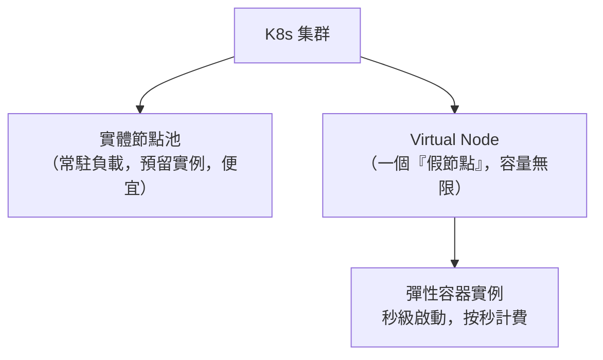
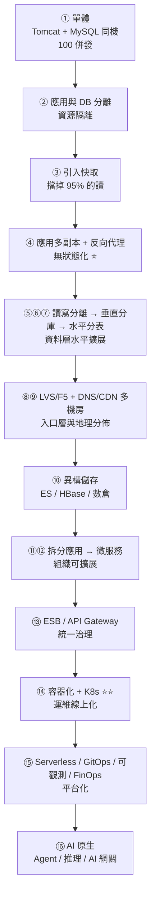

# 第十七章　總結與前瞻：ACK 新能力與未來

> 全書的收束。本章做三件事：
> **① 看一眼託管 K8s 的最新能力（未來運維會長什麼樣）**
> **② 把 17 章的演進路徑複盤成一條主線**
> **③ 給出一份可以帶走的技術選型與設計原則**

---

## 17.1 託管 K8s 2025–2026 新能力：Auto Mode / Virtual Node / 多集群 / AI Assistant

> 以下為各雲廠商託管 K8s（阿里雲 ACK、AWS EKS、Google GKE 等）在近年的共同方向。
> 具體名稱與能力請以官方文件為準。

### 方向一：Auto Mode——節點消失了

| 傳統託管 K8s | Auto Mode |
|---|---|
| 你管節點池：機型、數量、擴縮策略、升級 | **你只提交 Pod，平台自己決定用什麼機器** |
| 要自己裝 CNI、CSI、監控 agent、Autoscaler | 平台預裝並負責升級 |
| 要做節點升級與修補 | 平台自動輪換（節點壽命上限，定期換新） |
| 資源規劃是你的事 | **按 Pod 實際用量計費** |

> **這是 K8s 的「Serverless 化」**：K8s 原本抽象掉了「哪台機器」，
> Auto Mode 進一步抽象掉了「有沒有機器」。
>
> **對架構師的含義**：容量規劃的工作大幅減少，
> 但**成本治理的責任反而更重**——因為開資源變得更容易了，
> 而你再也看不到「機器」這個直覺的成本單位。第 13.3 節的 FinOps 變得更重要，不是更不重要。

### 方向二：Virtual Node / 彈性容器實例

把 Pod 直接跑在雲端的無伺服器容器服務上，**沒有節點概念**：



**最佳用途：應對突發尖峰。**

```
平時：20 個 Pod 跑在實體節點上（預留實例，成本低）
大促零點：HPA 擴到 300 個
        → 前 20 個用實體節點
        → 多出來的 280 個由 Virtual Node 秒級承接
        （不用等 Cluster Autoscaler 開機的 3–5 分鐘）
大促結束：280 個秒級釋放，只付實際使用的分鐘數
```

> **這解決了第 11.2 節那個「HPA 趕不上秒級尖峰」的問題**：
> 瓶頸原本在「開機要 3–5 分鐘」，Virtual Node 把它壓到秒級。

### 方向三：多集群艦隊管理

回顧第 11.4 節：一個集群就是一個爆炸半徑。
各雲廠商都在提供「艦隊（Fleet）」層的管理：統一的應用分發、
跨集群的流量調度與故障轉移、統一的策略與合規基線。

### 方向四：AI Assistant / 自然語言運維

```
「幫我看看 shop 命名空間裡為什麼有 Pod 一直重啟」
→ 自動查 events、logs、探針設定、資源用量，給出診斷與建議的修復 YAML
```

**價值**：把 K8s 的**除錯門檻**降低。
這是 K8s 最大的痛（8 層抽象、每層都有自己的失敗模式），也是新人上手最慢的部分。

> **但請保持清醒**（呼應第 16.2 節的 AIOps 護欄）：
> 它是**建議**，不是**授權**。
> 讓 AI 直接改生產集群，必須有嚴格的白名單、審批與審計。
> **「看起來合理的 YAML」跟「正確的 YAML」之間，隔著你的線上業務。**

---

## 17.2 全景複盤：單體 → 分散式 → 微服務 → 雲原生 → AI 原生

### 一張圖看完全書



### 每個階段真正解決的問題

| 階段 | 表面上在解決 | **實際上在解決** |
|---|---|---|
| 分離、快取、負載均衡 | 效能 | **單機資源的物理上限** |
| 分庫分表 | 資料庫壓力 | **單一資料庫的容量與 IOPS 上限** |
| 微服務化 | 系統耦合 | **人的協作上限（組織擴展）** |
| 容器化 | 環境不一致 | **交付單元的標準化** |
| K8s 編排 | 部署麻煩 | **「用人管理系統」這個模式的破產** |
| Serverless / 平台化 | 運維負擔 | **心智負擔與資源利用率** |
| AI 原生 | 使用者體驗 | **人機互動介面的重新定義** |

> **看清楚第三行與第五行——這兩行是全書最深的洞察：**
>
> **微服務解決的是「人」的問題，K8s 解決的是「人管不動了」的問題。**
>
> 前者是因為團隊變大到無法共用一個程式庫；
> 後者是因為部署單元多到無法用人腦與腳本管理。
> **這兩件事都與「技術先進性」無關，都是規模帶來的必然。**

### 貫穿全書的七個元思想

這七條比任何具體技術都更值得記住，因為它們在每一章都出現過：

| # | 元思想 | 出現過的地方 |
|---|---|---|
| 1 | **分層與漏斗**：用便宜的方法處理多數，昂貴的方法處理少數 | 多級快取(2)、CDN(3.4)、召回精排(14.1)、意圖分流(16.4) |
| 2 | **拆分與隔離**：把互相干擾的東西分開，縮小爆炸半徑 | 應用DB分離(1.2)、垂直分庫(4.2)、拆單體(5.1)、cgroup(7.1)、艙壁(5.4)、多集群(11.4) |
| 3 | **無狀態化**：把狀態外部化，換取任意水平擴展 | Session(3.2)、容器(7.2)、Pod(9.3)、Agent狀態(15.3) |
| 4 | **非同步與削峰**：用佇列把尖峰攤平，用最終一致換可用性 | MQ(6.2)、事務訊息(4.4)、CDC(6.1)、Agent任務化(15.3) |
| 5 | **宣告式與控制迴圈**：描述要什麼，讓系統持續維持 | K8s(8.3,9.2)、GitOps(13.1)、全圖化執行(16.3) |
| 6 | **冗餘與降級**：假設一切都會失敗，先想好壞掉時顯示什麼 | 主從(4.1)、熔斷降級(5.4)、探針(11.1)、多廠商容錯(16.1) |
| 7 | **不可變**：不修改，只替換；出事就換回舊的 | CDN版本化URL(3.4)、鏡像tag(7.2)、GitOps(13.1)、prompt版控(16.2) |

> **如果這本書你只能記住一頁，請記住上面這張表。**
> 具體技術五年會換一輪，這七條不會。
> 遇到任何新技術，問它：「它在實現哪一條？它的代價是什麼？」

---

## 17.3 技術選型白皮書：避免為了雲原生 / AI 而雲原生 / AI

### 反模式清單（全部都是真實發生過的）

| 反模式 | 為什麼錯 | 該怎麼做 |
|---|---|---|
| 5 人團隊拆 30 個微服務 | 服務數 >> 團隊數，維護成本壓垮團隊（12.1） | 模組化單體，保留拆分的可能 |
| 日活 1,000 卻上 K8s + Istio | 平台成本 > 業務價值 | 雲主機 + Docker Compose 或託管 PaaS |
| 為了「用上 K8s」把 MySQL 搬進集群 | 沒有消除任何運維工作，只加一層抽象（8.2） | 用託管 RDS |
| 上了微服務但共用一個資料庫 | 分散式單體，最糟的組合 | 先拆資料，或別拆 |
| 沒有可觀測性就上微服務 | 出事無法定位，除錯成本指數上升 | 先建 trace 與集中日誌 |
| 沒有評估集就上生成式功能 | 改 prompt 憑感覺，不知好壞（15.2） | 先建黃金測試集 |
| 把 AI 放上核心鏈路卻沒有降級路徑 | 廠商一掛，你的核心業務跟著掛（16.4） | 一律要有非 AI 兜底 |
| 用 `latest` 標籤 | 無法回滾、無法追溯（7.2） | 語意化版本或 git sha |
| 追新技術到生產環境 | 生產環境不是實驗室 | 新技術先在非核心場景驗證 |

### 決策框架：五個問題

面對任何一個「要不要上 X」的決定，依序問：

```
① 我現在的痛是什麼？能不能用一句話說清楚，並用數字量化？
   （說不出來 → 不要動。你在解決一個不存在的問題）

② 這個痛有沒有更便宜的解法？
   （加台機器？加個索引？改個參數？改個產品設計？
     —— 這些通常比架構改造便宜 10 倍）

③ 引入 X 之後，我會得到哪些新問題？我扛得住嗎？
   （每一章的「本章代價」都在示範這個問題）

④ 我的團隊有人能在半夜三點除錯 X 嗎？
   （沒有 → 選更簡單的方案，或先培養人）

⑤ 一年後如果要撤回這個決定，成本多大？
   （可逆的決定可以快速試；不可逆的要慎重 —— 例如分片鍵）
```

> **架構師最重要的能力，不是知道最多技術，而是知道「現在還不需要什麼」。**
>
> 在對的時間做對的事叫演進；
> 在錯的時間做對的事叫**過度設計**，代價跟做錯事一樣大。

### 演進的時機表（經驗值，僅供參考）

| 階段 | 團隊 | 建議架構 |
|---|---|---|
| 0–10 人，尋找 PMF | 1 個團隊 | **單體 + 託管資料庫 + 雲主機**。別碰 K8s |
| 10–30 人，業務明朗 | 2–3 個團隊 | **模組化單體 + 快取 + CDN + 讀寫分離**；容器化用於 CI 與部署 |
| 30–80 人，多條業務線 | 4–8 個團隊 | **垂直拆分成數個服務 + 託管 K8s + 可觀測性** |
| 80–300 人 | 8–30 個團隊 | 微服務 + 服務治理 + GitOps + FinOps；考慮服務網格 |
| 300+ 人，多地域 | 大量團隊 | 平台工程、多集群、單元化多活 |

**任何階段都適用的三件事**（而且投入產出比最高）：
1. **CDN + 快取**（第 2、3 章）
2. **監控告警與集中日誌**（第 13.2 節）
3. **自動化測試與可回滾的部署**（第 9.4、13.1 節）

---

## 17.4 架構設計原則：N+1、回滾、禁用、監控、多活、水平擴展、FinOps 與 AI 安全

這是一份可以貼在牆上的檢查清單。每一條都對應本書的具體章節。

### 可用性原則

| 原則 | 含義 | 檢查方式 | 章節 |
|---|---|---|---|
| **N+1** | 任何元件至少有一個冗餘；**能死一個而不影響服務** | 隨機關掉一台，服務有影響嗎？ | 3.3, 11.4 |
| **回滾** | 任何變更都能在 5 分鐘內回到上一個狀態 | 上次回滾演練是什麼時候？ | 7.2, 9.4, 13.1 |
| **禁用（Kill Switch）** | 任何非核心功能都能被一個開關關掉 | 大促前你能關掉推薦嗎？幾秒？ | 5.3, 5.4 |
| **監控** | 使用者感受到異常之前，你就知道了 | 上次事故是誰先發現的——監控還是客服？ | 13.2 |
| **多活** | 損失一個可用區/機房不影響服務 | 拔掉一個可用區，會怎樣？ | 3.4, 11.4 |
| **水平擴展** | 加機器就能加吞吐，不需要改架構 | 流量突然 10 倍，你要做什麼？ | 3.2, 11.2 |
| **降級** | 每個依賴都想好「它掛了顯示什麼」 | 列得出所有依賴的降級方案嗎？ | 5.4 |
| **冪等** | 每個寫操作重複執行結果相同 | 重複扣款會發生嗎？ | 5.2, 6.2 |

### 成本原則

| 原則 | 說明 | 章節 |
|---|---|---|
| **可歸屬** | 每一分錢都能追溯到團隊/服務/環境 | 13.3 |
| **可見** | 工程師在做決定時就看得到成本影響 | 13.3 |
| **彈性優先** | 波動負載用彈性資源，穩定負載用預留 | 11.2, 12.3, 17.1 |
| **關掉沒用的** | 非生產環境定時關機、清理孤兒資源 | 13.3 |

### AI 安全原則

| 原則 | 說明 | 章節 |
|---|---|---|
| **模型是不可信客戶端** | 授權與業務校驗必須在服務端做 | 15.2 |
| **資料非指令** | 外部內容（網頁、文件、使用者輸入）一律視為資料 | 15.2 |
| **工具最小權限** | 只給 Agent 完成任務所需的最小工具集 | 15.2 |
| **高危需確認** | 退款、改價、刪除必須人工確認或強校驗 | 15.4 |
| **成本有上限** | 迴圈上限、token 預算、成本熔斷 | 16.1 |
| **必有非 AI 降級** | AI 掛了，核心業務要能繼續 | 16.4 |
| **可審計** | 誰的什麼資料被送到哪家廠商，說得清楚 | 15.2, 16.1 |

### 最後三句話

> **① 沒有最好的架構，只有最適合當前約束的架構。**
> 約束會變（團隊規模、流量、成本、合規、時代），架構就該跟著變。
> **能演進的架構，勝過一開始就「完美」的架構。**

> **② 每一次演進都是用一組問題換另一組問題。**
> 誠實地列出你買進了什麼問題，比誇耀你解決了什麼問題重要得多。
> 本書每章都有「本章代價」，就是為了訓練這個習慣。

> **③ 技術服務於業務與人，不是相反。**
> 如果一個架構決定讓團隊更痛苦、讓交付更慢、讓成本更高，
> 那它就是錯的——**無論它在技術上多麼「正確」。**

---

## 後記：AI 會寫程式之後

這本書的起點是一個觀察：**當 AI 能寫程式之後，一行一行寫程式的價值正在稀釋。**

那什麼沒有被稀釋？

**判斷力。**

- AI 可以寫出一份完美的 K8s YAML，但**不會告訴你現在根本不該用 K8s**。
- AI 可以幫你拆出 30 個微服務，但**不會提醒你團隊只有 5 個人**。
- AI 可以生成一套快取程式碼，但**不會問你「這個欄位錯 3 秒會怎樣」**。
- AI 可以實作任何一種方案，但**「要不要做」「現在做還是以後做」「代價誰承擔」——
  這些問題的答案，藏在你對業務、對團隊、對約束的理解裡。**

而這種判斷力來自哪裡？

**來自看過足夠多「為什麼系統會長成這樣」的故事。**

這就是為什麼這本書不從 Docker 開始講，而從一台 4 核 8G 的機器開始講；
為什麼每章都要先描述痛點，再給解法；
為什麼每章結尾都要誠實地寫「本章代價」。

**因為架構師的工作不是選出最先進的技術，而是在一堆各有代價的選項裡，
為此時此地的這個團隊、這個業務，選出最能扛得住的那一個。**

如果讀完這 17 章，你在面對任何新技術時會自動地問出這三個問題——

> **「它在解決什麼痛？」**
> **「我現在有這個痛嗎？」**
> **「我要為它付出什麼代價？」**

——那這本書的目的就達成了。

---

**← 回到 [目錄](README.md)　|　附錄：[A 實驗環境速查](A-實驗環境與工具速查.md)　[B 對照表與案例集](B-對照表與案例集.md)**
