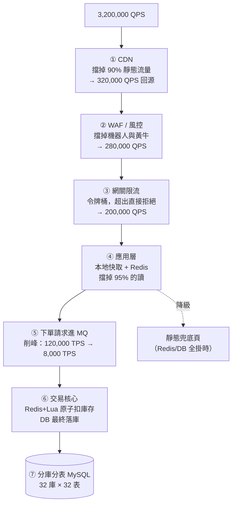

# 附錄 B　對照表與案例集

---

## B.1 淘寶 14 次演進 vs 本書章節對照表

> 「14 次演進」是流傳甚廣的大型網站架構演進教學模型。
> 本書以它為骨架，並在後面補上雲原生與 AI 原生的延伸。
> **教學模型，非真實路徑。**

| # | 演進動作 | 觸發它的痛點 | 買進的新問題 | 本書章節 |
|---|---|---|---|---|
| 1 | 單機部署：Tomcat + MySQL 同一台 | （起點） | 資源互搶 | 1.1 |
| 2 | Tomcat 與 MySQL **分機部署** | CPU/記憶體/I/O 互搶，OOM Killer 亂殺 | 多一跳網路、連線池成為關鍵 | 1.2 |
| 3 | 引入**本地快取與分散式快取** | 讀請求把 DB 打爆（95% 是重複讀） | 一致性、快取掛掉會擊垮 DB | 2.1–2.4 |
| 4 | 應用**多副本 + 反向代理**（Nginx） | 單台應用 CPU 打滿、發版即停機 | **必須無狀態化**、設定要維護 | 3.1–3.2 |
| 5 | 資料庫**讀寫分離** | 快取擋不住的個人化讀壓垮主庫 | **主從延遲**、寫後讀不到 | 4.1 |
| 6 | 按業務**垂直分庫** | 熱門業務吃光 DB 資源、爛 SQL 拖垮全部 | 跨庫 join 與事務消失 | 4.2 |
| 7 | 大表**水平分片** | 單表破億，索引層數加深、DDL 要 6 小時 | 分片鍵難撤回、分散式分頁 | 4.3 |
| 8 | **LVS / F5** 扛 Nginx 集群 | Nginx 自己成為瓶頸與單點 | 多一層要維運 | 3.3 |
| 9 | **DNS 輪詢 + CDN + 多機房** | 單機房頻寬上限、地理延遲、機房級故障 | DNS TTL 慢、資料跨機房同步 | 3.4 |
| 10 | 引入 **NoSQL 與搜尋引擎** | 全文檢索、海量日誌 RDB 做不動 | 多套儲存要同步（CDC） | 6.1 |
| 11 | **大應用拆小應用**（垂直拆分） | 一次發版全站停機、故障擴散 | 部署單元變多 | 5.1 |
| 12 | 公共模組**抽為微服務** | 同一段邏輯在八個系統各改一次 | **雪崩風險**、分散式事務 | 5.2–5.4 |
| 13 | **ESB / API Gateway** | 服務間協議與鑑權各自為政 | 網關可能變成新瓶頸/新 ESB | 6.3 |
| 14 | **容器化 + 容器編排** | **環境不一致 + 擴容靠人肉 + 發布無原子性** | 學習曲線、YAML 爆炸、集群要維運 | 6.4, 7–11 |
| 15 | GitOps / 可觀測性 / FinOps | YAML 沒真相、查不到根因、成本失控 | 平台工程的投入 | 13 |
| 16 | Serverless / 模組化單體反思 | 過度拆分的技術債、資源利用率低 | 冷啟動、廠商綁定 | 12 |
| 17 | AI 原生：GPU 調度 / Agent / AI 網關 | 新的工作負載模型完全不同 | 非確定性、成本、新攻擊面 | 14–16 |

### 演進的三個階段（更高層的歸納）

| 階段 | 步驟 | 本質 |
|---|---|---|
| **① 突破單機物理上限** | 1–10 | 用**分散**換取容量（快取、分片、多副本、多機房） |
| **② 突破組織協作上限** | 11–13 | 用**拆分**換取團隊自治（微服務、治理） |
| **③ 突破人工運維上限** | 14–17 | 用**自動化與自治系統**換取規模（容器、編排、平台、AI） |

---

## B.2 雙十一大促案例：削峰、降級與彈性擴縮

> 教學案例，數字為示意。目的是把全書技術串成一條可執行的作戰計畫。

### 情境設定

```
平日：  峰值 QPS 80,000，下單 TPS 2,000
大促：  預估峰值 QPS 3,200,000（40 倍），零點瞬時下單 TPS 120,000（60 倍）
時間：  11/11 00:00:00 開閘，前 3 分鐘承載約 60% 的全天下單量
```

### 作戰時間線

| 時間 | 動作 | 對應章節 |
|---|---|---|
| **T-45 天** | **全鏈路壓測**：在生產環境用影子表/影子庫打真實流量，找出真實瓶頸 | 13.2 |
| T-40 天 | 服務分級（P0/P1/P2/P3），確定每個服務的擴容倍數與降級方案 | 5.4 |
| T-30 天 | 補齊探針、PDB、resources、topologySpread；修掉所有「無 timeout 的 RPC」 | 9.3, 11.1 |
| T-21 天 | 熱點資料預熱腳本、語意/靜態頁面兜底內容準備 | 2.3 |
| T-14 天 | 演練：**混沌工程**——隨機殺 Pod、注入延遲、斷開一個可用區 | 11.4 |
| T-7 天 | 降級開關全部演練一遍（**沒演練過的開關等於沒有**） | 5.3 |
| T-3 天 | 凍結發布（錯誤預算全部保留給大促） | 13.2 |
| **T-4 小時** | Cluster Autoscaler 預開節點（開機要 3–5 分鐘，不能等） | 11.2 |
| **T-2 小時** | **預擴容**：`minReplicas` 拉到預估峰值的 80% | 11.2 |
| T-60 分 | 快取預熱（把熱門商品灌滿 Redis 與本地快取），驗證命中率 | 2.2 |
| **T-30 分** | **關閉 P2/P3**：評價詳情、瀏覽記錄、個人化推薦降級為靜態熱榜、暫停所有離線批次任務 | 5.4 |
| T-10 分 | 最後檢查：監控大盤、值班人員就位、回滾預案確認 | 13.2 |
| **T-0** | 開閘。HPA 處理預估外波動；Virtual Node 秒級承接溢出 | 11.2, 17.1 |
| T+3 分 | 觀察：下單成功率、P99、MQ 積壓、DB 連線數、快取命中率 | 13.2 |
| T+2 小時 | 逐步恢復 P2/P3（**一個一個開，觀察 5 分鐘再開下一個**） | 5.4 |
| **T+1 天** | **縮容**（這是錢）；並產出成本報表 | 13.3 |
| T+3 天 | 覆盤：哪些預估錯了？哪些降級沒用上？哪些監控沒發現問題？ | — |

### 零點那一刻的技術棧



### 每一層的關鍵決策

| 層 | 技術 | 關鍵決策 | 章節 |
|---|---|---|---|
| CDN | 靜態資源 + 活動頁 HTML | **版本化 URL**，不做原地刷新 | 3.4 |
| 風控 | 行為特徵 + 設備指紋 | 寧可誤殺一點，也不能讓黃牛吃掉庫存 | — |
| 網關 | 令牌桶限流 | **限流值按下游承載力反推**，不是按「希望扛多少」 | 5.4 |
| 應用 | 兩級快取 | 熱點商品**必須**進本地快取（扛住單 key 百萬 QPS） | 2.2–2.3 |
| 秒殺 | Redis + Lua 原子扣減 | **庫存預扣在 Redis，DB 最終對帳**；絕不用快取直接當真相 | 2.4 |
| 削峰 | MQ | 使用者體驗改為「排隊中」，3 秒後告知結果 | 6.2 |
| 交易 | 冪等 + 本地訊息表 | **每個請求帶唯一 requestId，重複直接返回原結果** | 4.4, 6.2 |
| 資料 | 分庫分表 | 按 uid 分片，賣家維度走異構索引 | 4.3 |
| 兜底 | 靜態頁 + 熔斷 | **Redis 與 DB 全掛時，仍回得出一個不出錯的頁面** | 5.4 |

### 事後覆盤該問的五個問題

1. **預估準不準？** 實際峰值 vs 預估，差距在哪、為什麼。
2. **哪些降級用上了？** 沒用上的是否過度準備？用上的是否夠用？
3. **有沒有「監控沒發現、使用者先發現」的問題？** 這是監控的缺口。
4. **多花了多少錢？** 哪些資源開了沒用到（下次不用開）。
5. **哪些是人肉操作？** 每一個人肉步驟都是下次的自動化候選。

---

## B.3 2025–2026 新名詞表

> 依「它解決什麼老問題」分類，這樣更好記。⚠️ 產品能力以官方文件為準。

### 一、AI 應用架構

| 名詞 | 一句話 | 它是哪個老問題的新版本 |
|---|---|---|
| **AI 原生（AI-Native）** | 核心決策由模型做出、行為非確定性的應用架構 | — |
| **Agent** | 能自主規劃、呼叫工具、多步完成任務的 AI 程式 | 工作流引擎 + 不確定性 |
| **Agent Infra / AgentRun** | 支撐 Agent 運行的基礎設施總稱 | 微服務中間件（註冊/配置/網關/MQ） |
| **AI 運行時（Agent Runtime）** | 長時運行、可中斷續跑、沙箱執行的執行環境 | 應用伺服器 + 任務調度 |
| **FunctionAI / AgentCore** | 雲廠商的 Agent 託管服務（阿里/AWS 等） | PaaS / FaaS |
| **MCP**（Model Context Protocol） | 標準化「Agent ↔ 工具/資料源」的開放協議 | API 標準化（6.3 的 Gateway） |
| **A2A**（Agent2Agent） | 標準化「Agent ↔ Agent」委派協作的協議 | 服務發現 + RPC（5.2–5.3） |
| **kagent** | 把 Agent 定義成 K8s CRD 的專案 | 宣告式部署（9.3） |
| **RAG** | 檢索相關知識注入上下文 | 異構索引 + 快取（4.3, 6.1） |
| **Memory 分層** | 短期對話 / 長期偏好 / 知識 / 工作記憶 | Session + 使用者畫像 + 快取 |
| **Eval / LLM-as-a-Judge** | AI 應用的測試體系 / 用模型當裁判 | 單元測試 + A/B 測試 |
| **Prompt Injection** | 用自然語言劫持模型指令 | SQL Injection 的語意版 |

### 二、AI 基礎設施

| 名詞 | 一句話 | 章節 |
|---|---|---|
| **AI 網關** | token 限流、模型路由、語意快取、多廠商適配 | 16.1 |
| **Gateway API Inference Extension** | K8s 把「推理感知路由」標準化的擴展 | 16.1 |
| **AI Serving Stack** | 路由 + 編排 + 推理引擎 + 資源分配的標準化組合 | 14.5 |
| **vLLM / SGLang / TensorRT-LLM** | 高吞吐 LLM 推理引擎 | 14.3 |
| **PagedAttention** | 像虛擬記憶體分頁一樣管理 KV Cache | 14.3 |
| **Continuous Batching** | 請求算完即走、空位即補的動態批次 | 14.3 |
| **P/D 分離** | Prefill 與 Decode 用不同集群、不同硬體 | 14.5 |
| **MIG / vGPU / 時間切片** | GPU 共享的三種方案（硬體隔離/軟體配額/無隔離） | 14.2 |
| **DRA**（動態資源分配） | 比 Device Plugin 更靈活的 K8s 資源模型 | 14.5 |
| **Gang Scheduling** | 全有或全無的成組調度（Volcano/Kueue） | 14.2 |
| **RDMA / RoCE** | 繞過核心直讀遠端記憶體的高速網路 | 14.2 |
| **機密推理 / TEE** | 在加密執行環境中推理，雲廠商也看不到明文 | 14.5 |
| **Serverless GPU** | 按秒計費、可縮到零的 GPU 推理 | 14.5 |

### 三、雲原生平台

| 名詞 | 一句話 | 章節 |
|---|---|---|
| **Auto Mode** | 託管 K8s 進一步抽象掉「節點」 | 17.1 |
| **Virtual Node / 彈性容器實例** | 沒有節點概念的 Pod 承載層，秒級擴容 | 17.1 |
| **Karpenter** | 按 Pending Pod 需求直接挑最合適機型的節點供應器 | 11.2 |
| **Istio Ambient Mode** | 無 Sidecar 的服務網格，大幅降低開銷 | 10.3 |
| **Higress** | Envoy + Istio 的雲原生網關，含 AI 插件 | 10.2, 16.1 |
| **Karmada** | CNCF 多集群調度與資源分發 | 11.4 |
| **KEDA** | 事件驅動擴縮容，支援縮到零 | 11.2 |
| **Koordinator / Volcano / Kueue** | 在離線混部 / 批次調度 / 佇列管理 | 13.3, 14.2 |
| **OpenCost / Kubecost** | K8s 成本可見性 | 13.3 |
| **eBPF / Cilium** | 核心內可程式化，用於網路/可觀測/安全 | 8.1 |
| **OpenTelemetry GenAI 約定** | AI 遙測的標準欄位（token、模型、成本） | 15.2 |
| **平台工程 / IDP** | 把基礎設施包裝成開發者自助平台 | 13, 17.3 |

---

## B.4 架構演進教學指引：如何用本書上課

### 課程設計（16 週，每週 3 小時）

| 週 | 主題 | 章節 | 實作 |
|---|---|---|---|
| 1 | 課程導論：為什麼要學架構演進 | README, 1.1 | 起一個單體 + MySQL |
| 2 | 單體的極限與瓶頸判斷 | 1.2–1.4 | 壓測，用 `top`/`jstack` 找瓶頸 |
| 3 | 快取與一致性 | 2.1–2.4 | 加 Redis，故意製造穿透/雪崩 |
| 4 | 無狀態化與負載均衡 | 3.1–3.4 | Nginx + 多副本 + Spring Session |
| 5 | 讀寫分離與分庫分表 | 4.1–4.4 | ShardingSphere 實作分片 |
| 6 | 服務拆分與 DDD | 5.1 | **事件風暴工作坊**（分組） |
| 7 | RPC、註冊中心、三板斧 | 5.2–5.4 | Nacos + 故意讓下游變慢，觀察雪崩 |
| 8 | 異構儲存與訊息佇列 | 6.1–6.3 | ES 搜尋 + Kafka 解耦 |
| **9** | **運維地獄體驗課**（關鍵） | **6.4** | **手動部署 5 個服務到 3 台 VM，計時** |
| 10 | Docker 與 Compose | 7.1–7.4 | 把週 9 的服務容器化，再計時一次對比 |
| 11 | Docker 網路儲存、編排的必要性 | 8.1–8.3 | 模擬節點故障，體驗手動恢復 |
| 12 | K8s 核心架構 | 9.1–9.4 | kind 建集群，部署 + 滾動更新 + 回滾 |
| 13 | Service / Ingress / 儲存 | 10.1–10.4 | 完整部署整套系統 |
| 14 | 探針、HPA、資源治理 | 11.1–11.4 | 壓測觸發 HPA；故意寫錯 liveness 觀察災難 |
| 15 | 反思、GitOps、可觀測、FinOps | 12, 13 | ArgoCD + Prometheus/Grafana |
| 16 | AI 原生架構與總結 | 14–17 | 部署一個小模型 + AI 網關；期末報告 |

### 教學重點：第 9 週是整門課的關鍵

> **強烈建議保留「運維地獄體驗課」。**
>
> 讓學生**手動**把 5 個服務部署到 3 台 VM（可用雲端或本機虛擬機），
> 要求：不同服務用不同 JDK 版本、其中一台機器的環境故意設得不一樣。
> **計時，並記錄每一個出錯的地方。**
>
> 然後第 10 週用 Docker 重做一次，再計時。
>
> **這 3 小時的痛苦，比 10 小時的 Docker 講解有效得多。**
> 沒有痛過的學生，會覺得 Docker 只是「另一種部署方式」；
> 痛過的學生，會終身記得它在解決什麼。

### 評量設計

| 項目 | 佔比 | 說明 |
|---|---|---|
| 每週實作 | 30% | 重點在「有沒有跑起來 + 有沒有記錄踩坑」 |
| **架構決策報告**（3 次） | 30% | 給一個情境，寫出方案 + **代價分析** + 為什麼不選其他方案 |
| 事故覆盤報告 | 15% | 故意破壞環境，學生寫覆盤（現象→排查→根因→改進） |
| 期末專案 | 25% | 完整部署一套系統，並回答「下一步該演進什麼、為什麼」 |

> **評量的核心原則：不考「K8s 有哪些物件」，考「什麼時候該用、代價是什麼」。**
> 前者 AI 三秒鐘就能回答，後者才是架構師的價值。

### 建議的討論題（適合分組辯論）

1. 一個 8 人團隊的新創，該不該上 K8s？（正反方各準備）
2. 訂單表該按 `uid` 還是 `seller_id` 分片？兩邊都要能查怎麼辦？
3. liveness 探針該不該檢查資料庫連線？（11.1 的災難案例）
4. 微服務拆得越細越好嗎？什麼時候該合併？（12.1–12.2）
5. AI 功能能不能放上核心下單鏈路？要有什麼前提？（16.4）
6. 快取與資料庫不一致時，誰是真相？不同業務答案一樣嗎？（2.4）

### 給老師的三個提醒

| 提醒 | 說明 |
|---|---|
| **不要跳過「本章代價」** | 只教解法不教代價，會養出「什麼都想上」的工程師 |
| **強調數字** | 「多少 QPS」「延遲幾毫秒」「省多少錢」比形容詞重要 |
| **鼓勵說「不需要」** | 學生能論證「這個情境不該用微服務」，比會畫微服務圖更值得高分 |

---

**← 回到 [目錄](README.md)　|　[附錄 A](A-實驗環境與工具速查.md)**
